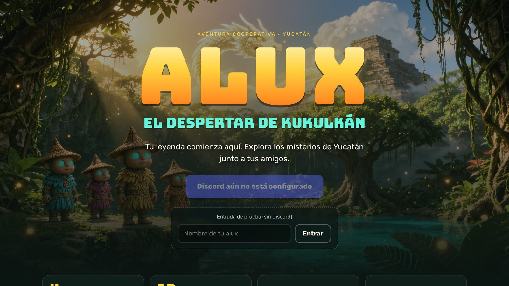
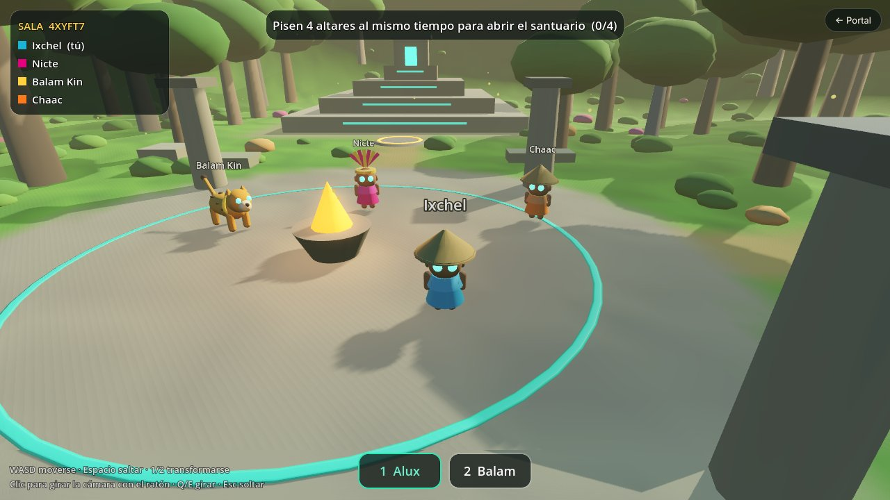

# ALUX: El Despertar de Kukulkán

Aventura cooperativa 3D para **4 jugadores**, en el navegador, inspirada en las leyendas mayas de Yucatán.
Entras con tu cuenta de **Discord**, creas tu alux, formas un grupo y juegan juntos: transformaciones,
acertijos que sólo se resuelven en equipo y, más adelante, el camino hasta Kukulkán.




## Qué funciona hoy (Fases 1 y 2, con un adelanto de la 3)

- **Portal** (Next.js): portada, inicio de sesión con Discord (OAuth2 con `state` y cookies seguras),
  creación del alux (nombre, color, accesorio), salas privadas por código, partida pública e invitaciones.
- **Juego 3D** (Godot 4, exportado a WebAssembly/WebGL 2): el Claro de los Aluxes, con plaza, pirámide,
  cenote para nadar, mirador y santuario sellado.
- **Multijugador con servidor autoritativo** (Godot sin ventana, WebSocket): hasta 4 aluxes por sala,
  predicción local e interpolación, reconexión automática conservando lugar y posición.
- **Transformación en Balam**, el jaguar: corre y salta más (llega al mirador que un alux no alcanza).
- **Acertijo cooperativo**: pisar a la vez tantos altares como jugadores haya (1–4) abre el santuario
  y da a todos el *Sello del Claro*, guardado en su perfil.
- **Progreso persistente**: PostgreSQL/Supabase, o un archivo local si no configuras base de datos.

Todavía no hay combate, enemigos ni jefe (Fase 3 y 4). El plan completo está en [docs/arquitectura.md](docs/arquitectura.md).

## Probarlo en tu computadora

Necesitas **Node.js 20.11+** y Linux, macOS o WSL (el script descarga Godot para Linux x86_64; en otros
sistemas instala Godot 4.5 y define `GODOT_BIN` con su ruta).

```bash
npm install
```

```bash
npm run setup:godot
```

```bash
npm run dev
```

Abre <http://localhost:3000>. Sin configurar nada, la portada ofrece una **entrada de prueba** (sin Discord)
y los datos se guardan en `apps/api/data/dev-store.json`. Para probar con cuatro jugadores, abre cuatro
ventanas de incógnito o cuatro navegadores distintos y comparte el código de sala.

Si tu computadora no tiene tarjeta gráfica, añade `&q=low` a la dirección del juego (calidad baja).

### Activar el inicio de sesión con Discord

1. Entra a <https://discord.com/developers/applications> y crea una aplicación.
2. En **OAuth2 → Redirects** agrega `http://localhost:3000/auth/discord/callback`
   (en producción, `https://tu-dominio/auth/discord/callback`).
3. Copia `.env.example` como `.env` y pon ahí el **Client ID** y el **Client Secret**.
4. Reinicia `npm run dev`. La entrada de prueba se desactiva sola cuando Discord está configurado.

Sólo se pide el permiso `identify` (nombre y avatar). No hace falta un bot.

### Guardar el progreso en Supabase

1. Crea un proyecto en Supabase y ejecuta `supabase/migrations/20261111000000_init.sql` en el editor SQL
   (o `supabase db push`).
2. Pon la cadena de conexión en `DATABASE_URL` dentro de `.env`.

Las tablas tienen RLS activado sin políticas: sólo la API puede leerlas y escribirlas.

## Pruebas

```bash
npm test
```

Ejecuta las pruebas de la API (sesiones, salas, tickets, recompensas sin duplicados) y la prueba de red
contra el servidor real de Godot con bots: 4 jugadores, tickets falsos, trampas de velocidad y
teletransporte, reconexión y el acertijo cooperativo.

```bash
npm run test:e2e
```

Con ALUX corriendo (`npm run dev`), abre **cuatro navegadores con cuatro cuentas**, los mete en la misma
sala desde el portal y comprueba que se ven moverse, la transformación, un corte de red con reconexión
automática y el rechazo del quinto jugador.

Para repetir las pruebas de la API contra PostgreSQL real: `TEST_DATABASE_URL=postgres://… npm test`.

## Estructura

```
apps/portal/              Portal Next.js: portada, Discord OAuth2, centro de jugadores
apps/api/                 API: perfiles, salas, emparejamiento, tickets, recompensas
game/                     Proyecto Godot 4 (cliente Web y servidor dedicado en el mismo proyecto)
  scripts/shared/         Mundo, simulación y verificación de tickets (cliente y servidor)
  scripts/server/         Servidor autoritativo
  scripts/client/         Red, predicción, escenario 3D, personajes, HUD
services/game-server/     Imagen Docker del servidor de juego
packages/shared-contracts Protocolo, JWT y tipos compartidos
supabase/migrations/      Esquema de base de datos
infra/                    Docker Compose y proxy HTTPS/WSS (Caddy)
tests/                    Prueba de protocolo con bots y prueba de 4 navegadores
docs/                     Arquitectura, protocolo, historia y despliegue
```

## Documentación

- [Arquitectura y plan por fases](docs/arquitectura.md)
- [Protocolo de red y reglas anti-trampas](docs/protocolo.md)
- [Historia y origen de la idea](docs/historia.md)
- [Despliegue de una beta](docs/despliegue.md)

ALUX es un proyecto original. Su punto de partida fue el recuerdo de los juegos de transformaciones
elementales de los 2000, pero el mundo, los personajes y la historia son propios.
