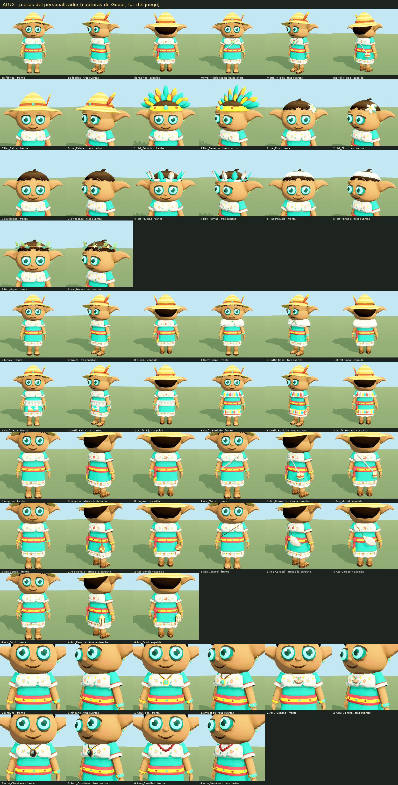

# Alux: piezas del personalizador

El modelo real del alux (`game/assets/characters/alux.glb`) trae ahora, además del cuerpo
y los tocados de siempre, catorce piezas que el juego enciende o apaga por nombre de
nodo y tres materiales que tiñe. Todo sale de `art/blender/build_alux.py`; el esqueleto
y las animaciones son los de antes, dato a dato.

Las imágenes de esta carpeta son capturas de Godot (renderer Compatibility, la luz del
juego) hechas con `art/blender/hojas_alux_opciones.py`, que enciende las mallas y tiñe
los materiales igual que `game/scripts/client/avatar.gd`.

| Hoja | Qué enseña |
| --- | --- |
| `opciones.png` | Todo junto: el alux de fábrica y cada opción de cada familia. |
| `tocados.png`, `vestimenta.png`, `accesorios.png`, `amuletos.png` | Cada familia, más grande y desde más lados. |
| `combinaciones.png` | Cuatro conjuntos completos con otros colores y otros tonos de piel. |
| `cruces.png` | Cada vestimenta con cada accesorio (y un amuleto), de cerca. |
| `movimiento.png` | Carrera, salto, caída, lanzamiento y aterrizaje con capa, morral, farol, faja… |
| `antes_despues.png` | El modelo anterior, el nuevo con morral y jade, y su diferencia. |



## Nodos

Cada pieza es **una sola malla** (`MeshInstance3D` con piel sobre el esqueleto), y
`find_children(prefijo + "*")` devuelve esa malla y ninguna otra. El índice es el del
catálogo del juego (`game/scripts/shared/look_def.gd`).

**Tocados** (`hat`)

| Índice | Nodo | Qué es | Triángulos | Materiales | Huesos |
| --- | --- | --- | --- | --- | --- |
| 0 | `Hat_Palma` | sombrero de palma con pluma (de siempre) | 656 | `Headwear`, `Jade` | `Head` |
| 1 | `Hat_Penacho` | penacho de plumas (de siempre) | 976 | `Headwear`, `Jade` | `Head` |
| 2 | `Hat_Flor` | flor de mayo (de siempre) | 504 | `Headwear` | `Head` |
| 3 | — | sin tocado: solo el cabello | | | |
| 4 | `Hat_Plumas` | diadema baja: cinta tejida y doce plumas cortas | 352 | `Headwear` | `Head` |
| 5 | `Hat_Panuelo` | pañuelo en banda ancha, anudado en la nuca | 204 | `Trim` | `Head` |
| 6 | `Hat_Hojas` | corona de hojas, florecillas y bayas | 308 | `Headwear` | `Head` |

**Vestimenta** (sobre la túnica, que no cambia)

| Índice | Nodo | Qué es | Triángulos | Materiales | Huesos |
| --- | --- | --- | --- | --- | --- |
| 0 | — | la túnica de siempre | | | |
| 1 | `Outfit_Capa` | capa corta sobre los hombros, con broche | 340 | `Trim`, `Body` | `Chest`, `Spine`, `UpperArm_L/R` |
| 2 | `Outfit_Faja` | faja ancha con nudo, puntas con flecos y delantal corto bordado | 268 | `Trim`, `Body` | `Hips`, `Spine`, `SashTail`, `Thigh_L/R` |
| 3 | `Outfit_Bordado` | pechera y bajo de rombos de colores | 352 | `Body`, `Trim` | `Chest`, `Hips`, `Thigh_L/R` |

**Accesorios** (uno a la vez)

| Índice | Nodo | Qué es | Triángulos | Materiales | Huesos |
| --- | --- | --- | --- | --- | --- |
| 0 | — | ninguno | | | |
| 1 | `Acc_Morral` | sabucán cruzado al hombro (el de siempre, ahora opcional) | 364 | `Trim`, `Body` | `Bag`; correa: `Chest`, `Spine`, `Hips` |
| 2 | `Acc_Sonaja` | sonaja de jícara colgada al cinto | 177 | `Body` | `Bag` (lazo: `Hips`) |
| 3 | `Acc_Caracol` | caracol marino a la espalda, con cordón cruzado | 292 | `Body` | `Hips`, `Spine`; cordón: `Chest`, `Spine`, `Hips` |
| 4 | `Acc_Farol` | farolito de luciérnagas al cinto | 198 | `Body`, `Firefly` | `Bag` (cordón: `Hips`) |

**Amuletos** (al cuello, uno a la vez)

| Índice | Nodo | Qué es | Triángulos | Materiales | Huesos |
| --- | --- | --- | --- | --- | --- |
| 0 | — | ninguno | | | |
| 1 | `Amu_Jade` | colgante de jade (el de siempre, ahora opcional) | 248 | `Body`, `Jade` | `Amulet`, `Chest` |
| 2 | `Amu_Concha` | concha de abanico en cordón de henequén | 152 | `Body` | `Amulet`, `Chest` |
| 3 | `Amu_Obsidiana` | espejo de obsidiana pulida en marco de madera | 204 | `Body`, `Obsidian` | `Amulet`, `Chest` |
| 4 | `Amu_Semillas` | collar de semillas rojas | 260 | `Body` | `Chest`, `Amulet` |

`Hair` (cabello, 306 triángulos, `Headwear`) se queda visible con todos los tocados.
`Alux` es el cuerpo (6 560 triángulos): `Skin`, `Body`, `Tunic`, `Trim`, `Eye`, `Jade`.

**Todas las mallas llegan visibles.** glTF no guarda la visibilidad de forma que Godot
4.5 la respete en mallas con piel (se probó `KHR_node_visibility`: la ignora), así que
quien instancie `alux.glb` tiene que apagar lo que no toque, como ya hace `avatar.gd`.

## Materiales

| Material | Qué es | Albedo de fábrica | Cómo lo trata el juego |
| --- | --- | --- | --- |
| `Tunic` | Color principal: la túnica. | `#2ec4a6` | `albedo_color = principal`. Vértices en gris (sombra y costuras). Sin cambios. |
| `Trim` | **Nuevo.** Color secundario: jubón, ruedo y puños del huipil; telas de `Outfit_Capa`, `Outfit_Faja` y `Outfit_Bordado`; `Hat_Panuelo`; correa de `Acc_Morral`. | `#f8efdc` | `albedo_color = secundario`. Vértices en blanco y grises (cenefas, forros, sombra): manda el tinte. |
| `Skin` | **Nuevo.** La piel, separada de `Body`. | `#e19764` | `albedo_color = tono de piel × 4/3 × 1.12` (ver abajo). Los vértices llevan el matiz (rubor, palmas, sombra) como factor. |
| `Body` | Lo que no se tiñe en cuerpo y piezas: bordados, faja de siempre, huaraches, cuero, madera, jícara, conchas, semillas… | blanco | Como hasta ahora: `× 1.12`. |
| `Headwear` | Tocados y cabello: paja, plumas, hojas, flores. | blanco | Como hasta ahora: `× 1.12`. |
| `Eye`, `Jade` | Emisivos de siempre (iris; jade del amuleto, la pulsera y el arete). | — | No se tocan. |
| `Firefly` | **Nuevo.** Luz del farol y sus tres luciérnagas; emisivo suave (energía 0.7, verde amarillento). | `#f6ffb4` | No se toca. |
| `Obsidian` | **Nuevo.** El espejo de `Amu_Obsidiana`: el único material pulido (rugosidad 0.12), con el color y el destello en los vértices. | blanco | No se toca. |

### `Trim`: lo que había con ese nombre

«Trim» ya existía, pero como color de vértice dentro de `Body`: el crema `#f8efdc` del
jubón, del ruedo y de los puños, es decir, justo los ribetes de la túnica. Se ha
ascendido a material: esas mismas caras son ahora del material `Trim`, con albedo
`#f8efdc` y vértices blancos (más su sombra), y dan exactamente el color de antes. Los
bordados que llevan encima (flores, hilos) siguen en `Body` y no se tiñen.

### `Skin`: por qué el albedo no es el tono de piel

En Compatibility, lo que se ve es albedo × color de vértice, tal como están guardados.
El rubor y las palmas son más claros que la piel media (hasta ×1.31 en azul), y un
color de vértice no puede pasar de 1. Por eso la piel media va en **gris 0.75** y el
albedo de fábrica es el tono de piel de siempre (`#a9714b`) × 4/3 = `#e19764`. Con eso
la cara sale como la anterior. Comprobado restando capturas de Godot del modelo viejo y
del nuevo (`antes_despues.png`): en los píxeles de piel la diferencia media es de 0.4
niveles sobre 255, y la máxima, de 12, está en los bordes y junto al cordón del amuleto
(redondeo y la sombra de contacto que ya no se hornea).

Para teñir, en `avatar.gd`:

```gdscript
# la piel media va en gris 0.75 en el vértice: el albedo es el tono × 4/3 (y × 1.12 como Body)
tint = Color(skin.r, skin.g, skin.b) * (1.12 * 4.0 / 3.0)
```

Con `skin * 1.12` a secas (sin el 4/3) la piel sale un 25 % más oscura que hoy.

## Lo que cambia en el alux de siempre

- **El sabucán y el amuleto de jade ya no son fijos.** Estaban dentro de la malla del
  cuerpo; ahora son `Acc_Morral` y `Amu_Jade`, idénticos de forma. Con accesorio 0 y
  amuleto 0 el alux va sin ellos: para que un jugador que nunca abrió el
  personalizador se vea como hasta ahora, sus valores iniciales deberían ser
  **accesorio 1 y amuleto 1**.
- **La correa del morral** pasa de henequén a `Trim` (gris claro en el vértice): con
  el secundario de fábrica se ve crema en vez de pajiza.
- **La sombra de contacto** del morral y del amuleto ya no está horneada en la túnica
  (se vería aunque no se llevaran puestos). Cada pieza opcional sí recibe la sombra del
  cuerpo. El resto de la oclusión del cuerpo es la de antes.
- Nada más: cuerpo, cara, túnica, faja, cabello y los cuatro tocados son los mismos, y
  el esqueleto (33 huesos) y las doce animaciones son idénticos dato a dato.

## Diseño

Diseños propios, en el estilo del modelo (pocos polígonos, formas redondas, color en
los vértices, sin texturas): prendas y adornos cotidianos de fantasía, sin insignias
ceremoniales ni símbolos religiosos.

- **`Hat_Plumas`**: cinta tejida turquesa y blanca con doce plumas cortas alrededor.
- **`Hat_Panuelo`**: pañuelo doblado en banda ancha, con el nudo en la nuca y dos
  puntas sueltas. Deja la coronilla al aire para que el remolino del cabello no lo
  atraviese.
- **`Hat_Hojas`**: aro de bejuco con dieciocho hojas, seis florecillas y cuatro bayas.
- **`Outfit_Capa`**: esclavina sobre los hombros, más larga por la espalda, abierta en
  pico por delante (ahí cuelga el amuleto) y cerrada con un broche dorado. Sus hombros
  van pesados a los brazos para acompañar a las mangas.
- **`Outfit_Faja`**: faja ancha con picos tejidos, nudo y dos puntas con flecos al
  costado izquierdo (tapan los de la faja de siempre), y delante un delantal corto con
  un rombo, una hilera de cuadros y fleco.
- **`Outfit_Bordado`**: pechera y bajo de rombos de colores entre dos hilos, sobre tela
  del color secundario. El dibujo es la propia malla (dos hileras de picos enfrentadas).
- **`Acc_Sonaja`**, **`Acc_Farol`**: cuelgan del cinto en el mismo sitio que el morral
  (cadera derecha, hacia atrás) y del mismo hueso `Bag`, así que se balancean con todas
  las animaciones sin tocarlas. La sonaja es una jícara con cenefa ajedrezada, mango y
  dos plumitas; el farol, una jaula de madera con techo de palma y luz.
- **`Acc_Caracol`**: caracol marino apoyado en la espalda, a la altura de la cintura,
  con un cordón cruzado como la correa del morral.
- **`Amu_Concha`**, **`Amu_Obsidiana`**, **`Amu_Semillas`**: cuelgan del mismo cordón y
  del mismo hueso `Amulet` que el jade. La obsidiana es un óvalo liso, sin grabados.

## Tamaño

| | Antes | Ahora |
| --- | --- | --- |
| `alux.glb` | 640 844 bytes (641 KB) | 822 580 bytes (823 KB) |
| Triángulos (todas las mallas) | 9 614 | 12 721 |
| Mallas | 5 | 19 |
| Materiales | 5 | 9 |
| Huesos / animaciones | 33 / 12 | 33 / 12 (idénticos) |

El archivo crece 181 736 bytes (182 KB; el límite era 250 KB). Las doce piezas nuevas suman 3 107 triángulos, entre 152 y 352 cada una (presupuesto: 60 a 400). `Acc_Morral` (364) y `Amu_Jade` (248) no son geometría nueva: salieron de la malla del cuerpo, que baja de 7 172 a 6 560 triángulos. Con el conjunto más pesado puesto (penacho, bordado, morral y collar de semillas) se dibujan 8 818 triángulos; antes, con el penacho, eran 8 454.

## Combinaciones y problemas conocidos

Revisado en las hojas (`cruces.png`, `movimiento.png`), en reposo y en `Run`, `Jump`,
`Fall`, `Cast`, `Land` e `Idle`. Las combinaciones pedidas funcionan: capa + morral,
faja + sonaja o farol, cualquier amuleto con cualquier vestimenta y cualquier tocado
con cualquier amuleto. También se miraron las doce parejas de vestimenta y accesorio.

Lo que no es perfecto:

- **Capa con los brazos en alto** (`Jump`, y por lo mismo `Transform`, `Dodge` y `Swim`):
  los hombros de la capa suben con los brazos y se arrugan, y por el borde asoma el
  puño de la manga. En reposo y corriendo las mangas quedan cubiertas.
- **Los accesorios del cinto no se ven de frente.** Sonaja, farol y morral cuelgan de la
  cadera derecha hacia atrás, donde está el hueso `Bag` que los balancea; de frente solo
  asoman la correa o un borde. Con la cámara del juego (detrás del alux) se ven bien, y
  el personalizador debería dejar girar el modelo.
- **Cabeza agachada** (`Land`, `Dodge`, `Death`, final de `Cast`): el mentón baja sobre el
  pecho y tapa o cruza el amuleto y el broche de la capa. Ya pasaba con el jade.
- **`Outfit_Faja`**: las puntas rojas de la faja de siempre asoman por detrás de las
  nuevas (parecen su forro). Con el morral, la boca del sabucán queda medio hundida en
  la faja y la correa pasa por encima.
- **`Outfit_Bordado` con el morral o el caracol**: sobre la esquina del hombro la pechera
  se separa uno o dos centímetros del jubón (para no cortarlo) y la correa queda un
  tramo por debajo.
- **Orejas**: al sacudirlas o levantarlas pueden rozar las plumas laterales de
  `Hat_Plumas`, las hojas de `Hat_Hojas` y las puntas del pañuelo.
- **Sin física**: todo es rígido salvo el balanceo de `Bag`, `Amulet` y `SashTail`. Al
  correr, la falda sigue a los muslos y el farol o la sonaja pueden rozarla.
- **Tonos de piel claros**: con el aclarado × 1.12 del juego, un tono como `#d6a57e` se
  quema hacia el blanco rosado (se ve en la cuarta fila de `combinaciones.png`).
  Conviene revisar la lista `SKINS` mirando el modelo, no el hex.
- **Secundario de fábrica**: el crema de hoy es `#f8efdc` aclarado × 1.12 (como todo
  `Body`). Con `ACCENTS[0] = "#fff7ec"` sin aclarar el jubón queda prácticamente igual
  (rojo y verde saturan; el azul baja un 4 %). Exacto sería `#f8efdc` × 1.12.

No comprobado: el personalizador y `avatar.gd` de verdad. Las capturas las hace
`render_alux_opciones.gd`, que copia su lógica (prefijos, tintes, × 1.12).

## Cómo regenerar

```bash
.tools/blender-venv/bin/python art/blender/build_alux.py            # el .glb
.tools/godot --headless --path game --import
.tools/godot --headless --path game --script "$PWD/art/godot/check_characters.gd"   # acaba en «CONTRATO ALUX: OK»
.tools/blender-venv/bin/python art/blender/hojas_alux_opciones.py   # estas hojas
```
