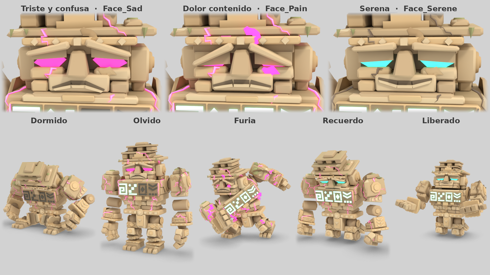

# Nojoch Tuunich, el Guardián Dormido — modelo definitivo

Rediseño parcial de la primera propuesta, con los cambios que pidió la revisión: rostro
triste y expresivo, más talla, caliza cálida, articulaciones que se leen como piezas y
grietas del Silencio en dos materiales. Conserva la silueta, el esqueleto (con cuatro
huesos más, de la cara), los nombres y los tiempos que el juego ya usa. El diseño es el
de [docs/BOSS.md](../../../docs/BOSS.md).

Como los demás personajes, está hecho por código con Blender local (módulo `bpy`): mallas,
color de vértice con oclusión horneada, un esqueleto y las animaciones dentro del mismo
`.glb`. No hay texturas, ni nada dibujado o generado con herramientas de imagen o vídeo.

**El `.glb` del juego no se ha tocado.** `game/assets/characters/nojoch.glb` sigue siendo la
propuesta anterior; para usar este hay que copiarlo encima y volver a importar (ver
«Cómo lo aplica el juego»).

Diseño original: un coloso de sillares de caliza con las juntas a la vista, cabeza ancha
sin cuello, crestería escalonada, pectoral con cuatro glifos y un espaldar que guarda el
corazón de cristal. Los glifos y todos los relieves (cabrios, rombos, almenas, tacos) son
geometría abstracta inventada para esto: no son escritura maya ni copian ningún glifo real.



## Archivos

| Archivo | Qué es | Tamaño |
| --- | --- | --- |
| `nojoch.glb` | El modelo con sus 11 animaciones y 3 expresiones | 1.01 MB |
| `nojoch_estados.png` | 1920×1080: la cara triste, dolorida y serena, y el cuerpo en los cinco estados (dormido, olvido, furia, recuerdo, liberado), con materiales y expresión aplicados. Lleva rótulos | 1.36 MB |
| `nojoch_hoja.png` | 1920×1080: frente, tres cuartos, lado y espalda, de pie, en estado «olvido». Es la misma de `art/referencias/` (sin textos) | 829 kB |
| `nojoch_sentado.png` | 1440×1080: dormido (`Sleep`), con los ojos apagados y las vetas tenues | 857 kB |
| `nojoch_escala.png` | 1920×1080: de pie entre un alux y Balam, a escala real | 713 kB |
| `nojoch_poses.png` | 1920×1080: `Slam` (1.50 s), `Sweep` (a mitad del arco), `Kneel` (final, en furia) y `Remember` (final, liberado) | 776 kB |
| `nojoch_godot.png` | Doce capturas hechas con el renderer de Godot (Compatibility) y la luz del juego: así se ve la caliza al sol y a la sombra, y los estados aplicados por nombre de material | 2.25 MB |
| `nojoch_animaciones.mp4` | Carrete con las once animaciones seguidas (640×360, 15 cuadros/s, H.264, sin audio), con el nombre de cada una sobreimpreso | 4.81 MB |
| `animaciones/<Anim>.mp4` | Una por animación, con el renderer de Godot | de 120 kB a 1259 kB |

La hoja para Kling está en [`art/referencias/`](../../referencias/README.md): `nojoch_frente.png`,
`nojoch_tres_cuartos.png`, `nojoch_lado.png`, `nojoch_espalda.png`, `nojoch_hoja.png` y
`nojoch_liberado_hoja.png`, con su ficha.

Scripts (fuera de esta carpeta): `art/blender/build_nojoch.py` (el modelo),
`art/blender/render_nojoch.py` (las imágenes y las medidas),
`art/blender/videos_nojoch.py` (los vídeos), `art/godot/check_nojoch.gd` (comprobación
sin ventana) y `art/godot/render_nojoch.gd` (capturas y cuadros con Godot).

## Qué ha cambiado respecto a la primera propuesta

| Pedido | Qué se hizo |
| --- | --- |
| Rostro menos agresivo y expresivo | La losa recta de la ceja son ahora dos cejas que giran sobre su extremo interior; la boca es una ranura con labio cuyo tramo central es fijo y cuyas comisuras giran; los párpados tienen el borde caído hacia fuera y los ojos son algo más altos. En reposo la cara es triste y confusa (una ceja más alta que la otra). Cuatro huesos nuevos y tres expresiones de un cuadro |
| Más detalle escultórico | Losa tallada en la espalda (marco, tres cabrios en la espina y dos cuadros con rombo), listones en los omóplatos y en las alas del espaldar, cenefa de almenas en la nuca; rombo y tacos en los muslos, greba con cabrios, tacos en espinillas y ajorcas; brazal con tres cabrios, marco con rombo y listones en el antebrazo, tacos en la muñequera y en el dorso de la mano; faldón y rabadilla con almena invertida y rombo |
| Caliza cálida | Paleta nueva, crema y arena, ajustada mirando el renderer de Godot con la luz del juego; sin verdín (la pátina del suelo es de tierra) y con el musgo reducido a ocho matas pequeñas, de color seco |
| Articulaciones | Rótulas de piedra oscura en hombros, muñecas, caderas y tobillos; goznes de tambor con tapas en codos y rodillas; collarín en el costado del pecho para cada hombro. Los sillares vecinos van rebajados en bisel para dejar sitio al doblarse |
| Grietas que evolucionan | `Silence`: las vetas de antes, un 40 % más finas, de anchura que late (nudos y tramos de hilo) y color de vértice del rosa claro al magenta oscuro. `Silence2`: grietas nuevas, más anchas y con ramas, que apagadas tienen el color de la piedra que pisan |
| Glifos | Se exportan apagados: piedra tallada oscura (`#5a564b`), sin emisión |
| Corazón y ojos | Se conservan (los ojos, un poco más altos) |

## Medidas

1 unidad = 1 metro, origen en el suelo entre los pies, mira a **+Z** en Godot (a −Y en
Blender). Medidas tomadas sobre la malla ya deformada con `render_nojoch.py medidas`.

| | |
| --- | --- |
| De pie | **5.00 m** en reposo (4.97 m en el primer cuadro de `Idle`); 4.48 m de mano a mano; 1.87 m de fondo |
| Sentado (`Sleep`) | **3.41 m** de alto, 5.22 m de ancho (las manos descansan en el suelo a los lados). Queda de 0.93 m por delante a 1.56 m por detrás del origen |
| Cabeza y crestería | 1.70 m (cara 0.88 m + crestería 0.82 m); 1.94 m de orejera a orejera |
| Tronco | Cinturón a 1.7–1.9 m; hombros a 3.10 m; 4.16 m de hombro a hombro |
| Brazos | 2.86 m del hombro a la punta de los dedos (llegan a 0.24 m del suelo). Mano de 0.84 m de ancho: tres dedos y pulgar |
| Piernas | Cadera a 1.40 m, rodilla a 0.82 m; pies de 0.68 × 1.08 m |
| Glifos | Fila centrada a 2.91 m; `Glyph1` es el de la izquierda de quien lo mira de frente |
| Corazón | Centro a 3.56 m de pie; **3.22 m de rodillas** al final de `Kneel` (de 2.85 a 3.59 m) y 3.07 m al final de `Remember` |
| Golpes | `Slam`: el puño cae de 2.7 a 3.5 m por delante, algo a su derecha. `Summon`: los puños, de 2.0 a 2.8 m por delante y a 0.9–1.5 m a cada lado. `Sweep`: la punta de la mano va de −76° a +63° (139°) a 2.9 m del eje |

## Malla y esqueleto

- **11 006 triángulos** (tope: 14 000) y 11 445 vértices en Godot, en un solo nodo de malla,
  `Nojoch`, con piel sobre un solo esqueleto. Sin texturas: `COLOR_0` con el color y la
  oclusión horneada. **1.01 MB** (tope: 1.7 MB): pesa menos que la primera propuesta, con
  2 200 triángulos más, porque los chaflanes de los sillares comparten ahora sus vértices.
- **30 huesos.** Los 26 de antes, con el mismo nombre y la misma posición: `Root`, `Hips`,
  `Spine`, `Chest`, `Head`, `Jaw`, `Lids`, `HeartBone` y, a cada lado (`_L`, `_R`),
  `UpperArm`, `Forearm`, `Hand`, `Fingers`, `FingerTips`, `Thumb`, `Thigh`, `Shin`, `Foot`.
  Y cuatro nuevos, hijos de `Head`: `Brow_L`, `Brow_R` (cejas) y `Mouth_L`, `Mouth_R`
  (comisuras). El orden de los huesos en el esqueleto ha cambiado: hay que buscarlos por
  nombre, no por índice.
- Cada sillar va pegado a un solo hueso (no hay piel que se doble).
- Árbol al cargar: `Node3D > Armature > Skeleton3D > Nojoch`, con `AnimationPlayer` en la
  raíz, igual que los otros personajes.

## Materiales

Se localizan por nombre de superficie, como en los demás `.glb`. Son de una sola cara.

| Material | Triángulos | Cómo se exporta | Para qué sirve |
| --- | --- | --- | --- |
| `Body` | 8 762 | Blanco; todo el color va en los vértices | Caliza, relieves, rótulas, musgo y raíces |
| `Eye` | 32 | Jade `#2ec4a6`, emisión `#59ffe0` × 1.2 | Los ojos, al fondo de las cuencas |
| `Glyph1` … `Glyph4` | 70, 50, 50, 70 | Piedra oscura `#5a564b`, **sin emisión** (apagados); color de vértice blanco | Los cuatro glifos del pecho, uno por material |
| `Heart` | 96 | Jade `#2ec4a6`, emisión `#3fe8c4` × 1.0 | El corazón de cristal del espaldar |
| `Silence` | 864 | Albedo blanco, **el magenta va en los vértices** (del rosa `#ffc4e6` al magenta oscuro `#b01c66`), emisión `#fa3399` × 1.8 | Las vetas base |
| `Silence2` | 1 012 | Albedo `#ece4d8`, sin emisión; los vértices llevan el color de la piedra de debajo | Las grietas de la furia |

## Cómo lo aplica el juego

Es lo que hacen `art/godot/render_nojoch.gd` (tabla `ESTADOS`) y `render_nojoch.py` para
sacar las imágenes de esta carpeta; `nojoch_estados.png` y `nojoch_godot.png` enseñan el
resultado. Todo se hace con una copia propia de cada material, por nombre.

### Estados

| Estado | `Eye` | `Silence` | `Silence2` | `Glyph1`…`4` | `Heart` | Cara | Animación |
| --- | --- | --- | --- | --- | --- | --- | --- |
| **Dormido** | Apagados: sin emisión, albedo `#2e302c`, sin color de vértice | Tenue: emisión magenta × 0.25 | Como se exporta | Apagados | × 0.5 | Da igual: párpados cerrados | `Sleep` |
| **Olvido** | Magenta `#fa3399` × 1.6 (albedo magenta) | Emisión × 1.7, latiendo despacio | Como se exporta | Se encienden de uno en uno: albedo blanco, emisión jade `#3fe8c4` × 2.4 | × 1.4 | `Face_Sad` | `Awaken`, `Idle`, `Walk`, `Slam`, `Sweep`, `Summon` |
| **Furia** | Magenta × 2.6 | Emisión × 2.6, latiendo rápido | **Encendido**: emisión magenta × 2.4, albedo magenta, sin color de vértice | Los encendidos se quedan | × 1.4 | `Face_Pain` | Además `Charge`, `Stunned`, `Kneel` |
| **Recuerdo** | Jade × 1.6 | Apagándose: × 0.7 → 0 | Como se exporta | Los cuatro encendidos | × 2.0 | De `Face_Sad` a `Face_Serene` | `Kneel` → `Remember` |
| **Liberado** | Jade × 1.6 | Apagado: sin emisión, albedo `#8a7460`, sin color de vértice (cicatrices) | Como se exporta | Encendidos | × 2.4 | `Face_Serene` | Último cuadro de `Remember` |

- **`Silence`**: basta cambiar la emisión. Como el magenta va en los vértices, el albedo se
  deja en blanco con `vertex_color_use_as_albedo = true` (es lo que ya hace `boss_view.gd`).
  Para apagarlo del todo, albedo `#8a7460` sin color de vértice. El gris verdoso que usa hoy
  `boss_view.gd` (`STONE`) quedará frío sobre la caliza nueva.
- **`Silence2`**: si el juego no lo toca, no se ve. Para encenderlo: `emission_enabled`,
  emisión magenta, y mejor también albedo magenta con `vertex_color_use_as_albedo = false`
  (con el albedo de piedra la grieta sale rosa blanquecino). Para apagarlo se devuelven los
  valores de exportación.
- **Glifos**: `boss_view.gd` ya los pone en blanco con emisión al encenderlos y en gris al
  apagarlos; no hay que cambiar nada.
- La emisión de un material es uniforme (Godot no la multiplica por el color de vértice):
  la irregularidad de las vetas viene de su anchura y de su color, no de la emisión.

### Expresiones

`Face_Sad`, `Face_Pain` y `Face_Serene` son animaciones de **un cuadro** (0.033 s) con
pista solo en `Brow_L`, `Brow_R`, `Mouth_L`, `Mouth_R` (giro y posición), `Lids` (posición)
y `Jaw` (giro). Las once animaciones del cuerpo **no llevan pista en `Brow_*` ni
`Mouth_*`**: lo que el juego ponga en esos cuatro huesos se queda puesto. Sí animan `Lids`
(dormir, parpadeo de `Idle`, aturdido) y `Jaw`, con los párpados entornados por omisión.

| Expresión | Cejas | Comisuras | Párpados | Para |
| --- | --- | --- | --- | --- |
| `Face_Sad` (es la pose de reposo) | Caídas hacia fuera 17° (izq.) y 12° (der.), la izquierda más alta: tristeza y confusión | Bajas 21° y 16° | 26 % cerrados | Olvido |
| `Face_Pain` | Muy caídas (25°) y apretadas sobre los ojos, con el extremo interior arriba: nunca ceño de enfado | Bajas 13° y estiradas 3.5 cm; mandíbula 2.5° | 78 % | Furia |
| `Face_Serene` | Casi horizontales (4°), iguales | Suben 12° | 46 %, suaves | Recuerdo y liberado |

Formas de usarlas, de más simple a más fina:

1. Con el mismo `AnimationPlayer`: `play("Face_Serene")`, `advance(0)` y a continuación
   la animación del cuerpo. Cejas y boca se quedan en la expresión (lo comprueba
   `check_nojoch.gd`); párpados y mandíbula los sigue llevando la animación del cuerpo.
2. Leyendo las claves (`track_get_key_value(pista, 0)`) de dos expresiones y escribiendo su
   mezcla con `Skeleton3D.set_bone_pose_rotation` / `set_bone_pose_position`. Para `Brow_*`
   y `Mouth_*` basta hacerlo al cambiar de fase (o cada cuadro, para una transición); para
   `Lids` y `Jaw` hay que hacerlo cada cuadro, después del `AnimationPlayer`, y pisa el
   parpadeo. Es lo que hace `_cara()` en `render_nojoch.gd`.
3. Un `AnimationTree` con una mezcla filtrada por hueso también vale.

Sin tocar nada, el coloso sale triste: es la pose de reposo.

### Para poner este modelo en el juego

- Copiar `nojoch.glb` a `game/assets/characters/` y reimportar.
- `Walk` dura ahora **1.2 s** (antes 1.6 s) y está compuesta para 1.7 m/s.
- Buscar huesos por nombre: los índices han cambiado.
- Lo demás (nombres de malla, materiales, huesos y animaciones; origen, orientación,
  alturas y tiempos de los golpes) es igual.

## Animaciones

30 cuadros por segundo. Las once del cuerpo llevan pista en los mismos huesos (2 de
posición, 23 de giro y 1 de escala), así que cambiar de una a otra no deja restos. Ninguna
desplaza la raíz. Los ciclos cierran exactos, pero Godot los importa sin bucle.

| Animación | Duración | Tipo | Notas |
| --- | --- | --- | --- |
| `Sleep` | 4.0 s | ciclo | Sentado, rodillas abiertas, cabeza gacha, párpados cerrados y **las manos descansando en el suelo** a los lados. Respiración mínima. El cuerpo queda unos 0.8 m por detrás del origen |
| `Awaken` | 4.0 s | una vez | Quieto hasta 0.7 s; tiembla entre 0.25 y 1.45 s; a 1.45 s ha alzado la cabeza y abierto los ojos; se empuja con los puños, que siguen donde dormían, y los suelta entre 2.25 y 2.7 s; en pie a 3.3 s; se sacude el polvo. Termina en el primer cuadro de `Idle` |
| `Idle` | 4.0 s | ciclo | De pie; respira, mira despacio a los lados, parpadea una vez (a 3.0 s), el corazón late |
| `Walk` | 1.2 s | ciclo | Pasos pesados y cortos, compuesta para **1.7 m/s**: a esa velocidad el pie apoyado no se mueve (0.0 mm medidos). Planta el pie izquierdo a 0 s y el derecho a 0.6 s |
| `Slam` | 2.6 s | una vez | Alza el puño derecho hasta **1.2 s**, golpea a **1.45 s** y lo deja clavado hasta 1.85 s; suelta entre 1.85 y 2.05 s |
| `Sweep` | 2.2 s | una vez | Se agacha y se carga hacia su derecha hasta **0.9 s** (apoya el puño izquierdo) y barre con el brazo derecho hasta **1.35 s**, a ras de suelo: 139° |
| `Summon` | 2.6 s | una vez | Los dos puños arriba a 1.1 s; golpean el suelo a **1.40 s** y se quedan hasta 1.95 s |
| `Charge` | 0.8 s | ciclo | Embestida de hombro: el tronco gira hasta poner el hombro derecho delante y se vence 40° hacia donde va, el antebrazo derecho va cruzado como un ariete, el brazo izquierdo atrás, las piernas abiertas y clavadas. No da pasos: **resbala adrede** (el juego lo mueve a 12 m/s) y traquetea |
| `Stunned` | 2.4 s | ciclo | Tambaleo en círculo, cabeza colgando, párpados casi cerrados, mandíbula floja |
| `Kneel` | 2.0 s | una vez | Las rodillas tocan el suelo a **0.95 s**, a la vez que los puños, que se quedan apoyados (se sostiene el último cuadro) |
| `Remember` | 3.0 s | una vez | Empieza donde acaba `Kneel`; suelta el suelo, levanta la cabeza, abre los ojos y tiende las manos abiertas hacia delante (2.5 s); se queda así |
| `Face_Sad`, `Face_Pain`, `Face_Serene` | 0.033 s | pose | Solo huesos de la cara (ver «Expresiones») |

### Revisadas en movimiento

Cada animación se dibujó cuadro a cuadro con el renderer de Godot (15 cuadros/s) y se
miró en hojas de cuadros consecutivos, además de medirla (`render_nojoch.py medidas`:
pies que patinan, saltos de velocidad de un cuadro al siguiente, puntos bajo el suelo).
`Walk` y `Charge` se ven desplazándose a la velocidad del juego sobre losas de 2 m.

| Defecto visto | Qué se hizo |
| --- | --- |
| `Walk` patinaba: estaba compuesta para 1.0 m/s y el juego la mueve a 1.7 | Recompuesta: ciclo de 1.2 s, apoyo del 56 %, cadera más baja; deslizamiento medido 0.0 mm. Además las manos rozaban el suelo: codos más doblados |
| Manos en el aire en `Sleep` | Descansan en el suelo, colocadas con cinemática inversa del brazo |
| Saltos al pasar una mano de apoyada a libre (`Awaken`, `Slam`, `Summon`, `Kneel`, `Remember`) y, al medir, también en `Stunned` y `Sweep` (hasta 70 m/s de un cuadro al siguiente) | Venían de un ajuste que buscaba el ángulo del hombro y a veces encontraba otra solución. Ahora las manos apoyadas van a un punto fijo con cinemática inversa y un peso que entra y sale suave; la protección contra hundirse en el suelo es continua. Queda el golpe seco de `Slam` y `Summon`, que es el puñetazo |
| `Charge` era una carrera de 2.2 m/s que a 12 m/s patinaba | Recompuesta como embestida de hombro deslizante |
| La espinilla se hundía en `Summon` (7.6 cm), `Slam`, `Sweep` y de rodillas | Greba más corta y fina, canto de abajo de la espinilla rebajado, sentadillas menos hondas y rodillas 3 cm más altas: lo peor ahora son 5 mm |
| `Sweep` barría 125° con la mano entre 0.4 y 1.7 m | La mano sigue un arco: 139° a 2.9 m, con el canto de la mano a 0.1–0.5 m del suelo |
| En `Slam` el brazo que golpea quedaba tapado por el cuerpo desde la cámara de revisión | Solo era la cámara: el vídeo se toma ahora desde su derecha |
| Sillares que se cruzan en codos, rodillas y caderas | Rótulas y goznes con los sillares vecinos rebajados; las suelas de los pies, que se ven de rodillas, vuelven a estar cerradas |

Orden del carrete: `Sleep`, `Awaken`, `Idle`, `Walk` (4 vueltas), `Slam`, `Sweep`, `Summon`,
`Charge` (4 vueltas), `Stunned` (2 vueltas), `Kneel`, `Remember`. Cada una lleva el estado
en que el juego la usa: `Sleep` dormido; de `Awaken` a `Summon`, olvido; `Charge`,
`Stunned` y `Kneel`, furia (con `Silence2` encendido y `Face_Pain`); `Remember`, liberado.

## Paleta

Los hex están en el diccionario `HEX` de `build_nojoch.py`. **En el juego la piedra se ve
bastante más clara que estos códigos**: el renderer Compatibility usa el color de vértice
tal cual, sin descodificar sRGB, y el ambiente del juego es frío (0.62, 0.76, 0.80), así
que una piedra amarillenta sale verdosa a la sombra y un tono claro se quema a blanco al
sol. Por eso los tonos van más rojizos y oscuros que la caliza del santuario
(`LIME #dbcca8`). Medido en las capturas de Godot: al sol, entre `#d4ad6e` y `#f2dba7`; a
la sombra, entre `#8f6d3d` y `#c8a669`. Las imágenes de Blender de esta carpeta imitan ese
resultado (color de vértice con gamma 1.2 y un tinte cálido), no el hex.

| Nombre | Hex | Dónde |
| --- | --- | --- |
| Caliza | `#ba8f6b` | Tono medio de los sillares |
| CalizaArena | `#aa805e` | Sillares más tostados |
| CalizaCrema | `#d0a781` | Sillares claros, tachones y relieves |
| CalizaOscura | `#8e6a50` | Sillares en sombra, rótulas y goznes |
| CalizaCalida | `#c99565` | Placas talladas: pectoral, ajorcas, banda, losa de la espalda |
| Junta | `#4f3d30` | Fondo de las cuencas, la boca y el espaldar |
| Rotura | `#dfbf9c` | Caliza recién partida en los desportillados |
| Tierra | `#7d6248` | Pátina cerca del suelo |
| Musgo / MusgoOscuro / MusgoClaro | `#737544` / `#565a36` / `#8d8a52` | Musgo seco de hombros y crestería |
| Raiz / RaizOscura | `#6a4c33` / `#45301f` | Raíces |
| Jade | `#2ec4a6` | Corazón y ojos (albedo) |
| JadeLuz | `#59ffe0` | Emisión de los ojos (la del alux) |
| JadeVivo | `#3fe8c4` | Emisión del corazón y de los glifos encendidos |
| GlifoApagado | `#5a564b` | Los glifos sin encender |
| Silencio | `#fa3399` | Emisión de las vetas (`MAGENTA` del santuario) |
| SilencioNucleo / SilencioBorde | `#ffc4e6` / `#b01c66` | Color de vértice de las vetas: filo y falda |
| SilencioApagado | `#8a7460` | Las vetas base cuando ya no hay Silencio |
| Silencio2Apagado | `#ece4d8` | Albedo de `Silence2` apagado (multiplica al color de la piedra) |

## Cómo regenerar

Desde la raíz del repo, con el entorno de `art/README.md` (`bpy`, `numpy`, `Pillow`), más
Godot, `xvfb` y `ffmpeg` para los vídeos:

```bash
.tools/blender-venv/bin/python art/blender/build_nojoch.py     # el .glb: unos 7 s
.tools/blender-venv/bin/python art/blender/render_nojoch.py    # todas las imágenes (también art/referencias/): varios minutos (Cycles, 2 hilos, 24 muestras)
.tools/blender-venv/bin/python art/blender/videos_nojoch.py    # los once vídeos y el carrete: unos 2 min (Godot, 2 hilos)
.tools/godot --headless --script "$PWD/art/godot/check_nojoch.gd"   # comprobar el .glb
```

Lo demás es opcional:

```bash
# una sola imagen (referencias, sentado, escala, poses, estados), o una prueba rápida al 30 % con 6 muestras
.tools/blender-venv/bin/python art/blender/render_nojoch.py estados
.tools/blender-venv/bin/python art/blender/render_nojoch.py todo /tmp/prueba 6 0.3
# medidas, contactos con el suelo, pies que patinan, saltos y arco del barrido
.tools/blender-venv/bin/python art/blender/render_nojoch.py medidas
# un cuadro suelto de cualquier animación, en un estado
.tools/blender-venv/bin/python art/blender/render_nojoch.py toma Slam 1.2 -40 10 /tmp/slam.png 640 furia
# capturas con el renderer de Godot (necesita un proyecto vacío) y su hoja
mkdir -p /tmp/nojoch_godot && touch /tmp/nojoch_godot/project.godot
LP_NUM_THREADS=2 xvfb-run -a .tools/godot --path /tmp/nojoch_godot --rendering-driver opengl3 --resolution 640x640 \
    --script "$PWD/art/godot/render_nojoch.gd" -- /tmp/nojoch_godot/capturas "$PWD/art/propuestas/nojoch/nojoch.glb"
.tools/blender-venv/bin/python art/blender/render_nojoch.py godot /tmp/nojoch_godot/capturas
# solo algunos vídeos, o las hojas de cuadros para revisarlos, o mirar desde otro lado
.tools/blender-venv/bin/python art/blender/videos_nojoch.py --solo Walk,Charge --hojas /tmp/hojas --giro 90
```

## Comprobaciones hechas

- **Godot 4.5.1 sin ventana** (`check_nojoch.gd`): una malla `Nojoch`, un esqueleto, los 9
  materiales, los 30 huesos, las 11 animaciones con su duración y las 3 expresiones; 11 006
  triángulos y 1.01 MB dentro del presupuesto; glifos y `Silence2` apagados; ninguna
  animación del cuerpo lleva pista en `Brow_*` ni `Mouth_*`; una expresión puesta con el
  reproductor se conserva bajo `Idle`. Resultado: correcto.
- **Renderer de Godot con la luz del juego** (`nojoch_godot.png`): sol, ambiente, curva
  fílmica, resplandor y ajuste de saturación copiados de `world_builder.gd`. La caliza se
  lee crema al sol y arena a la sombra, sin verdear ni quemarse.
- **Dos construcciones seguidas dan el mismo `.glb`**, byte a byte.
- **Suelo**: lo más hundido en cualquier animación son 5 mm (`Sweep`).
- **Imágenes**: todas salen del `.glb` que se entrega y están revisadas una a una.

## Qué sigue flojo

**Del modelo**

- **La crestería no se ha tocado** (se pidió conservar la silueta): de frente sigue
  leyéndose como un sombrero de losas apiladas.
- **Los goznes de codos y rodillas son tambores lisos y grandes.** Se leen como pieza,
  pero son la parte menos tallada. El sillar del brazo entre el hombro y el codo es corto
  y queda casi tapado.
- **Siguen cruzándose algunos sillares**: los dedos al cerrar el puño, el muslo con el
  faldón al sentarse y el bloque del hombro con el collarín cuando el brazo se abre mucho.
  Las articulaciones se revisaron en capturas de las poses extremas, no cuadro a cuadro
  desde todos los lados.
- **El bloque del hombro sigue girando con el brazo**: al alzarlo, su musgo queda boca
  abajo (ahora hay menos y ya no cuelga).
- **`Silence2` apagado no desaparece del todo**: es relieve (1.6 cm) y de cerca se adivina
  como una costura algo más oscura. Tampoco las vetas pueden «crecer»: solo encenderse.
- **La cara tiene pocos grados de libertad.** Cejas y comisuras giran en el plano de la
  cara y los dos párpados bajan juntos. `Face_Pain` se distingue de `Face_Sad` por la
  pendiente de las cejas, los párpados y la boca estirada; de lejos, con el resplandor de
  los ojos, la diferencia es pequeña y la llevan más las grietas que la cara.
- **La paleta está hecha para la luz de día del juego.** Con otra luz (interior, noche,
  cinemática) la piedra tirará a tostado o a rosado. Los hex no se parecen a lo que se ve.
- **El corazón sigue en el espaldar**, por detrás de la cabeza, no entre los omóplatos.
- La oclusión está horneada en reposo y no cambia con la pose.

**De las animaciones**

- **`Walk` es un arrastrar de pies**: con piernas de 1.4 m, a 1.7 m/s da pasos de 1 m cada
  0.6 s. No patina, pero no es la zancada lenta que pediría un coloso; para eso habría
  que bajar la velocidad en el juego.
- **`Charge` no tiene arranque ni frenada**: es la pose de embestida con traqueteo. El
  aviso de 1.5 s («rasca el suelo») y el choque no tienen animación propia.
- **`Sweep`**: en la carga la mano empieza alta (el canto a 0.5 m) y baja durante el
  barrido; el giro del tronco es muy brusco (130° en 0.45 s).
- **`Summon`**: los puños caen más cerca que antes (2.0–2.8 m, antes 2.5–3.4 m).
- **`Kneel`**: los pies siguen tendidos con la planta hacia arriba.
- **Golpes secos**: al golpear, `Slam` y `Summon` cambian de velocidad 26 y 17 m/s en un
  cuadro. Es intencionado, pero en una mezcla lenta entre animaciones puede notarse.
- No se ha probado la mezcla entre animaciones del `AnimationPlayer` (el juego funde
  0.25 s), ni las expresiones con fundido.

**De las imágenes, los vídeos y la comprobación**

- Los vídeos están hechos sobre un suelo de prueba, no en el patio, y a 640×360.
- Las imágenes de Blender imitan el color del juego, no lo reproducen: la referencia fiel
  del color es `nojoch_godot.png`.
- **No está probado dentro del juego**: ni el coste en equipos modestos, ni cómo se ve en
  el patio con su cámara, ni que `boss_view.gd` funcione sin cambios con el `.glb` nuevo
  (debería, salvo la duración de `Walk`).
