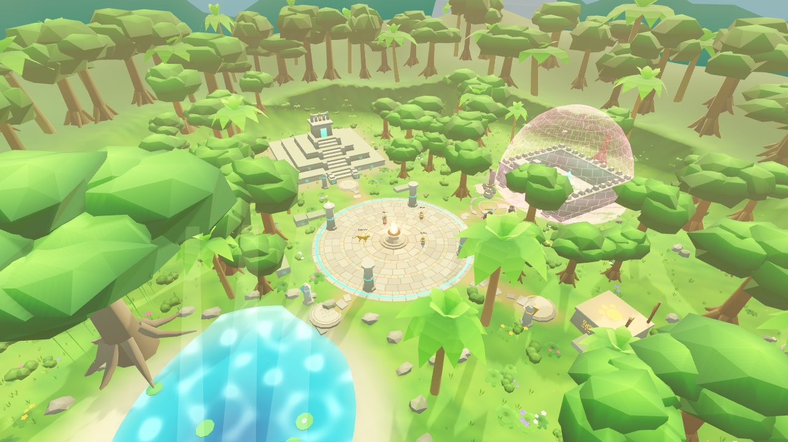
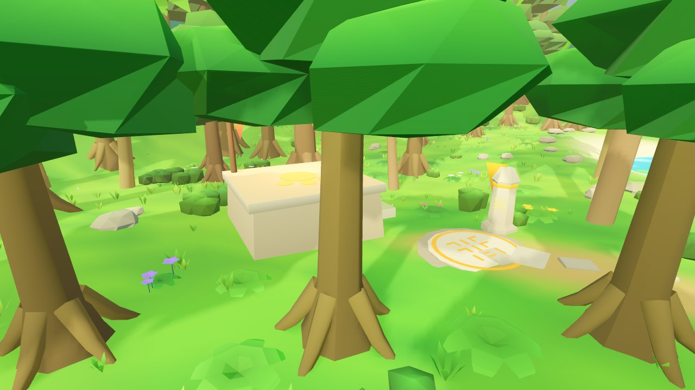

# Biblia de arte de ALUX

Lenguaje visual, personajes, escenarios y paleta. Historia: [STORY_BIBLE.md](STORY_BIBLE.md) ·
Cinemáticas: [CINEMATICS.md](CINEMATICS.md).

ALUX busca verse como una aventura de fantasía colorida y con encanto: formas redondeadas y legibles,
color saturado, piedra caliza clara, jade y turquesa que brillan, selva viva. Todo el arte es propio y
se inspira en Yucatán y en la mitología maya; no se reutiliza ni se imita ningún personaje, criatura,
interfaz, icono o composición de otros juegos.

## Principios

| Principio | Cómo se aplica |
| --- | --- |
| **Lectura antes que detalle** | Siluetas claras a distancia de juego; cada forma del jugador tiene un color de acento (jade para el alux, ámbar para Balam). |
| **Paleta de Yucatán** | Caliza crema, verde selva, turquesa de cenote, jade, oro, y magenta sólo para la corrupción y el peligro. |
| **Hecho para navegador** | Sin texturas: el color y la oclusión van en los vértices. Pocos materiales, mallas fusionadas e instanciado. |
| **Reproducible** | Personajes generados por scripts de Blender (`art/`); escenario, HUD e iconos generados por código. |
| **La red manda** | Ningún efecto cambia las reglas: el servidor sigue decidiendo movimiento, daño y recompensas. |

## HUD e interfaz (`game/scripts/client/hud.gd`, `ui/ui_kit.gd`)

Todo se dibuja por código (sin imágenes, salvo los dos retratos) con un mismo lenguaje: placas de
obsidiana con filo de jade y remaches, medallones con anillo y tipografías Bungee (títulos) y Rubik (texto),
ambas con licencia OFL.

- **Grupo** (arriba a la izquierda): código de sala y una fila por jugador con medallón de retrato,
  nombre, barra de vida y estado (caído, reconectando).
- **Objetivo** (arriba al centro): placa con icono y color según el estado (objetivo, alerta, logrado).
- **Brújula**: marcas del brasero, la pirámide, el cenote, el santuario y el mirador.
- **Barra inferior**: medallón con el retrato de la forma actual; vida y energía con transición suave,
  sombra del daño reciente y destello al curar o recibir daño; tres ranuras de habilidad con icono
  propio, tecla, nombre, cortina de enfriamiento con segundos, anillo de carga y estado "sin energía";
  selector de forma con su enfriamiento.
- **Avisos**: pista contextual sobre la barra (purificar, brasero), estandarte para momentos importantes,
  recompensa al terminar la emboscada, ayuda de controles con **H** y panel técnico discreto con **F3**.

## Personajes (`art/`, `game/assets/characters/`)

Detalle técnico en [art/README.md](../art/README.md).

- **Alux**: cabeza grande, ojos con iris y brillo, párpados, cejas, boca articulada, orejas largas que
  nacen de la cabeza, manos con dedos, sandalias, túnica con bordado regional, faja, morral de henequén,
  amuleto y pulseras de jade. Tres tocados (sombrero de palma, penacho, flor) y cabello.
- **Balam**: jaguar de pecho ancho con rosetas integradas en la piel, vientre claro, máscara facial,
  collar con el color del jugador, ajorcas y glifos de jade en los hombros.
- **Animaciones**: reposo, carrera, salto, caída, aterrizaje, nado, golpe recibido, caída en combate y
  transformación para ambos; lanzar, esquivar e interactuar (alux); garras, carga, zarpazo, salto
  ofensivo y su aterrizaje (Balam). La carrera se reproduce al ritmo de la velocidad real del
  personaje, de modo que el pie apoyado no patina.
- **Transformación**: columna de luz, anillos, chispas y el modelo nuevo que brota girando.

## Escenario (`game/scripts/client/world_builder.gd`, `env/mesh_builder.gd`)

El Claro de los Aluxes conserva exactamente la geometría de colisión del servidor
(`game/scripts/shared/world_def.gd`); lo nuevo es su aspecto y algunos sólidos añadidos a esa definición
compartida (escalinata de la pirámide, ceiba, piedras de los altares).

| Punto focal | Qué se ve |
| --- | --- |
| **Plaza y brasero** | Enlosado en anillos con incrustaciones de jade, brasero tallado con llama animada, pilares labrados. |
| **Pirámide** | Cuerpos con cornisas y bandas de glifos, escalinata transitable, templo con crestería. |
| **Santuario sellado** | Muralla con almenas, portal monumental, sol de oro, círculo ritual, reja de luz y cúpula de energía que se disuelve al abrirse. |
| **Cenote** | Agua con cáusticas animadas, rocas de orilla, nenúfares y haces de luz. |
| **Mirador** | Plataforma elevada con estela y vista al claro. |
| **Altares cooperativos** | Cada uno con su glifo y color, haz de luz al activarse y piedra con estandarte. |
| **Ceiba sagrada** | Árbol gigante con raíces y lianas, punto de referencia al oeste. |

Profundidad en capas: primer plano con helechos, flores y hierba; plano medio con árboles, palmas,
ruinas y estelas; fondo con anillo de selva, dos cordilleras, una pirámide lejana y nubes. Los glifos
son inventados (generados por una regla simétrica), no escritura maya real ni símbolos de otras obras.

## Calidad gráfica

| Nivel | Qué incluye | Cómo se elige |
| --- | --- | --- |
| **Alta** | Sombras, resplandor, suavizado, partículas, flora menuda, selva de fondo. | Por defecto, o `?q=high` (no baja sola). |
| **Baja** | Sin sombras, resplandor ni flora menuda; 60 % de resolución interna. | `?q=low`, o automática si el equipo no llega a 20 FPS. |
| **Mínima** | Además sin fondo lejano ni nubes; 50 % de resolución interna. | `?q=min`, o automática desde baja. |

La bajada automática sólo cambia lo que se dibuja en ese navegador; no afecta a la red ni a los demás
jugadores. Costos medidos en [rendimiento.md](rendimiento.md).

## Cómo se revisa el arte

`scripts/preview.sh <carpeta> [tomas…]` monta el escenario real, la interfaz y unos personajes sin
servidor y guarda capturas desde varias cámaras (plaza, pirámide, santuario, cenote, mirador,
panorámica, retratos, combate) en unos 30 s. Las imágenes de esta documentación salen de ahí.
`tests/e2e/one-shot.ts` hace una captura del juego real en el navegador.

## Dirección por capítulo

Las imágenes de referencia que se han compartido para los capítulos sirven de **ambiente** (luz,
color, escala), nunca de modelo a copiar: algunas son obras de otros autores. El arte de ALUX se
construye propio, con las reglas de arriba.

| Capítulo | Ambiente buscado | Paleta | Luz |
| --- | --- | --- | --- |
| I. El Claro de los Aluxes | Selva viva y ruinas de caliza con jade; formas redondeadas y legibles | Verde selva, caliza crema, jade, turquesa, oro | Día claro; noche con brasero para la escena de Balam |
| II. Los Secretos del Cenote | Cueva inundada con una abertura al cielo; raíces, hongos y piedra tallada | Azul profundo, turquesa que brilla, verde musgo, ámbar puntual | Rayos de sol que caen al agua; lo demás, penumbra y bioluminiscencia |
| III. La Ciudad de Piedra | Pirámides de base ovalada y patios con celosías, entre la selva | Piedra cálida, antorchas naranjas, cielo magenta y violeta | Atardecer con fuego; sombras largas |
| IV. Los Vientos del Mayab | Manglar y ría al amanecer; flamencos, palmas, torres de viento | Rosa flamenco, verde brillante, agua esmeralda, naranja de sol bajo | Contraluz y reflejos en el agua |
| V. El Despertar de Kukulkán | Tormenta sobre la gran pirámide; plumas de jade y oro en el viento | Verde jade, oro, azul tormenta, relámpago blanco | Tormenta que se abre al amanecer |

El magenta se reserva para el Silencio en todos los capítulos: si algo es magenta, está olvidado.

## Personajes de la historia

| Personaje | Aspecto | Estado |
| --- | --- | --- |
| **Chiich Yaxché** | Alux anciana, algo más grande que los jugadores; rebozo blanco con cenefa bordada, flor en el pelo, bastón de ceiba con un brote de jade encendido; halo dorado en el suelo. | **Modelo propio** (`art/blender/build_yaxche.py`): 8 935 triángulos, 39 huesos, con reposo, hablar, regañar y bendecir. Sin revisar en movimiento con GPU. |
| **Nojoch Tuunich** | Coloso de caliza tallada, tres veces la altura de un alux, con glifos en el pecho que se encienden; musgo y raíces; vetas magenta mientras está olvidado. | Sin modelar (0.3) |
| Espíritus de los capítulos II–IV | Por definir cuando se aprueben | Sin diseñar |

**Referencias aprobadas para vídeo:** las hojas de `art/previews/` (alux y Balam) y capturas del
propio juego. Ningún vídeo parte de un diseño que no esté aquí.

## Lo que sigue siendo provisional

- **Enemigos**: siguen hechos con primitivas (sólo se les cambió el color).
- **Balam**: la cabeza es su parte más floja (nariz pesada, perfil algo de oso).
- **Articulaciones**: volúmenes que se solapan; de cerca se notan las uniones.
- **Animaciones**: revisadas en cuadros fijos, no en movimiento con una GPU real.
- Audio provisional generado por código (ver `art/audio/README.md`); nadie lo ha escuchado aún.
