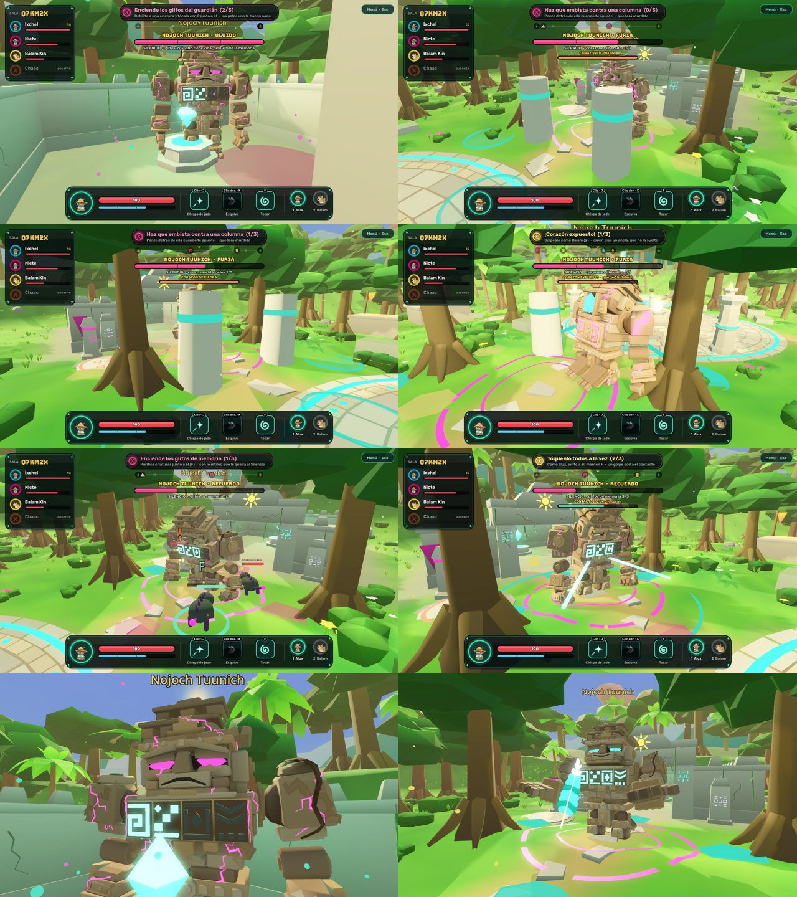
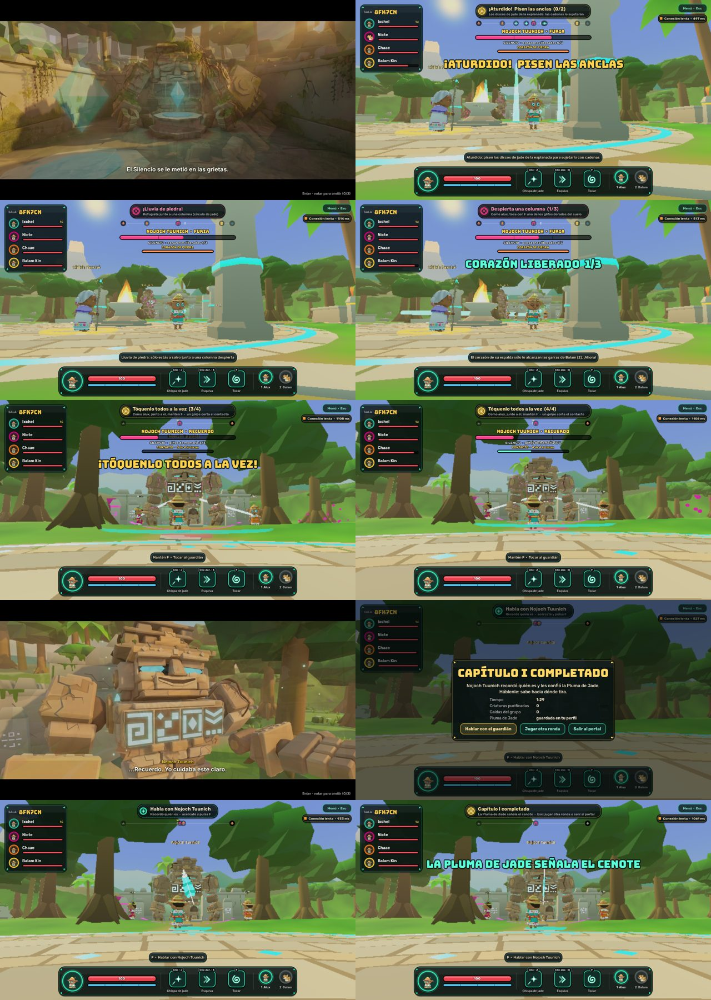
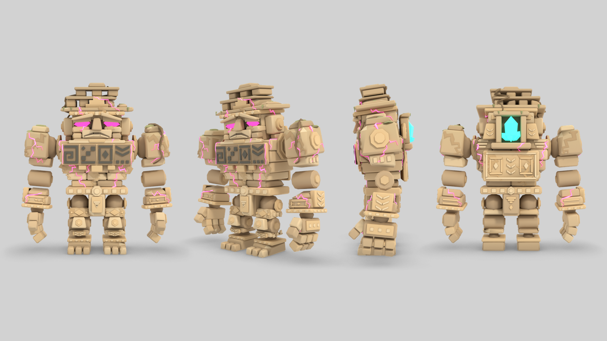
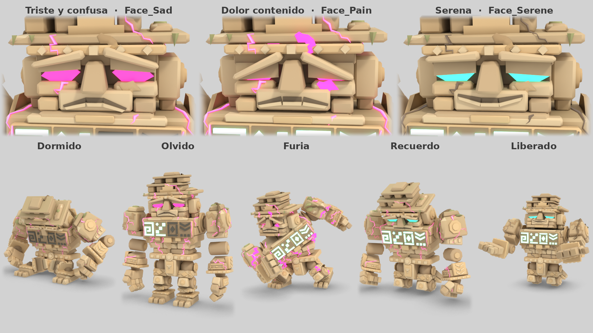
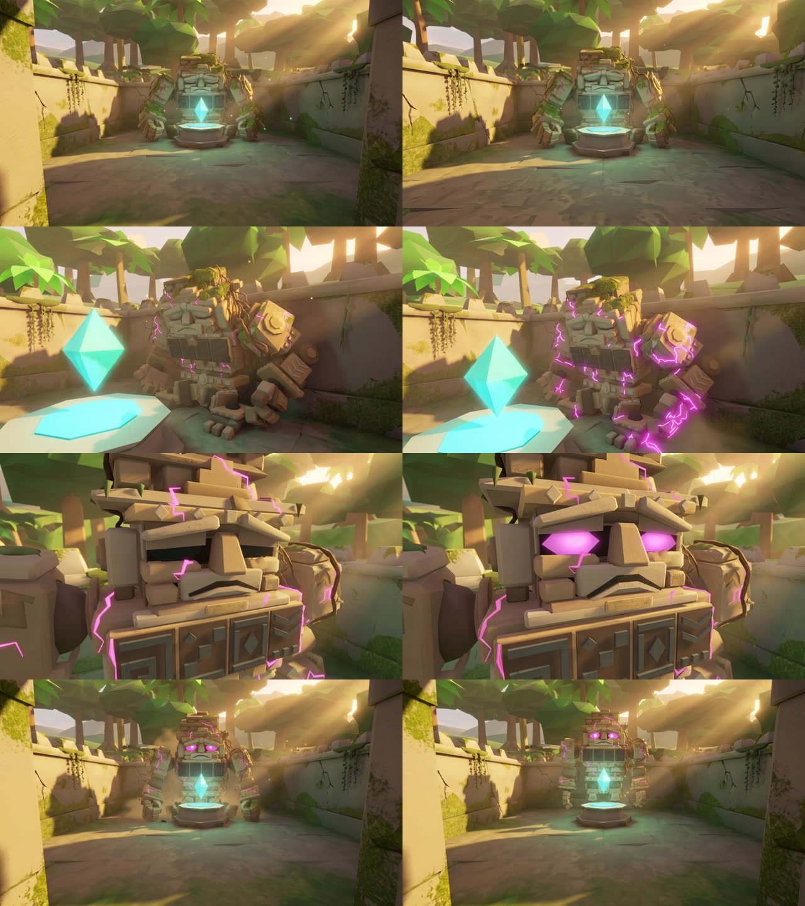
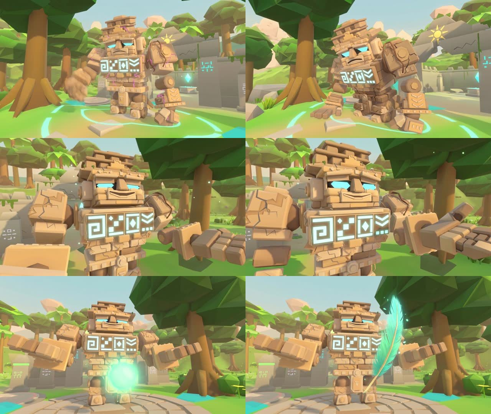

# Nojoch Tuunich, el Guardián Dormido

Primer jefe de ALUX (Alpha 0.3). Concepto aprobado el 12 de noviembre de 2026: tres fases
cooperativas, fase 2 en la explanada, reintento por fases, recompensas persistentes sin duplicar y
la Pluma de Jade como recompensa final.

| Parte | Estado |
| --- | --- |
| Las tres fases en el servidor | **Hechas y probadas** con bots para 1, 2 y 4 jugadores (combate completo, reintento por fase, desconexiones) |
| Las tres fases en el cliente | **Hechas**: escenario del combate, barra, objetivos, avisos, sonido y música. Probadas en un navegador real con una jugadora y tres bots; **sin probar con personas** |
| Modelo del coloso | **Definitivo** (ver «El modelo») |
| Pluma de Jade | **Hecha**: la entrega el servidor, una por jugador, aparece en el perfil y abre la pista del Cenote |
| Cinemáticas de despertar y liberación | Versión del motor **hecha** (es el respaldo). Vídeos de Kling: ver «Cinemáticas» |

Resumen del capítulo y de las formas: [GAME_DESIGN.md](GAME_DESIGN.md) · Historia: [STORY_BIBLE.md](STORY_BIBLE.md) ·
Cinemáticas: [CINEMATICS.md](CINEMATICS.md).

## Qué es

Un coloso de caliza tallada que duerme sentado en el patio del santuario desde antes de que hubiera
aluxes. Guardaba la primera pluma de Kukulkán. El Silencio no lo corrompió: le hizo **olvidar a
quién cuida**, y al despertar ve intrusos. No se le mata: se le hace **recordar**.

Por eso su barra no es de vida sino de **Silencio**: baja cuando el grupo le devuelve memoria, no
cuando le pega. Los golpes directos no le hacen nada en ninguna fase (suenan a piedra y un aviso lo
explica).

| | |
| --- | --- |
| Tamaño | 3.4 m sentado, 5 m de pie (un alux mide 1.1 m) |
| Dónde | Fase 1 en el patio del santuario; fases 2 y 3 en la explanada de delante |
| Cuándo | Al entrar el grupo al patio tras superar la emboscada |
| Silencio | 100 → 66 al acabar la fase 1 → 55, 44, 33 con cada corazón → 0 al liberarlo |

## El combate pide repartirse

| Lo que hace falta | Sólo lo puede hacer | Con qué |
| --- | --- | --- |
| Devolver la memoria a una criatura | El alux | Tocar (F) |
| Despertar una columna de la explanada | El alux | Tocar (F) su glifo dorado |
| Sujetar al guardián aturdido | Cualquiera | Pisar un ancla de jade (en grupo, sin soltarla) |
| Golpear el corazón expuesto | Balam | Garras, zarpazo cargado o salto |
| Despertarlo del todo | Todos como alux, a la vez | Mantener F junto a él |

Nadie queda atado a una forma: cualquiera cambia con 1 y 2 en cualquier momento.

## Fases

### 1. Olvido — en el patio

El guardián se levanta y pelea despacio. Su pecho está apagado y su cara es de tristeza y confusión.

| Ataque | Aviso | Efecto | Cómo se responde |
| --- | --- | --- | --- |
| **Golpe de losa** | Levanta el puño 1.2 s; círculo en el suelo (3.5 m) | Daño alto y 12 s de escombros cargados de Silencio que dañan a quien los pisa | Salir del círculo; después, rodear los escombros |
| **Barrido** | Gira el torso 0.9 s; abanico de 140° | Daño medio y empujón | Esquiva del alux o salto de Balam |
| **Llamada del Silencio** | Golpea el suelo con las dos manos | Salen criaturas corrompidas de los muros (2 a 4 según el grupo) | Ver abajo |

**Cómo avanza:** cada criatura **purificada a menos de 6 m de él** enciende uno de los glifos del
pecho (y por un instante la cara se le ablanda). Romperlas no cuenta. Con los glifos encendidos
(2 jugando solo, 3 en pareja, 4 con tres o cuatro) empieza la fase 2.

### 2. Furia — «El corazón de piedra», en la explanada

Recuerda un instante, de rodillas… y el Silencio lo arrastra fuera: **sale del santuario de un
salto**. Se agacha (1,3 s, con un círculo en la explanada donde va a caer), vuela en arco por encima
del muro (1,7 s) y cae en el centro de la explanada, empujando sin daño a quien esté debajo. A
ningún jugador se le mueve de sitio; el punto de reaparición pasa a estar camino de la plaza, fuera
de su alcance.

*Por qué un salto (Alpha 0.4.1):* antes cruzaba el portal andando y, al rodear el pedestal, podía
quedarse hasta 5 s empujando contra él (en 7 de 121 posiciones de salida simuladas, incluida la de
reposo). El salto no depende de colisiones ni de caber por el portal: dura siempre lo mismo. El
servidor lo lleva en línea recta; la altura del arco sólo se dibuja.

| Elemento | Qué es | Reglas |
| --- | --- | --- |
| **Columnas** | Seis glifos dorados en el suelo. Un alux los toca (F) y sube una columna | Tres a la vez como mucho; cada una dura 50 s. No sube debajo del guardián |
| **Lluvia de piedra** | Aviso de 2 s y 4 s de cascotes en toda la explanada | Sólo se está a salvo a menos de 2.6 m de una columna despierta (círculo de jade) |
| **Embestida** | Apunta 1.6 s (carril en el suelo); medio segundo antes de salir fija la dirección y el carril se enciende | Corre en línea recta. Si choca contra una columna, **la rompe y queda aturdido 7 s** |
| **Anclas** | Cuatro discos de jade en la explanada. Sólo responden con el guardián aturdido o sujeto | Hay que tener activas 1 (uno o dos jugadores) o 2 (tres o cuatro). En grupo se sueltan a los 2 s de dejar de pisarlas; jugando solo aguantan toda la ventana |
| **Cadenas de jade** | Con las anclas activas, lo sujetan 9 s y **el corazón de la espalda queda expuesto** | Sólo los golpes de Balam le quitan aguante (90; 135 con cuatro jugadores). Lo quitado no se recupera entre ventanas |
| Golpe de losa y Barrido | Como en la fase 1 | |

**Cómo avanza:** cada corazón liberado baja el Silencio. Con **tres** empieza la fase 3.

Lo que cambió respecto al diseño aprobado, y por qué: las columnas las despiertan los jugadores (así
es una decisión del grupo y no una espera) y la embestida se corta contra una columna, no contra un
ancla; las anclas son discos nuevos de la explanada, no los altares de la plaza (quedaban a más de
20 m); y no hay muros que caigan ni suelo que se hunda: las columnas no son sólidas, sólo dan
refugio y paran la embestida. Sólidos que aparecen y desaparecen en la simulación compartida quedan
como mejora posterior (ver «Pendiente»).

### 3. Recuerdo — «La memoria restaurada»

Se arrodilla en el centro de la explanada. El Silencio se resiste por última vez.

| Paso | Qué hay que hacer | Reglas |
| --- | --- | --- |
| **Glifos de memoria** | Purificar criaturas junto a él enciende los glifos del suelo (1, 2, 2 o 3 según el grupo) | Llegan criaturas de los bordes cada 9 s, con un máximo en pie según el grupo |
| **Contacto** | Todos los que sigan en pie, como alux y a menos de 4.6 m, **mantienen F a la vez** durante 3 s (4 s jugando solo) | Un golpe corta el contacto de quien lo recibe durante 1 s; si falta alguien, lo acumulado se pierde poco a poco |
| **Pulso de Silencio** | Con el contacto abierto, cada 11 s (aviso de 1.5 s) empuja a quien esté a menos de 3.6 m | No llega al borde del círculo de contacto: tocándolo desde los glifos del suelo no hay que soltarlo |

**Quién cuenta para el contacto:** los conectados que estén en pie y a menos de 30 m. Quien se cae
de la sala, está abatido o se ha ido lejos **no bloquea** al resto; si vuelve, el contacto vuelve a
exigirle.

Al completarse: el Silencio llega a 0, las criaturas se deshacen, se anota en la historia de la
sala, el servidor entrega la Pluma de Jade y empieza «La liberación».

## Reglas generales

| Tema | Regla |
| --- | --- |
| Escala | Glifos, criaturas, anclas, aguante del corazón y glifos de memoria según los conectados. El daño usa la escala que ya existía (×0.6 / ×0.8 / ×1 / ×1) |
| Derrota | Si cae todo el grupo, el guardián se duerme donde se libra la fase y se reintenta desde el principio de la **fase alcanzada**, con su Silencio de partida. En las fases 2 y 3 despierta al acercarse a él |
| Caídas | Reaparecer tarda 8 s. Desde la fase 2, en el camino de la plaza |
| Quién decide | El servidor: fases, ataques, glifos, columnas, anclas, corazón, contacto, liberación, historia y recompensa. El cliente sólo dibuja |
| Trampas | Ningún mensaje del cliente puede saltarse una fase, encender un glifo, activar un ancla, tocar el corazón ni darse la pluma (probado) |
| Sin atascos | Ninguna fase depende de que el jefe haga un ataque concreto: las criaturas, la embestida y la lluvia vuelven cada cierto tiempo, y las columnas las ponen los jugadores |
| Otra ronda | Tras vencerlo, la sala puede votar otra ronda; el jefe vuelve a dormirse en el patio. Las cinemáticas no se repiten en la misma sala y la pluma no se duplica |

## Qué ve y oye el jugador

| Dónde | Qué dice |
| --- | --- |
| Barra superior | «NOJOCH TUUNICH · Olvido / Furia / Recuerdo», barra magenta de Silencio y debajo lo que cuenta en la fase: glifos, corazones liberados o glifos de memoria |
| Segunda barra | Fase 2: el aguante del corazón («CORAZÓN EXPUESTO · ¡garras de Balam!» con las cadenas puestas). Fase 3: el contacto («2 de 4 lo tocan») |
| Objetivo | Cambia con cada momento: «Despierta una columna», «Haz que embista contra una columna», «¡Lluvia de piedra!», «¡Aturdido! Pisen las anclas (1/2)», «¡Corazón expuesto!», «Enciende los glifos de memoria», «Tóquenlo todos a la vez (3/4)» |
| Guía de la fase (derecha) | Los pasos de la fase en curso, numerados, con el que toca ahora resaltado y los hechos marcados: fase 1 «esquiva → debilita una criatura → purifícala con F cerca de él»; fase 2 «despierta una columna → que embista contra ella → pisen las anclas → Balam golpea el corazón»; fase 3 «glifos de memoria → tócalo con F». Debajo, el contador que importa |
| Balizas en el mundo | Un haz de luz y una flecha sobre aquello a lo que hay que ir en el paso activo: criaturas ya purificables, glifos dorados de las columnas, la columna que hay que poner en medio, anclas libres, el corazón, el guardián para el contacto |
| Golpe sin efecto | Cada golpe inútil al guardián deja «Sin efecto» sobre él; cada pocos segundos, además, una frase con qué hacer en su lugar en esa fase, y la guía parpadea |
| Pista junto al personaje | Qué hace F aquí y con qué forma: despertar la columna, pisar el ancla, golpear el corazón, tocar al guardián |
| Avisos de una vez | Qué es el Silencio, cómo va la lluvia, la embestida, las anclas, el corazón y el contacto: cada uno la primera vez que hace falta |
| Brújula | Las anclas mientras está aturdido; el guardián liberado; el cenote cuando ya dio la pista |
| En el escenario | Avisos de cada ataque en el suelo, carril de la embestida que se enciende al fijarse, círculos de refugio, cadenas, haces de contacto, cascotes y polvo |
| Sonido y música | 31 sonidos propios (pasos, avisos, losa, embestida, choque, cadenas, corazón, glifos, liberación…) y una música por fase |
| Cámara | Sacudida moderada en los impactos. Se regula en el menú («Sacudida de cámara») y empieza en cero si el sistema pide menos movimiento |
| Chiich Yaxché | Durante el combate: «No lo rompan: no se puede, y además es mi amigo». Después: «Les dio la Pluma de Jade. No la pierdan» |

## El modelo

Hecho por código en Blender, como los demás: **11 006 triángulos, 30 huesos, 1.01 MB**, sin
texturas. Misma silueta que la propuesta aprobada, con lo que se pidió cambiar:

| Pedido | Hecho |
| --- | --- |
| Menos agresivo, rostro más expresivo | Cejas, comisuras, párpados y mandíbula móviles. Nunca frunce el ceño: la furia se lee como **dolor contenido** |
| Tristeza o confusión al principio | Es su expresión de reposo (cejas caídas y desiguales, boca hacia abajo) |
| Serenidad al recordar | Tercera expresión; el juego se acerca a ella según avanza el ritual y se queda en ella al liberarlo. Cada glifo encendido se la adelanta un instante |
| Más detalle en espalda, piernas y antebrazos | Espaldar tallado con el corazón de cristal, grebas, brazales y rótulas |
| Caliza cálida, musgo discreto | Crema al sol y arena a la sombra; el cristal del patio ya no lo tiñe de verde |
| Articulaciones definidas | Goznes y rótulas; los sillares vecinos están rebajados para no cruzarse |
| Grietas magenta que evolucionan | Vetas base (tenues dormido, vivas en Olvido) y una segunda red de grietas que sólo se enciende en Furia. Al liberarlo quedan como cicatrices |
| Glifos de jade que se encienden | Cuatro en el pecho, uno por material, apagados de serie |

| Fase | Rostro | Ojos | Vetas | Grietas de furia | Glifos | Corazón |
| --- | --- | --- | --- | --- | --- | --- |
| Dormido | Párpados cerrados | Apagados | Tenues | No | Apagados | Tenue |
| Olvido | Triste y confuso | Magenta | Vivas, latiendo despacio | No | Se encienden de uno en uno | Normal |
| Furia | Dolor contenido | Magenta intenso | Más vivas, rápidas | **Sí** | Encendidos | Late fuerte cuando está expuesto |
| Recuerdo | De triste a sereno | Jade | Apagándose | No | Encendidos | Brillante |
| Liberado | Sereno | Jade | Cicatrices | No | Encendidos | Muy brillante |

**Animaciones revisadas en movimiento** (once, más las tres expresiones): se dibujaron cuadro a
cuadro con el renderer del juego y se midieron pies que patinan, saltos y hundimientos. Lo
corregido: `Walk` estaba compuesta para otra velocidad y patinaba; `Charge` era una carrera que a
12 m/s resbalaba (ahora es una embestida de hombro); manos en el aire al dormir; saltos al soltar
un apoyo; espinillas que se hundían hasta 7.6 cm (ahora 5 mm como mucho); sillares que se cruzaban
en codos, rodillas y caderas. Vídeo de todas: `art/propuestas/nojoch/nojoch_animaciones.mp4`; una
por una en `art/propuestas/nojoch/animaciones/`.

**Hoja para Kling:** `art/referencias/nojoch_frente|lado|espalda|tres_cuartos.png`,
`nojoch_hoja.png` y `nojoch_liberado_hoja.png`.

**Lo que sigue flojo** (detalle en `art/propuestas/nojoch/README.md`): la crestería no se tocó y
de frente se lee como losas apiladas; codos y rodillas son tambores lisos; aún se cruzan los dedos
al cerrar el puño y el muslo con el faldón al sentarse; la diferencia entre la cara triste y la de
dolor se nota poco de lejos (la llevan más las grietas); el corazón está tras la cabeza, no entre
los omóplatos.

## Cinemáticas

Las dos son compartidas: las empieza el servidor, pausan la sala, se omiten por mayoría y se ven
una sola vez por sala. Cada plano tiene su versión del motor (lo que se ve si el vídeo falta o
falla) y su vídeo de Kling. El sonido de cada plano y los subtítulos los pone el juego, igual con
vídeo que sin él, por los buses de volumen de siempre.

### «El despertar de Nojoch Tuunich»

La primera vez que el grupo entra al patio con la emboscada superada. 16 s, cuatro planos, sin
jugadores en cuadro. **Termina con el guardián en pie tras el pedestal, de cara al portal:
exactamente donde empieza el combate** (el servidor salta lo que quedaba de «levantarse»).

| Plano | Qué pasa | Subtítulo | Sonido |
| --- | --- | --- | --- |
| 1. El patio en silencio (4 s) | Desde el portal, el coloso sentado al fondo, tras el cristal | «Al fondo del patio, algo duerme desde antes que la selva.» | `cine_patio_silencio` |
| 2. Las grietas (4 s) | De lado: el Silencio le recorre el pecho; las vetas pasan de tenues a vivas | «El Silencio se le metió en las grietas.» | `cine_grietas` |
| 3. Los ojos (4 s) | Primer plano: tiembla, alza la cabeza, los ojos se encienden en magenta. Cara triste | «Nojoch Tuunich abre los ojos… y no reconoce a nadie.» | `cine_ojos` |
| 4. En pie (4 s) | Contrapicado: se empuja con los puños y se yergue | Rótulo «Nojoch Tuunich · El Guardián Dormido» | `cine_en_pie` |

### «La liberación de Nojoch Tuunich»

Al completarse el contacto del ritual. 12 s, tres planos, en la explanada. **No aparece ningún
alux**: la pluma se entrega hacia la cámara, que es el grupo. Termina como queda el juego: el
guardián de rodillas, sereno, con la Pluma de Jade flotando ante él.

| Plano | Qué pasa | Subtítulo | Sonido |
| --- | --- | --- | --- |
| 1. El Silencio se va (4 s) | De rodillas; las vetas se apagan y se desprenden motas magenta | «El Silencio lo suelta. Grieta a grieta.» | `cine_silencio_se_va` |
| 2. La serenidad (4 s) | Primer plano: ojos de jade, glifos encendidos, la cara serena | Nojoch Tuunich: «…Recuerdo. Yo cuidaba este claro.» | `glifo_restaurado` |
| 3. La entrega (4 s) | Tiende las manos abiertas; la pluma sale de ellas y flota hacia el grupo | Rótulo «La Pluma de Jade» · «La primera pluma de Kukulkán. Ahora la guardan ustedes.» | `cine_pluma` |

### Vídeos de Kling

Registro completo (cada generación, coste, prompt y resultado): `art/cinematicas/jefe/kling/PRODUCCION.md`.

| | «El despertar» | «La liberación» |
| --- | --- | --- |
| Estado | **Producida e integrada** | **Producida e integrada** |
| Máximo aprobado | 450 | 350 |
| Declarado por las generaciones | 280 (6 cuadros, 5 vídeos; 2 descartes) | 228 (5 cuadros, 4 vídeos; 1 descarte) |
| Consumido según el saldo | **488 en total** (2 375 → 1 887) | |
| Peso para el jugador | 2.00 MB en MP4 o 1.08 MB en WebM | 1.72 MB o 1.09 MB |

Lo que cambió respecto al storyboard: el plano 4 del despertar es ancho desde el portal (la cámara
del combate) en vez de un contrapicado, porque así salió el cuadro de referencia y así termina
exactamente como empieza la pelea. Lo que hubo que repetir: un plano en el que Kling le puso ojos
con pupila y otro en el que levantaba un puño donde tocaba serenidad.

## Recompensa y enlace con el Capítulo II

| | |
| --- | --- |
| Qué es | **La Pluma de Jade**, primera pluma de Kukulkán. Un objeto ancestral, no una transformación: no desbloquea habilidades |
| Cómo aparece | Sale de las manos del guardián en «La liberación» y se queda flotando ante él |
| Cómo se entrega | La pide el servidor a la API en cuanto se completa el ritual, para todos los que libraron el combate (también quien se cayó de la sala hace un momento). La API la anota **una vez por jugador**, aunque la gane en varias salas o se repita la petición |
| Dónde se ve | En el perfil del portal como «Objeto ancestral · Pluma de Jade · Tira hacia el agua del cenote»; en el juego, en el panel «Capítulo I completado» |
| Qué abre | Hablar con el guardián liberado (a su lado; lo valida el servidor): cuenta que la pluma tira hacia el cenote, la brújula lo marca y el objetivo pasa a «Capítulo I completado · La Pluma de Jade señala el cenote». Chiich Yaxché lo comenta |
| Lo que cuenta | La pluma no es un trofeo: es una brújula. Abajo hay otro guardián al que no hicieron olvidar: lo hicieron callar |

## Pendiente

| Qué | Por qué queda fuera de la 0.3 |
| --- | --- |
| Probar el combate con personas | Sólo lo han jugado bots y una jugadora simulada: el ritmo, la dificultad y si las pistas bastan están sin validar |
| Escenario que cambia de verdad (muros que caen, suelo hundido, columnas sólidas) | Exige sólidos dinámicos en la simulación compartida entre cliente y servidor. Hoy las columnas dan refugio y paran la embestida, pero se pueden atravesar |
| El corazón «a 3 m de altura» que pedía salto | Se dejó al alcance de las garras: con un solo Balam y ventanas de 9 s, exigir puntería en salto lo hacía injusto jugando solo |
| Una pluma en el tocado del alux | Es apariencia de personaje: mejor decidirla con el sistema de personalización |
| La escalera del cenote y su «Próximamente» | Es escenario del Capítulo II |
| «El sello cede», plano 3 | El vídeo publicado enseña el patio **sin** el coloso (se produjo antes de que existiera). Rehacer ese plano son 24–44 créditos; no está dentro de los presupuestos aprobados |

## Decisiones tomadas

| Decisión | Elegido |
| --- | --- |
| Barra de Silencio en vez de vida | Silencio: es lo que distingue a este jefe y encaja con «recordar, no destruir» |
| El combate sale del patio en la fase 2 | Sí: reutiliza la explanada y es el cambio de escenario más vistoso |
| Reintento por fases | Por fase: una derrota a los seis minutos no debe costar otros seis |
| Quién despierta las columnas | Los jugadores (alux, F): es una decisión del grupo y nunca hay que esperar al jefe |
| Pulso de Silencio en la fase 3 | No llega al borde del círculo de contacto: castiga pegarse a él, no tocarlo |
| Audio de las cinemáticas | Sonidos propios por plano, puestos por el juego: suenan igual con vídeo que con el respaldo del motor y respetan los volúmenes. No se usó el audio generado por Kling |
