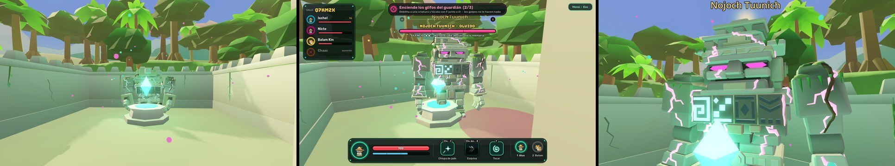
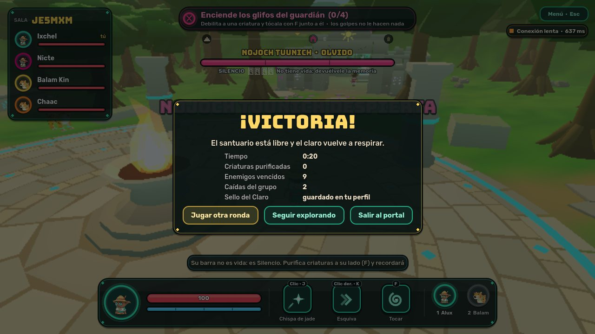
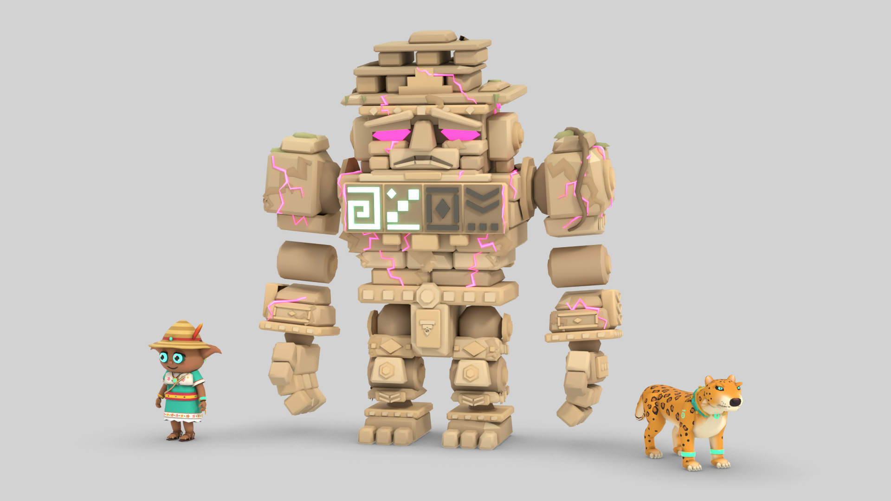
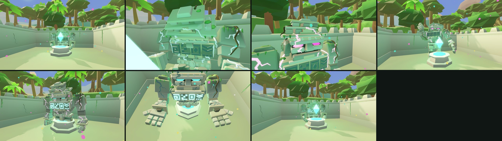

# Nojoch Tuunich, el Guardián Dormido

Diseño del primer jefe de ALUX (Alpha 0.3). **Concepto aprobado el 12 de noviembre de 2026:** tres
fases cooperativas, fase 2 en la explanada, reintento por fases, recompensas persistentes sin
duplicar y la Pluma de Jade como recompensa final. No se ha gastado ningún crédito de Kling en él.

| Parte | Estado |
| --- | --- |
| Fase 1 (Olvido) en el servidor | **Hecha y probada** con bots para 1, 2 y 4 jugadores |
| Fase 1 en el cliente: modelo, barra de Silencio, avisos de ataque, objetivo | **Hecha**; vista en capturas, sin probar con personas |
| Modelo del coloso | **Propuesta lista para tu revisión** (`art/propuestas/nojoch/`); en el juego va como provisional |
| Fases 2 y 3, escenario que cambia, recompensa | Diseñadas aquí; **sin programar**. Al completar la fase 1 el guardián queda de rodillas |
| Cinemáticas de despertar y liberación | Storyboards, cuadros clave, prompts y presupuesto listos; **sin producir** hasta que apruebes modelo y créditos |

Resumen del capítulo y de las formas: [GAME_DESIGN.md](GAME_DESIGN.md) · Historia: [STORY_BIBLE.md](STORY_BIBLE.md) ·
Cinemáticas: [CINEMATICS.md](CINEMATICS.md).

## Qué es

Un coloso de caliza tallada que duerme sentado en el patio del santuario desde antes de que hubiera
aluxes. Guardaba la primera pluma de Kukulkán. El Silencio no lo corrompió: le hizo **olvidar a
quién cuida**, y al despertar ve intrusos. No se le mata: se le hace **recordar**.

Por eso su barra no es de vida sino de **Silencio**: baja cuando el grupo le devuelve memoria, no
cuando le pega.

| | |
| --- | --- |
| Tamaño | 3.4 m sentado, 5 m de pie (un alux mide 1.1 m) |
| Aspecto | Bloques de caliza encajados, cabeza ancha con tocado escalonado, cuatro glifos de jade en el pecho, un corazón de cristal en la espalda, musgo y raíces. Vetas magenta mientras está olvidado |
| Dónde | Patio del santuario (12 × 12 m) y, desde la fase 2, la explanada de delante |
| Cuándo | Al entrar el grupo al patio tras superar la emboscada |
| Duración objetivo | 5–7 minutos con cuatro jugadores; 8–10 uno solo |

## El combate pide repartirse

| Lo que hace falta | Sólo lo puede hacer | Con qué |
| --- | --- | --- |
| Devolver la memoria a una criatura | El alux | Tocar (F) |
| Dejar a una criatura lista para purificar sin romperla | Balam | Zarpazo cargado: aturde |
| Sujetar al guardián | El alux, quieto sobre un ancla | Pisar el altar |
| Alcanzar el corazón de la espalda, a 3 m de altura | Balam | Salto alto y salto ofensivo |
| Cubrirse de la lluvia de piedra y curar al grupo | El alux | Brasero y purificación |
| Despertarlo del todo | Todos como alux, a la vez | Tocar (F) |

Nadie queda atado a una forma: cualquiera cambia con 1 y 2 en cualquier momento.

## Fases

### 1. Olvido — en el patio

El guardián se levanta y pelea despacio. Su pecho está apagado.

| Ataque | Aviso | Efecto | Cómo se responde |
| --- | --- | --- | --- |
| **Golpe de losa** | Levanta el puño 1.2 s; círculo en el suelo (3.5 m) | Daño alto. **Rompe las losas**: deja 12 s de escombros cargados de Silencio que hacen daño a quien los pisa. (El hundimiento real del suelo llegará con el escenario que cambia.) | Salir del círculo; después, rodear los escombros |
| **Barrido** | Gira el torso 0.9 s; abanico de 140° | Daño medio y empujón | Esquiva del alux o salto de Balam |
| **Llamada del Silencio** | Golpea el suelo con las dos manos | Salen criaturas corrompidas de los muros (2 a 4 según el grupo) | Ver abajo |

**Cómo avanza:** cada criatura **purificada a menos de 6 m de él** enciende uno de los glifos del
pecho. Balam las aturde y las acerca; el alux las toca. Romperlas no cuenta. Con los glifos
encendidos (2 jugando solo, 4 con cuatro) el Silencio pierde un tercio y empieza la fase 2.

### 2. Furia — el escenario cambia

El guardián arranca los muros del patio: **el lado oeste del santuario se derrumba** y el combate
sale a la explanada, donde brotan del suelo **anclas** (altares de presión) y columnas de piedra.

| Ataque | Aviso | Efecto | Cómo se responde |
| --- | --- | --- | --- |
| **Columnas** | El suelo tiembla en tres puntos | Tres pilares suben del suelo y se quedan: estorban y dan refugio | Apartarse; usarlos después |
| **Lluvia de piedra** | Alza los brazos 2 s; el cielo se oscurece | Caen piedras en toda la explanada durante 4 s | Ponerse **detrás de un pilar** |
| **Embestida** | Rasca el suelo 1.5 s; línea ancha | Corre en línea recta y destroza los pilares que toca | Apartarse de la línea. Si se le hace embestir **contra un ancla**, queda aturdido 5 s |
| Golpe de losa y Barrido | Como antes, más rápidos | | |

**Cómo avanza:** mientras está aturdido, los alux pisan las anclas (tantas como jugadores menos una;
una jugando solo, que se queda pisada 6 s al soltarla) y salen cadenas de jade que lo sujetan de
rodillas. Sólo entonces el **corazón de la espalda** queda expuesto, y sólo Balam llega. Cada vez que
se le suelta, el Silencio baja otro tramo. Tres veces y empieza la fase 3.

### 3. Recuerdo

Cae de rodillas en el centro. Ya no ataca: el Silencio sale de él en una última oleada de criaturas
que van a por quien esté tocándolo.

**Cómo termina:** **todos los conectados**, como alux, lo tocan (F) a la vez durante 3 s, uno en cada
glifo del suelo que rodea sus manos. Quien recibe un golpe se suelta; por eso alguien tiene que
aguantar a las criaturas hasta el último momento y volver a tiempo. Jugando solo, basta sostener el
toque 4 s seguidos.

Las vetas magenta se apagan, los glifos se encienden y el guardián recuerda.

## Reglas generales

| Tema | Regla |
| --- | --- |
| Escala | Silencio, criaturas, glifos y anclas según los conectados, como la emboscada. El daño usa la misma escala que ya existe (×0.6 / ×0.8 / ×1 / ×1) |
| Derrota | Si cae todo el grupo, el guardián vuelve a sentarse y se dormita. Se reintenta desde el principio de la **fase alcanzada**, no desde cero |
| Caídas | Reaparecer tarda 8 s, como en la emboscada, junto a la entrada del patio |
| Quién decide | El servidor: fases, glifos, anclas, huecos del suelo, muros caídos y pilares. El cliente sólo dibuja |
| Trampas | Ningún mensaje del cliente puede saltarse una fase, encender un glifo ni tocar el Silencio |
| Sin atascos | Ninguna fase depende de que el jefe haga un ataque concreto: las criaturas y la embestida vuelven cada cierto tiempo |
| Otra ronda | Tras vencerlo, la sala puede votar otra ronda como hoy; el jefe vuelve a dormirse |

## Cómo se explica la barra de Silencio

| Dónde | Qué dice |
| --- | --- |
| Barra superior | «NOJOCH TUUNICH · Olvido», barra magenta y debajo «SILENCIO · glifos 1/3 · No tiene vida: devuélvele la memoria» |
| Al despertar, una vez | «Su barra no es vida: es Silencio. Purifica criaturas a su lado (F) y recordará» |
| Objetivo | «Enciende los glifos del guardián (1/3) · Debilita a una criatura y tócala con F junto a él · los golpes no le hacen nada» |
| Si se purifica lejos | «Demasiado lejos del guardián: purifícala a su lado para encender un glifo» |
| Al llamar criaturas | «El Silencio trae criaturas: son la llave de su memoria» |
| Chiich Yaxché (pendiente) | Una línea nueva cuando el santuario esté libre: el guardián no es un enemigo, es alguien que olvidó |

## El modelo (propuesta para revisar)

Hecho por código en Blender, como los demás: 8 765 triángulos, 26 huesos, 1.17 MB, sin texturas.
Once animaciones: dormir, despertar, reposo, andar, golpe de losa, barrido, llamada, embestida,
aturdido, de rodillas y recordar. Hojas, poses y medidas en `art/propuestas/nojoch/`.

Cada fase se distingue a la vista sin cambiar de modelo, sólo con materiales y animación:

| Fase | Ojos | Vetas del Silencio | Glifos del pecho | Postura |
| --- | --- | --- | --- | --- |
| Dormido | Apagados | Tenues | Apagados | Sentado, cabeza gacha |
| Olvido | Magenta | Magenta, latiendo despacio | Se encienden en jade de uno en uno | De pie, lento |
| Furia | Magenta intenso | Más vivas, latiendo rápido | Los encendidos se quedan | Agresivo; de rodillas cuando lo sujetan |
| Recuerdo | Jade | Apagándose | Los cuatro encendidos | De rodillas |
| Liberado | Jade | Apagadas (quedan como cicatrices) | Encendidos | Sentado en su sitio, despierto |

**Lo que está flojo y conviene decidir antes de las cinemáticas:** recuerda todavía al gólem de
bloques genérico (le falta talla en espalda y piernas); la cara sale más adusta que serena; la
crestería se lee de frente como un sombrero de losas; con la luz del juego la caliza se ve verdosa;
las animaciones sólo se han visto en cuadros sueltos, no en movimiento; y en algunas poses los
sillares se cruzan en codos y rodillas.

## Qué hay que construir

| Pieza | Reutiliza | Nuevo |
| --- | --- | --- |
| El jefe como entidad | IA de enemigos, avisos de ataque, aturdimiento, escala de daño | Máquina de fases, ataques con patrón, barra de Silencio |
| Glifos y purificación | Purificación de criaturas | Contar sólo las que ocurren cerca de él |
| Anclas | Altares de presión, la regla de «tantos como jugadores» | Cadenas, ventana de corazón expuesto |
| Escenario que cambia | Sólidos del mundo que se abren (el portal ya lo hace) | Muros que caen, losas hundidas, pilares que suben: sólidos que aparecen y desaparecen por orden del servidor |
| Toque de todos a la vez | Regla de los altares | Canalizar el toque y soltarse al recibir daño |
| Presentación y despedida | Cinemáticas compartidas por fases, con vídeo y respaldo del motor | Dos escenas nuevas |
| Modelo | Proceso de Blender por código | El coloso, con sus animaciones |
| Pruebas | Bots de servidor, flujo en navegador | Victoria con 1, 2 y 4; derrota y reintento por fase; nadie se salta fases |

**Riesgos que hay que medir antes:** el coloso y sus efectos en equipos sin tarjeta gráfica potente;
la memoria del servidor (512 MB compartidos); y que el patio de 12 m se queda justo para cinco
cuerpos, por eso la fase 2 sale a la explanada.

## Orden de trabajo propuesto

| Paso | Entrega | Se puede probar |
| --- | --- | --- |
| 1 | Modelo del coloso y sus animaciones | Hojas y capturas |
| 2 | Jefe en el servidor con la fase 1 completa | Bots: se llega a la fase 2 con 1, 2 y 4 jugadores |
| 3 | Escenario que cambia y fase 2 | Bots y navegador |
| 4 | Fase 3, derrota por fases y recompensa | Bots: victoria y reintento |
| 5 | Presentación en el cliente: modelo, avisos, barra, efectos | Flujo completo en navegador |
| 6 | Escenas con el motor (presentación y despedida) | Con cuatro navegadores |
| 7 | Vídeos de Kling de las dos escenas | Tras aprobar diseño y presupuesto |

## Cinemáticas

Las dos son narrativas principales: llevan Kling, con la versión del motor debajo, como «El sello
cede». **No se produce ninguna hasta que apruebes el modelo y el presupuesto.**

Referencias para Kling: los cuadros clave (`art/cinematicas/jefe/`), la hoja del modelo
(`art/propuestas/nojoch/nojoch_hoja.png`) y los cuadros enriquecidos de «El sello cede» como estilo,
para que el patio se vea igual que en esa escena.

### «El despertar de Nojoch Tuunich» (presentación, compartida)

16 s en cuatro planos. Empieza cuando el grupo entra al patio. Sin jugadores en cuadro.

| Plano | Dur. | Qué pasa | Cámara | Cuadro clave |
| --- | --- | --- | --- | --- |
| 1. La estatua | 4 s | El patio en silencio. Al fondo, lo que parecía una estatua cubierta de musgo y raíces. El cristal late una vez. | Del umbral hacia el fondo, muy lenta | `despertar_1` |
| 2. Las grietas | 4 s | Una grieta de luz recorre el pecho de piedra; caen polvo y hojas; las raíces de los hombros se rompen. | Primer plano del pecho, subiendo | `despertar_2` |
| 3. Los ojos | 4 s | Los glifos parpadean en jade un instante… y se tiñen de magenta. Las vetas se encienden. Se abren los ojos. | Primer plano de la cabeza | `despertar_3` |
| 4. De pie | 4 s | El coloso se incorpora, el patio tiembla, alza un puño. | Baja, desde el portal; termina en **la cámara de combate** | `despertar_4` (primer y último cuadro) |

Subtítulos: «El santuario guardaba algo más que un cristal.» · «Nojoch Tuunich, el que cuida.» ·
«…y ya no recuerda a quién.»

| Plano | Prompt (imagen a vídeo, con el cuadro clave enriquecido como primer cuadro) |
| --- | --- |
| 1 | *A quiet walled courtyard of an ancient jungle sanctuary. At the back sits a colossal statue made of stacked limestone blocks with a stepped stone headdress, covered in moss and roots, completely motionless, eyes dark. In front of it a jade crystal floats above a stone pedestal and pulses once with light. Dust motes drift in the golden light. Very slow camera push-in toward the statue. Nothing else moves.* |
| 2 | *Close on the chest of the limestone colossus. A thin crack of light runs across the stone blocks, dust and dry leaves fall, the roots wrapped around its shoulders snap one by one. The four carved glyph panels on its chest stay dark. Slow camera tilt up toward the head.* |
| 3 | *Close-up of the stone head with its stepped headdress. The carved glyphs flicker jade for an instant, then turn magenta; magenta veins of light spread along the cracks of the head and shoulders; the heavy stone eyelids grind open and two magenta eyes ignite. Slow push-in.* |
| 4 | *The limestone colossus rises to its full height, five metres tall, stone blocks grinding, the courtyard trembling and dust pouring from its shoulders. It raises one huge fist. Low wide shot from the gate. It ends standing behind the pedestal, facing the camera.* |

En los cuatro: *Epic stylized 3D animated fantasy film, volumetric light, same statue design, same
courtyard, pedestal and crystal as the first frame. No other characters, no people, no text, no logos.*
Negativo: *photorealistic, humanoid face, extra limbs, weapons, armor, new buildings, text, watermark.*

### «La liberación» (despedida, compartida)

12 s en tres planos, al terminar la fase 3. Entrega la Pluma de Jade.

| Plano | Dur. | Qué pasa | Cámara | Cuadro clave |
| --- | --- | --- | --- | --- |
| 1. El Silencio se va | 4 s | De rodillas. Las vetas magenta se apagan de la cabeza a los pies; los glifos del pecho se encienden en jade uno a uno; los ojos pasan a jade. | Media, girando despacio | `liberacion_1` |
| 2. La pluma | 4 s | Abre las manos: entre ellas flota una pluma de jade que antes no estaba. La acerca hacia delante. | Desde arriba, sin mostrar a los jugadores | `liberacion_2` |
| 3. El que cuida | 4 s | Vuelve a sentarse en su sitio, despierto. La pluma tiembla y gira sola hacia el oeste; lejos, el agua oscura del cenote devuelve un destello. | Del patio hacia fuera, subiendo | `liberacion_3` |

Subtítulos: «Recordó.» · «La primera pluma de Kukulkán.» · «La pluma señala al cenote. Abajo hay
alguien que también olvidó su nombre.»

| Plano | Prompt |
| --- | --- |
| 1 | *The limestone colossus kneels in the courtyard. The magenta veins of light along its cracks fade out from the head down to the feet, leaving dark scars. The four carved glyph panels on its chest light up in jade one by one, and its eyes turn from magenta to calm jade. Slow orbit, warm golden light returning.* |
| 2 | *High angle looking down at the kneeling colossus as it opens its two huge stone hands. Between them a small glowing jade feather appears and floats, turning slowly, shedding motes of jade light. The colossus gently offers it forward.* |
| 3 | *The colossus sits back in its place at the end of the courtyard, awake and serene, jade eyes glowing softly. The jade feather trembles in the air and turns by itself toward the west. Camera rises above the courtyard walls: far away over the jungle canopy, a dark cenote flashes once with light.* |

### Presupuesto de Kling (con los precios medidos; sin aprobar)

Precios reales de «El sello cede»: 20 créditos por cuadro clave enriquecido y 8 por segundo de vídeo
a 1080p. Saldo: 2 375.

| | Despertar | La liberación |
| --- | --- | --- |
| Duración | 16 s | 12 s |
| Cuadros clave enriquecidos | 5 (4 de inicio + el final del plano 4): 100 | 4 (3 de inicio + el final del plano 1): 80 |
| Vídeo, una pasada | 128 | 96 |
| **Una pasada** | **228** | **176** |
| Repeticiones previstas | 1 por plano de media: un coloso animado falla más que un escenario (en «El sello cede», sin personajes, hubo 1 de 7) | Igual |
| **Máximo propuesto** | **450** | **350** |

Sin medir: si conviene registrar al coloso como «sujeto» de Kling para fijar su diseño entre planos;
se probaría con la primera toma, dentro del máximo.

**Qué falta antes de producirlas:** tu visto bueno al modelo (o los cambios que pidas), la versión
del motor de las dos escenas (los planos con estas mismas cámaras) y, para la liberación, la fase 3.

## Recompensa y enlace con el Capítulo II

| | |
| --- | --- |
| Recompensa | **La Pluma de Jade**, primera pluma de Kukulkán. Persistente, una por jugador, como el Sello del Claro |
| Se nota en | El perfil del portal y una pluma en el tocado del alux |
| Qué abre | El guardián, despierto, se queda en el claro como personaje con quien hablar. El agua del cenote se aclara y aparece la escalera que baja: la entrada al Capítulo II, cerrada con un «Próximamente» hasta la Alpha 0.5 |
| Lo que cuenta | La pluma no es un trofeo: es una brújula. Señala a Áayin, el espíritu del cenote, que también olvidó su nombre |

Esto adelanta a la 0.3 la recompensa que la hoja de ruta ponía en la 0.4. La 0.4 queda para el
vínculo de Balam como desbloqueo narrativo y el pulido del capítulo.

## Decisiones

Aprobadas el 12 de noviembre de 2026: barra de Silencio (explicada en la interfaz y la narrativa),
tres fases cooperativas, fase 2 en la explanada, reintento por fases, recompensas sin duplicar y la
Pluma de Jade como recompensa final. Quedan abiertas:

| Decisión | Opciones | Recomendación |
| --- | --- | --- |
| Modelo del coloso | Aprobarlo · pedir cambios (cara más serena, más talla, otra crestería) | Pedir al menos la cara y la talla antes de hacer vídeos con él |
| Presupuesto de las dos cinemáticas | 450 + 350 créditos · menos · esperar | Aprobarlo cuando el modelo esté cerrado |

Decisiones ya tomadas (se conservan como registro):

| Decisión | Opciones | Recomendación |
| --- | --- | --- |
| Barra de Silencio en vez de vida | Así · barra de vida clásica | Silencio: es lo que distingue a este jefe y encaja con «recordar, no destruir» |
| El combate sale del patio en la fase 2 | Sí · todo dentro del patio (habría que agrandarlo) | Salir: reutiliza la explanada y es el cambio de escenario más vistoso |
| Reintento por fases | Por fase · desde cero | Por fase: una derrota a los seis minutos no debe costar otros seis |
| Pluma de Jade en la 0.3 | Adelantarla · dejarla en la 0.4 | Adelantarla: sin recompensa el jefe no cierra nada |
