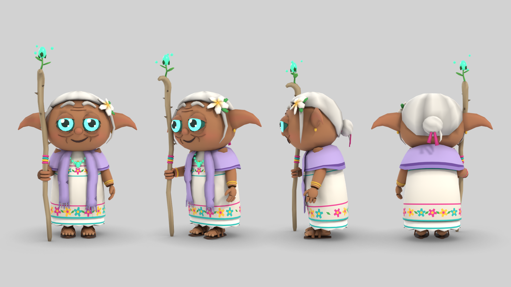
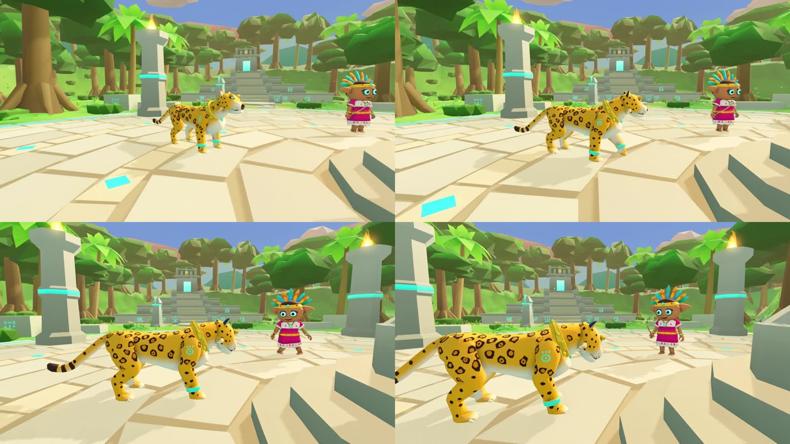
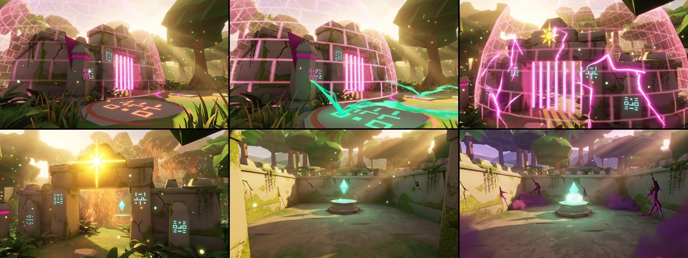
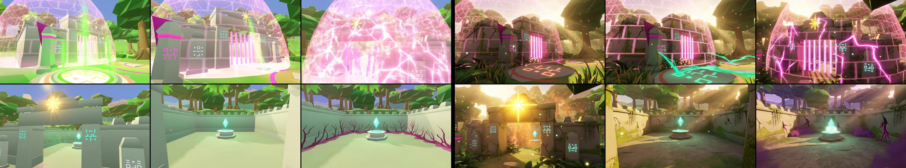

# Cinemáticas de ALUX

Dirección cinematográfica oficial: qué es una cinemática narrativa, cómo se produce con Kling, cómo
se reproduce en una partida cooperativa sin romperla y en qué estado está cada una.

## Política

1. **Toda cinemática narrativa lleva un componente producido con Kling.** Son narrativas: la
   introducción del juego, la presentación de personajes importantes, el vínculo con cada espíritu
   (transformaciones), las revelaciones de la historia, la presentación de jefes, la apertura y el
   final de cada capítulo y todo lo relacionado con Kukulkán.
2. **No llevan Kling** el combate, el movimiento, los diálogos interactivos ni los eventos menores:
   funcionan mejor en tiempo real. Una escena interactiva no se sustituye por un vídeo.
3. **Ninguna escena depende de que un vídeo cargue.** Cada plano de vídeo tiene debajo el mismo plano
   hecho con el motor; si el vídeo falta, falla o se atasca, se ve ese y la partida sigue.
4. **El servidor manda.** Empieza la escena, pausa la sala, cuenta los votos, la termina y reanuda.
   El progreso y las recompensas nunca dependen del reloj de un vídeo.
5. **Kling no rediseña.** Personajes y lugares salen de los modelos del juego: cada plano parte de un
   cuadro hecho con el propio juego y de las hojas de personaje. Nada fotorrealista ni con aspecto de
   otro motor: fantasía 3D estilizada, formas expresivas, luz de cine, elementos de Yucatán.
6. **El alux del jugador no sale con una cara fija.** Cada quien elige color y sombrero, así que en
   vídeo sólo aparece de forma que no lo contradiga (encuadres de ambiente, sombras, punto de vista,
   espíritus); cuando hace falta verlo, ese tramo se hace con el motor y su aspecto real.
7. **Los créditos se aprueban por cinemática**, con presupuesto máximo. Dentro del límite aprobado
   se generan las tomas necesarias sin pedir permiso una a una.

## Cómo está hecho (sistema híbrido Godot + vídeo)

**Lo que se comprobó del motor:** Godot 4.5 en el navegador sólo reproduce Ogg Theora, decodificado
por software en el hilo del juego; no reproduce MP4 ni WebM. Por eso los vídeos los reproduce el
navegador en un `<video>` colocado encima del lienzo, y el juego lo dirige por un puente.

| Pieza | Archivo | Qué hace |
| --- | --- | --- |
| Guiones | `game/scripts/shared/story_def.gd` (`CUTSCENES`) | Planos: duración, cámara, texto, sonido y, si lo hay, `video` |
| Reproductor | `game/scripts/client/cinematics/cutscene.gd` | Mueve la cámara plano a plano; si el plano tiene vídeo listo lo pone encima y vigila que avance. Mide la escena con el reloj real: un navegador lento no se retrasa respecto al servidor |
| Puente (juego) | `game/scripts/client/cinematics/video_bridge.gd` | Órdenes y consultas al navegador; fuera de la web responde «no hay vídeo» |
| Puente (navegador) | `game/web/static/cine-video.js` | Manifiesto, precarga, `<video>` sobre el juego, subtítulos, registro de fallos |
| Vídeos y manifiesto | `game/web/static/video/` | `manifest.json` y los archivos; se copian al portal al compilar |
| Transiciones e interfaz | `game/scripts/client/hud.gd` | Fundido a negro, franjas, subtítulos, aviso de omitir |
| Fases en la sala | `game/scripts/server/game_server.gd` | Preparación, inicio compartido, votos, fin y reanudación |

Un plano con vídeo sólo añade un campo; el resto es el plano del motor que sirve de respaldo:

```gdscript
{"dur": 4.0, "from": [Vector3(15.5, 3.2, 4.0), Vector3(26, 3.2, 0)], "to": [Vector3(17.5, 2.6, 2.2), Vector3(27, 3.8, 0)],
	"text": "…y el sello cede.", "sound": "santuario_abre", "video": "sello_2"}
```

Y el vídeo se declara en `game/web/static/video/manifest.json` (hoy contiene los tres planos de «El sello cede»):

```json
{ "v": 1, "clips": { "sello_2": { "src": { "mp4": "sello_2.mp4", "webm": "sello_2.webm" }, "dur": 4.0, "audio": false, "v": "855744486e" } } }
```

Añadir o cambiar un vídeo es dejar los archivos y su entrada en el manifiesto; no hay que tocar el
juego. `v` es la versión: va en la dirección, así el navegador puede guardar el archivo un año.

### En el navegador

| Tema | Cómo se resuelve |
| --- | --- |
| Formatos | MP4 (H.264) y WebM (VP9), 720p. Se descarga sólo el que el navegador reproduce. «El sello cede» pesa 2.63 MB en MP4 o 2.03 MB en WebM. |
| Precarga | En dos etapas. **Descarga** al entrar a la partida, con prioridad baja y de uno en uno: el archivo se baja entero, así no hay cortes por red a mitad. **Decodificación** sólo justo antes de la escena (durante la preparación) y se libera al terminar. Se midió por qué: con los decodificadores abiertos toda la partida, cuatro navegadores sin tarjeta gráfica en un mismo equipo dejaban de poder jugar. |
| Caché | Vídeos con versión en la dirección y caché de un año; el manifiesto se revalida en cada visita. |
| Sonido | Por defecto en silencio (suena el audio del juego, con los volúmenes del jugador). Un vídeo marcado `audio` suena sólo si el usuario ya interactuó con la página; si el navegador lo bloquea, se reproduce mudo. |
| Subtítulos | Los mismos textos del guion, dibujados por la página sobre el vídeo (no van quemados). |
| Rendimiento | Mientras el vídeo tapa el juego, el mundo 3D no se dibuja. |
| Fallos | Sin manifiesto, archivo ausente, formato no soportado, descarga lenta, error al decodificar, bloqueo de reproducción y vídeo atascado: en todos se ve la escena del motor. Cada fallo queda en el registro del navegador y en las métricas de la sesión (`cine` en `/api/v1/telemetry`). |
| Seguridad | Sólo archivos del mismo sitio declarados en el manifiesto; el juego pasa identificadores y textos, nunca código ni HTML. |

### En la sala (compartidas)

```
PREPARING ──(todos listos o 5 s)──▶ PLAYING ──(duración o mayoría)──▶ RESUMING ──(1 s)──▶ partida
```

| Fase | Servidor | Cliente |
| --- | --- | --- |
| **PREPARING** | Pausa la sala y avisa (`cine_prep`). Espera a que cada conectado conteste `cine_ready`, como mucho 5 s. | Oculta la interfaz, funde a negro, comprueba si tiene los vídeos y contesta (con vídeo o sin él). |
| **PLAYING** | Orden de inicio para todos a la vez (`cine`). Cuenta la duración y los votos. | Reproduce vídeo o motor, según lo que tenga. Enter vota omitir. |
| **RESUMING** | `cine_end`; la sala sigue en pausa 1 s más: nadie recibe daño en la transición. | Corte a negro, la cámara vuelve detrás del personaje, fundido de entrada, interfaz de juego. |

| Regla | Detalle |
| --- | --- |
| El vídeo no viaja por el WebSocket | Cada navegador lo descarga por HTTP; el servidor sólo manda órdenes. |
| Nadie bloquea a nadie | Quien no contesta (descarga colgada, versión vieja) retrasa el inicio como mucho 5 s. Quien se desconecta deja de contar al instante. |
| Omitir | Mayoría de los conectados (1 de 1, 2 de 2, 2 de 3, 3 de 4). Sólo durante la reproducción. Un jugador solo omite al instante. |
| Reconexión | Quien vuelve o entra a mitad recibe la fase y el punto por el que va (`at`) y se engancha ahí; si ya terminó, entra directo a la partida. |
| Sin duplicados | Una vez por sala. Otra ronda o una reconexión no la repiten ni repiten sus consecuencias. |
| Diferencias entre clientes | Cada uno puede ir unas décimas adelantado o atrasado. El final lo marca el servidor para todos; el último plano se corta si un cliente iba tarde. |
| Sólo en puntos seguros | Nunca en mitad de un combate. |

Las **locales** (la introducción) no pasan por el servidor: cada jugador la ve y la omite en su
pantalla, y usan el mismo reproductor y los mismos vídeos.

### Integración con el juego

- **Entrada:** fundido a negro desde la cámara de juego (0.45 s) durante la preparación.
- **Salida:** corte a negro, la cámara vuelve a su sitio sin que se vea el salto y fundido de entrada
  (0.55 s), todo dentro del segundo de reanudación.
- **Alineación:** el primer cuadro de cada plano de Kling es una captura del juego con la cámara
  exacta del plano; cuando el modelo lo permite, también el último. Así el vídeo empieza y termina
  en el mismo encuadre que el plano del motor que tiene debajo.
- **Sin teletransportes:** un vídeo no cambia de sitio a un personaje ni altera el mundo sin que la
  historia lo explique; lo que cambie (el sello abierto) tiene que estar ya cambiado en el juego.
- **El mundo espera a la escena:** un plano puede pedir que el portal siga sellado (`hold_gate`); se
  abre en el plano siguiente y, al volver al juego, ya está abierto del todo, como mostró el vídeo.

## Proceso con Kling

| Paso | Qué se hace | Con qué |
| --- | --- | --- |
| 1 | Imágenes de los modelos actuales | `art/referencias/` (se regeneran con `art/blender/render_referencias.py`) |
| 2 | Hojas de personaje: frente, tres cuartos, lado y espalda | `art/referencias/*_hoja.png` |
| 3 | Ficha de ropa, accesorios, proporciones, colores y rasgos fijos | `art/referencias/README.md` |
| 4 | Cuadros clave del escenario con la cámara de cada plano | `PREVIEW_SIZE=1920x1080 scripts/preview.sh <carpeta> kf_sello_1a …` → `art/cinematicas/<escena>/` |
| 5 | Storyboard | Este documento |
| 6 | Movimientos de cámara | Los `from`/`to` del guion: son los mismos del plano del motor |
| 7 | Prompts por plano | Este documento |
| 8 | **Presupuesto aprobado** → enriquecer los cuadros clave (imagen a imagen), generar y evaluar tomas | Kling |
| 9 | Corregir inconsistencias (repetir, recortar, descartar) | Kling + montaje |
| 10 | Convertir a MP4 y WebM 720p, añadir al manifiesto, probar | `ffmpeg`, `npm run test:cine`, `npm run test:cine-coop` |

**Hojas de personaje** (sin textos: Kling copia lo que lee):



Las hojas coinciden con los modelos del juego (comprobado píxel a píxel tras corregir los hilos de
las prendas), con una excepción que sólo se retoca en el render: el cabello del alux bajo el
sombrero de palma, que en el juego atraviesa la cinta. Está anotado en [pendientes.md](pendientes.md).

### Lo medido

| Dato | Valor | Origen |
| --- | --- | --- |
| Saldo | **2 375 créditos** | Consultado el 12 nov 2026, tras producir «El sello cede» |
| Cuadro clave enriquecido (`gemini-3-pro-image`, 2K) | **20 créditos** | 5 generaciones |
| Vídeo `kling-video-v3_0`, 1080p, sin audio, con o sin último cuadro | **8 créditos por segundo** | 7 generaciones |
| Vídeo `kling-video-v3_0_turbo`, 1080p, sólo primer cuadro | 10 créditos por segundo | La toma de prueba del vínculo |
| Tomas aprobadas a la primera, sin personajes | 6 de 7 | «El sello cede» |
| Peso para web | 2.6 MB por 10 s (MP4, 720p) | «El sello cede» |

Lo que da el salto visual es **enriquecer el cuadro clave antes de animarlo**: el vídeo hereda el
aspecto de su primer cuadro. Registro completo, con cada prompt, costo y veredicto:
[art/cinematicas/sello/kling/PRODUCCION.md](../art/cinematicas/sello/kling/PRODUCCION.md).

Sin medir: planos con personajes (se espera más repeticiones), sonido generado, 720p y 4K.



La toma de prueba del vínculo mantuvo el aspecto del juego (personajes y plaza). **No sirve como
metraje final**: muestra a un alux con un aspecto fijo (regla 6) y la cabeza de Balam aún se va a
retocar. Queda como referencia de movimiento.

## Presupuestos

Con los precios medidos. Una pasada = todos los cuadros clave enriquecidos y una toma por plano.

| | **C. El sello cede** | **A. El llamado de Chiich Yaxché** | **B. El vínculo de Balam** | **D. Despertar de Nojoch Tuunich** | **E. El guardián recuerda** |
| --- | --- | --- | --- | --- | --- |
| Duración | 10 s | 13 s | 20–24 s | 16 s | 12 s |
| Planos | 3 | 3 | 4 | 4 | 3 |
| Una pasada | — | ~165 | ~270 | ~230 | ~180 |
| **Máximo** | **500 aprobados · 284 usados** | 400 | 600 | 450 | 350 |
| Estado | **Producida e integrada** | Sin aprobar | Sin aprobar | Sin aprobar; diseño del jefe en [BOSS.md](BOSS.md) | Sin aprobar |
| Bloqueos | — | Storyboard y cuadros clave por hacer | Cabeza de Balam, luz de noche, storyboard por adaptar a la regla 6 | Modelo y mecánica del jefe sin aprobar | Lo mismo |

Los máximos de A y B bajan respecto a la primera estimación porque el precio real resultó menor,
pero conservan margen: los planos con personaje fallan más que un escenario.

## Estado de cada cinemática

| Id | Título | Clase | Dónde ocurre | Estado |
| --- | --- | --- | --- | --- |
| `llamado` | El llamado | Local | Al entrar por primera vez; se repite desde el menú | Versión del motor hecha (4 planos, 19 s). Componente Kling: cinemática A, sin presupuesto aprobado |
| `sello` | El sello cede | Compartida | La primera vez que el grupo abre el santuario | **Producida con Kling e integrada** (3 planos, 10 s), con la versión del motor debajo. En la rama de trabajo; sin publicar |
| `vinculo_balam` | El vínculo de Balam | Compartida o local, por decidir | Tras hablar con Chiich Yaxché | Storyboard aprobado, por adaptar a la regla 6; una toma de prueba; producción en 0.4 |
| `guardian_despierta` | Despertar de Nojoch Tuunich | Compartida | Al entrar al patio del santuario | Guion en [BOSS.md](BOSS.md); bloqueada hasta aprobar modelo y mecánica del jefe |
| `guardian_recuerda` | El guardián recuerda | Compartida | Al vencer al jefe; entrega la Pluma de Jade | Guion en [BOSS.md](BOSS.md); misma condición |

## «El llamado» (hecha)

| Plano | Duración | Cámara | Texto |
| --- | --- | --- | --- |
| 1 | 5.0 s | Vista alta del claro, avanzando despacio | *Capítulo I · El Claro de los Aluxes* — «La selva del Mayab lleva tres noches sin cantar.» |
| 2 | 4.5 s | Orilla del cenote, bajando hacia el agua | «El agua del cenote amaneció oscura, y nadie se atreve a beberla.» |
| 3 | 5.0 s | Hacia el santuario sellado | «El santuario de los guardianes se cerró por dentro. Un sello que no es de este claro lo cubre.» |
| 4 | 4.5 s | Se acerca a Chiich Yaxché | **Chiich Yaxché:** «¡Despierta, alux! La selva te necesita… y yo ya me cansé de gritar.» |

Sólo se muestra sola la primera vez en cada navegador; después se puede repetir desde el menú.

## C. «El sello cede» (producida con Kling)

**Qué cuenta:** el grupo acaba de coordinarse por primera vez; el santuario responde, se abre… y lo
que guardaba ya no los reconoce. **10 s en tres planos**, compartida. **Sin personajes:** los
jugadores están sobre los altares con su propio aspecto, así que ningún plano los muestra, ni a los
enemigos (sus modelos son provisionales).



| Plano | Duración | Qué pasa | Cámara (la misma del plano del motor) | Subtítulo |
| --- | --- | --- | --- | --- |
| 1. La barrera reacciona | 3 s | Los glifos del altar se encienden en jade; la energía sube hacia el santuario y la rejilla de la cúpula se intensifica. | Baja, del altar hacia el portal sellado | «Cada alux en su altar…» |
| 2. El sello se rompe | 4 s | Fracturas luminosas recorren la cúpula, que estalla en partículas; los barrotes se deshacen, el sol tallado se enciende y el portal queda abierto. | Avanza hacia el portal | «…y el sello cede.» |
| 3. Algo despierta | 3 s | La cámara entra al patio. El cristal ancestral emite anillos de jade; vetas y niebla magenta invaden los muros y el cielo se oscurece. | Del umbral hacia el cristal | «Pero quienes lo cuidaban ya no recuerdan a quién. ¡Los Olvidados despiertan!» |

Termina en negro y la partida vuelve con la cámara de cada jugador, con el santuario ya abierto y
justo antes de la emboscada.

**Dos tratamientos**, como se pidió. Se integró el B porque mantiene la continuidad: misma
arquitectura, mismos glifos, mismo sello; cambian la luz, los materiales y la atmósfera.



| | A. Fiel al videojuego | B. Fantasía enriquecida (en el juego) |
| --- | --- | --- |
| Primer cuadro | La captura del juego tal cual | La captura enriquecida con imagen a imagen |
| Continuidad | Total: empieza y termina en cuadros del juego | Misma geometría y colores; cambia el acabado. La entrada y la salida van por fundido a negro |
| Espectáculo | Efectos sobre un escenario plano | Luz de atardecer, rayos, piedra con musgo, partículas |
| Créditos | 104 (una toma repetida) | 180 (5 cuadros, uno descartado, y 3 tomas a la primera) |

Las dos secuencias montadas, los originales de Kling, los cuadros enriquecidos y todos los prompts
están en `art/cinematicas/sello/kling/`. Para cambiar al tratamiento A bastaría con convertir sus
tres tomas y sustituir los archivos de `game/web/static/video/`.

**Diferencia con el estado real que conviene saber:** al terminar el plano 3 el vídeo deja niebla y
vetas magenta en el patio; en el juego el patio no las tiene. No se ve el salto porque se vuelve por
fundido a negro a la cámara del jugador, que está fuera, en su altar.

## A. «El llamado de Chiich Yaxché» (guion; sin presupuesto aprobado)

13 s en tres planos, como cierre de la introducción y entrada al diálogo que ya existe.

| Plano | Duración | Qué pasa | Notas |
| --- | --- | --- | --- |
| 1 | 4 s | La ceiba ancestral late: una luz extraña sube por el tronco y las hojas se quedan quietas. | La gran ceiba ya existe junto al cenote; faltan sus cuadros clave. |
| 2 | 4 s | Chiich Yaxché levanta la cabeza; el brote de jade de su bastón parpadea y se oscurece un instante. | Plano con personaje: su hoja como referencia y primer cuadro del juego. |
| 3 | 5 s | Sobre las copas avanza una sombra magenta hacia el santuario. Ella se vuelve hacia la cámara. | Termina en el encuadre donde empieza el diálogo: «¡Por fin despiertas…!». |

Es local (cada jugador la ve al entrar), así que el vídeo tiene que estar precargado antes de
empezar: la introducción esperará su descarga unos segundos y, si no llega, usará el motor.

## B. «El vínculo de Balam» (storyboard aprobado el 12 nov 2026; producción en 0.4)

**Qué cuenta:** por qué el alux puede volverse jaguar. Balam no es un poder: es alguien que decide
caminar con él. **Duración:** unos 24 s en cuatro planos. **Formato:** 16:9, 1080p de origen.
**Sin diálogo**; un único texto al final.

| Plano | Duración | Qué se ve | Cámara | Referencias | Primer cuadro |
| --- | --- | --- | --- | --- | --- |
| 1. La noche | 6 s | El claro de noche. El brasero casi apagado. Un alux pequeño, de espaldas, mira la selva. Entre los árboles se encienden dos ojos ámbar. | Avance lento hacia el alux | Alux (hoja de modelo), plaza del juego | Captura del juego: plaza de noche, alux de espaldas |
| 2. El jaguar | 7 s | Balam sale de la maleza: jaguar de rosetas oscuras con ajorcas y glifos de jade que brillan. Rodea al alux despacio. El alux retrocede un paso… y se queda. | Giro alrededor de los dos | Balam (hoja de modelo), alux | Captura del juego: Balam y alux frente a frente |
| 3. La frente | 5 s | Primer plano. El jaguar baja la cabeza y apoya la frente en la del alux. Las rosetas se encienden una a una. | Fija, muy cerca | Retratos de ambos | Montaje de los dos retratos |
| 4. La luz | 6 s | Balam se deshace en motas y plumas de luz de jade que envuelven al alux. Por un instante su sombra es la de un jaguar. Amanece. | Retroceso y subida | Alux, plaza al amanecer | Último cuadro del plano 3 |

**Texto final (subtítulo del juego):** «Balam camina contigo. Llámalo con el 2.»

**Prompts base** (en inglés, que es como mejor responde Kling; se afinan con la toma de prueba):

| Plano | Prompt |
| --- | --- |
| 1 | *Night in a small jungle plaza of pale limestone, a low stone brazier with dying embers. A small clay guardian with large ears, a palm hat and an embroidered tunic stands with his back to the camera, looking into the dark jungle. Two amber eyes light up between the trees. Slow push-in, soft moonlight, fireflies, stylized 3D animation, rounded shapes, saturated colors.* |
| 2 | *A stylized jaguar with dark rosettes, jade anklets and softly glowing jade glyphs on its shoulders steps out of the foliage and slowly circles the small clay guardian. The guardian takes one step back, then holds still. Camera orbits around them, moonlight, gentle jade glow on the stone floor.* |
| 3 | *Extreme close-up: the jaguar lowers its head and rests its forehead against the small guardian's forehead. The rosettes on its fur light up one by one in jade green. Static camera, shallow depth of field, warm and tender mood.* |
| 4 | *The jaguar dissolves into motes and feathers of jade light that swirl around the small guardian. For an instant his shadow on the stone is the shadow of a jaguar. Dawn breaks over the jungle. Camera pulls back and rises.* |

En todos: *same character design as the reference images, no text, no logos, no humans.*

**Qué hace falta antes de producirla**

1. ~~Tu aprobación de este guion y de los cuatro planos.~~ Hecho.
2. Modelos definitivos del alux y de Balam (la cabeza de Balam todavía se va a retocar): si se
   produce antes, habrá que repetirla.
3. Las capturas de primer cuadro, de noche; hoy el juego sólo tiene iluminación de día.
4. Tu autorización del presupuesto (máximo 600). La toma de prueba ya está hecha.
5. ~~El reproductor de vídeo del navegador.~~ Hecho.
6. Adaptar los planos 1, 2 y 4 a la regla 6: el alux del jugador no puede salir con un aspecto fijo.
   Propuesta: verlo sólo como sombra o desde su punto de vista, y hacer con el motor (con su aspecto
   real) el instante en que se vuelve jaguar.

**Respaldo dentro del motor:** la misma escena en tres planos con los modelos del juego y el efecto
de transformación que ya existe. Se hará primero, así la escena existe aunque el vídeo no cargue.

## D y E. Nojoch Tuunich: despertar y despedida (bloqueadas)

Guiones plano a plano y presupuesto en [BOSS.md](BOSS.md). **No se producen** hasta que el modelo y
la mecánica del jefe estén aprobados: un vídeo hecho antes habría que repetirlo.
