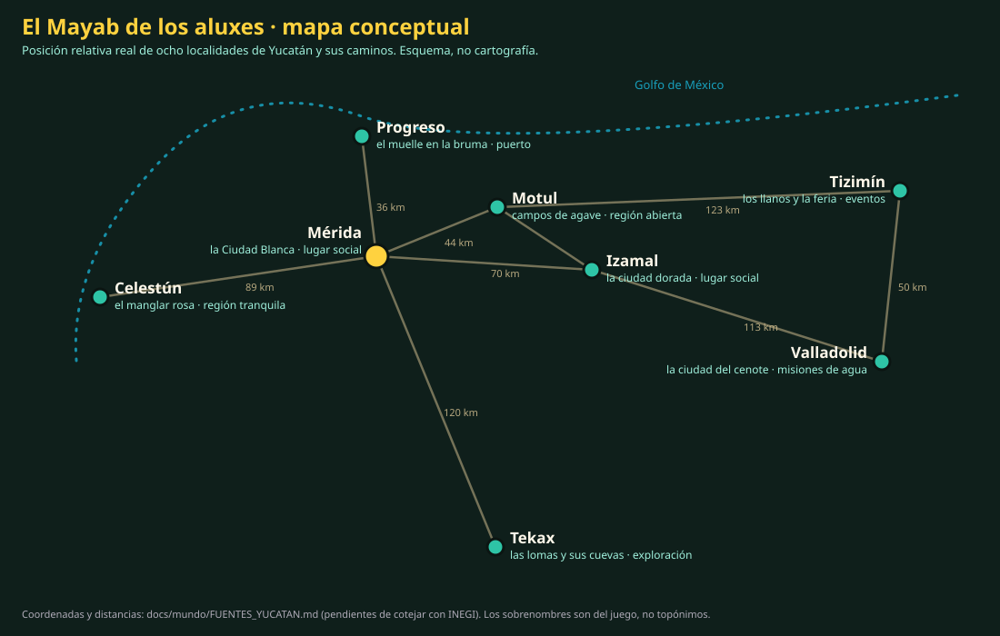

# El mundo abierto del Mayab

Cómo pasa ALUX de una colección de misiones cooperativas a un mundo compartido al que apetezca
volver: un lugar social persistente, regiones inspiradas en Yucatán y, colgando de ellas, las
misiones de siempre.

Este documento es **diseño**. Lo construido y medido se marca como tal; lo demás es plan. No se
promete ninguna cifra de jugadores que no se haya medido.

- Fuentes sobre las localidades reales: [mundo/FUENTES_YUCATAN.md](mundo/FUENTES_YUCATAN.md).
- Estado de las versiones: [ROADMAP.md](ROADMAP.md) · Servidor actual: [protocolo.md](protocolo.md).

## 1. Tres niveles de experiencia

| Nivel | Qué es | Quién manda | Tamaño |
| --- | --- | --- | --- |
| **Lugar social** | Una plaza donde encontrarse: ver a otros aluxes, formar grupo, cambiarse de aspecto, hablar con personajes, tomar el camino a una misión. Sin combate | Servidor de zonas sociales | Decenas de jugadores por instancia (la cifra sale de las pruebas, §9) |
| **Región abierta** | Un trozo de mundo que se recorre: caminos, puntos de interés, criaturas por zona, recolección, encuentros. Combate ligero | Servidor de zonas (misma pieza, con criaturas) | Menos jugadores por instancia que el lugar social |
| **Misión cooperativa** | Lo que ya existe: el Claro de los Aluxes, el santuario, Nojoch Tuunich. 1 a 4 jugadores, combate completo, cinemáticas compartidas | **Servidor de mazmorras actual, sin cambios** | 4 |

El jugador siempre está en exactamente uno de los tres. Pasar de uno a otro es un **viaje** (§7).

## 2. Piezas

```
navegador ── HTTPS ──► portal (Next) ──► API (Node)  ◄── PostgreSQL
    │                                     ▲   ▲
    │  WSS  ticket de sala                │   │ latidos, recompensas, apariencia
    ├──────────────► servidor de mazmorras (Godot sin cabeza)      ← existe, no se toca
    │  WSS  ticket de zona                    │
    └──────────────► servidor de zonas (Godot sin cabeza, otro proceso)   ← nuevo
```

- **API**: sigue siendo la única que guarda datos y la única que firma tickets. Gana tres cosas:
  el directorio de zonas (qué instancias hay y cuánta gente tienen), los viajes (§7) y, más
  adelante, amigos y grupos.
- **Servidor de mazmorras**: el de hoy. Salas de 4, simulación a 30 Hz, estados a 15 Hz, combate
  autoritativo. **No se sustituye ni se le añaden responsabilidades.**
- **Servidor de zonas**: nuevo, en **otro proceso**. Reutiliza lo que ya está probado —el mismo
  ejecutable de Godot, la simulación de movimiento compartida, los tickets, la reconexión— con
  otro tipo de sala: más jugadores, sin combate en los lugares sociales y con **interés por
  proximidad** (§4). Si falla o se satura, las misiones siguen funcionando.
- **Cliente**: el mismo juego. Carga el escenario de la zona, dibuja sólo a quien el servidor le
  manda y cambia de servidor en los viajes sin recargar la página.

Por qué otro proceso del mismo servidor y no un servicio nuevo en otro lenguaje: el movimiento
autoritativo (velocidad, colisiones, teletransportes rechazados) ya existe y está cubierto por
427 840 comprobaciones de simulación; reescribirlo sería el mayor riesgo del proyecto. Por qué no
dentro del proceso de mazmorras: para que una plaza llena no le quite cuadros a un combate.

## 3. Instancias

- Una **zona** es un lugar del mapa (`merida`, `camino_motul`…). Una **instancia** es una copia en
  marcha de esa zona con su gente. Varias instancias de la misma zona son «canales».
- La API reparte: al pedir entrada a una zona, devuelve la instancia donde está tu grupo; si no
  tienes, la de tus amigos conectados; si no, la más llena que no pase de su capacidad cómoda
  (para que las plazas se sientan vivas en vez de repartir a la gente en plazas vacías).
- **Capacidad configurable** por tipo de zona (`ZONE_CAPACITY_SOCIAL`, `ZONE_CAPACITY_WILD`). Se
  empieza conservador y se sube con mediciones (§9), nunca al revés.
- Una instancia vacía se cierra a los pocos minutos. La última de cada lugar social puede quedarse
  abierta para que entrar sea inmediato.
- Las instancias no guardan nada que importe: el estado duradero vive en la API (§8). Si un
  proceso cae, los jugadores reconectan a otra instancia en el mismo sitio.

## 4. Jugadores visibles por proximidad

El coste de un mundo compartido en el navegador no es tener a 60 personas en el servidor: es
**mandar y dibujar** a 60. Tres límites, del servidor hacia el cliente:

1. **Rejilla de interés.** La zona se divide en celdas (16 m). Cada jugador recibe sólo a quienes
   están en su celda y en las vecinas hasta un radio (unos 40 m), con margen de salida mayor que el
   de entrada para que nadie parpadee en el borde.
2. **Tope de vecinos.** Aunque haya 50 en la plaza, a cada cliente se le mandan los K más cercanos
   (empezar con 24), y siempre su grupo y sus amigos. El resto son presencia: un contador («hay 31
   aluxes en la plaza») y, más adelante, siluetas baratas.
3. **Ritmo por distancia.** Los cercanos a 10 estados por segundo; los lejanos a 3–5. En un lugar
   social nadie apunta a nadie: no hace falta más.

En el cliente: los aluxes lejanos sin sombra y con animación a menos cuadros, nombres sólo de
cerca, y la calidad automática que ya existe decidiendo cuántos se dibujan en equipos modestos.

Entrar y salir del radio se anuncia (`enter` con nombre y aspecto, `leave`), de modo que el aspecto
completo de un alux viaja una vez, no en cada estado.

## 5. Grupos y amigos

- **Grupo** (hasta 4, lo que cabe en una misión): se forma en el lugar social acercándose a otro
  alux e invitándolo, o con el código de sala de siempre. El grupo viaja junto: quien abre el
  portal de una misión se lleva a los que acepten.
- **Amigos**: lista en la API (tabla nueva, sólo aditiva). Sirve para tres cosas: caer en su misma
  instancia, verlos siempre aunque la plaza esté llena, e invitarlos.
- **Comunicación**: primero gestos y frases hechas (sin texto libre). El chat de texto necesita
  moderación —límite de frecuencia, bloqueo, denuncia y registro— **antes** de abrir el juego fuera
  de la beta por invitación; hasta entonces no se activa.
- Nada de esto existe todavía. El prototipo del lobby (§10, fase 1) sólo lleva presencia y el
  portal a la misión.

## 6. Regiones inspiradas en Yucatán

Las regiones toman de la península real su **posición relativa, su paisaje y algún rasgo
verificable**, y lo reinterpretan como fantasía: son lugares del mundo de los aluxes, no
reproducciones. Reglas:

- **No se inventan etimologías mayas.** Donde las fuentes dan varias versiones, el juego no elige:
  usa el nombre real de la localidad y un sobrenombre en español. Las etimologías pendientes de un
  hablante competente están en [FUENTES_YUCATAN.md](mundo/FUENTES_YUCATAN.md).
- **Los sitios ceremoniales y arqueológicos reales no son mazmorras.** Las ruinas del juego son
  inventadas; los lugares reales, si aparecen, lo hacen como paisaje lejano o referencia.
- Todo texto del juego que hable de un lugar real distingue lo real de lo inventado.

### Mapa conceptual



Esquema generado a partir de las coordenadas de cada localidad y de las distancias por carretera
recogidas en las fuentes (que citan a INEGI y a la SCT, **sin cotejar todavía contra el Marco
Geoestadístico de INEGI**). Conserva la posición relativa y el orden de los caminos; no es
cartografía: la costa está sólo sugerida y las distancias del juego son otras.

| Región | Dónde queda | De la localidad real (verificable) | En el mundo de los aluxes | Papel |
| --- | --- | --- | --- | --- |
| **Mérida**, la Ciudad Blanca | Centro-noroeste; de ella salen todos los caminos | Capital; catedral y casonas del centro; Paseo de Montejo; cruce de las carreteras a Progreso, Motul, Valladolid, Tekax y Celestún | Una plaza blanca de arcos y un gran árbol, donde los aluxes se reúnen al atardecer | **Primer lugar social.** Portal al Claro de los Aluxes |
| **Progreso** | Costa norte, a 36 km de Mérida | Puerto; muelle muy largo; faro | Un muelle que se pierde en la bruma, del que salen las barcas | Puerta al mar; pesca y recados. Segunda parada natural |
| **Motul** | Noreste de Mérida, a unos 44 km | Zona henequenera | Campos de agave y talleres de cuerda; cenotes entre las plantaciones | Primera región abierta: caminos y criaturas del monte bajo |
| **Izamal** | Centro, al este de Mérida | Ciudad pintada de amarillo; gran convento con atrio de arcos; cerros dentro de la ciudad | La ciudad dorada sobre colinas antiguas | Lugar social secundario; oficios y vestimenta |
| **Valladolid** | Oriente | Cenote dentro de la ciudad; plaza y convento | La ciudad del cenote: se baja al agua por una escalinata | Entrada a misiones de agua (enlaza con la pista del Cenote del capítulo I) |
| **Tizimín** | Noreste | Zona ganadera; feria de enero | Llanos abiertos y una feria que nunca termina de desmontarse | Eventos de temporada, monturas más adelante |
| **Tekax** | Sur, al pie de la sierrita | Lomas (lo único que no es llano en la península); grutas cercanas | Las lomas y sus cuevas | Región de más nivel; exploración vertical |
| **Celestún** | Costa oeste | Ría y manglar; flamencos; salinas | El manglar rosa | Región tranquila: recolección, observación, sin combate obligatorio |

Entre regiones hay **caminos**: tramos de selva, monte y sacbé inventado, con criaturas y puntos de
interés propios. No hace falta que existan todos: el mundo se abre por tramos.

### Puntos de interés y criaturas

- Cada zona declara sus **puntos de interés** (personajes, altares, miradores, puertas de misión,
  cenotes) en datos compartidos entre cliente y servidor, como hoy hace `world_def.gd` con los
  altares del Claro. Descubrirlos se guarda por jugador.
- **Criaturas por zona**: tablas de aparición por celda, activas sólo donde hay jugadores cerca
  (una celda sin nadie no simula nada). El comportamiento es el de los enemigos actuales,
  decidido por el servidor. Presupuesto de criaturas por instancia, no por jugador.
- En los lugares sociales no aparecen criaturas hostiles.

## 7. Viajes

Un viaje es cambiar de servidor o de instancia: plaza → misión, misión → plaza, región → región.

1. El cliente pide a la API `viajar a X` (una zona, o una sala de misión para su grupo).
2. La API comprueba que puede (está donde dice estar, la misión está desbloqueada, cabe) y devuelve
   un **ticket de destino** de un solo uso, como los de sala de hoy.
3. El cliente funde a negro, se conecta al destino con el ticket y, cuando el destino lo acepta,
   cierra la conexión anterior.
4. Si el destino no responde, **se queda donde estaba** (la conexión anterior no se cerró) y se lo
   dice al jugador. Repetir la petición con el mismo identificador no crea dos viajes.

- El punto de llegada lo decide el servidor (la puerta por la que se entra), no el cliente.
- Volver de una misión deja al grupo junto al portal por el que salió, en la misma instancia si
  sigue abierta.
- Viaje rápido entre regiones ya descubiertas, desde puntos concretos (no desde cualquier sitio).
- Las misiones cooperativas actuales se alcanzan desde un portal del lugar social: el del Claro de
  los Aluxes es el primero. Crear o unirse a la sala usa la API de salas **tal como está**.

## 8. Persistencia

| Qué | Dónde | Cuándo |
| --- | --- | --- |
| Perfil, aspecto del alux, recompensas, progreso de misiones | API / PostgreSQL | Ya existe (el aspecto completo llega con el personalizador 3D) |
| Última zona y puerta de cada jugador | API | Al viajar y al desconectar; se vuelve ahí |
| Puntos de interés descubiertos, viajes rápidos | API | Al descubrirlos |
| Amigos, bloqueos | API | Al cambiar |
| Posición exacta, criaturas, quién está en la plaza | Memoria de la instancia | No se guarda: se reconstruye |

Todas las tablas nuevas son **aditivas**. Una versión anterior del juego debe seguir funcionando
contra la base nueva (es lo que permite el rollback).

## 9. Escalabilidad y límites del navegador

**Lo medido hasta hoy** (Alpha 0.3, [RELEASES.md](RELEASES.md)):

- Servidor de mazmorras: 107 MB de memoria y 4 % de CPU de media con tres salas peleando a la vez.
- Imagen completa en Render: 270 MB de 512 recién arrancada. Un segundo proceso de Godot para las
  zonas cabe, pero el margen es corto: habrá que medirlo y, si no alcanza, subir de plan.
- Cliente: unas 300 llamadas de dibujo en el combate del jefe con cuatro jugadores. Todas las
  pruebas son con render por software: **no hay ninguna medida con tarjeta gráfica**.
- Protocolo: JSON sobre WebSocket, 15 estados por segundo para 4 jugadores.

**Lo que limita, por orden:**

1. **Dibujar aluxes en el navegador.** Cada alux es un modelo animado con varias mallas. El tope de
   vecinos (§4) existe por esto.
2. **Ancho de banda de bajada por jugador.** Crece con el número de vecinos, no con el de la
   instancia. Medirlo en bytes por segundo y, si hace falta, pasar los estados a binario.
3. **CPU del servidor de zonas.** Sin combate, el coste es validar movimiento y repartir estados.
4. **Memoria del contenedor.** 512 MB para portal, API, dos servidores de juego y el proxy.
5. **Un solo hilo en el navegador** (la exportación web no usa hilos): cargar una zona nueva no
   puede congelar la partida; las zonas tienen que ser pequeñas y cargarse por partes.

**Plan de medición** (con jugadores simulados contra el servidor real y un navegador observando):

| Paso | Jugadores en la instancia | Qué se mide | Se sigue si |
| --- | --- | --- | --- |
| 1 | 8 | CPU y memoria del servidor, bytes/s por jugador, estados/s recibidos, FPS del navegador | Todo estable y sin pérdida de estados |
| 2 | 16 | Lo mismo, más el efecto del tope de vecinos | El servidor no pasa del 50 % de un núcleo |
| 3 | 32 | Lo mismo, con todos juntos en la plaza (peor caso) y repartidos | Idem; el navegador mantiene su ritmo con el tope |
| 4 | 64 | Sólo si el paso 3 deja margen claro | — |

La capacidad que se configure para cada tipo de zona será **la última que pasó su prueba**, con
margen. Las cifras, cuando existan, irán en una tabla aquí.

## 10. Fases

Cada fase es pequeña, jugable y se puede publicar o descartar sin tocar las misiones.

| Fase | Qué entrega | Criterio de aceptación |
| --- | --- | --- |
| **0. Base** *(en curso, Alpha 0.4)* | Pantalla completa. Personalizador 3D con el modelo real, guardado y replicado | Hecho: pantalla completa ([FULLSCREEN.md](FULLSCREEN.md)). El aspecto elegido se ve igual en otro navegador |
| **1. Prototipo del lobby** | Una plaza inspirada en Mérida en el servidor de zonas: movimiento autoritativo, aluxes visibles por proximidad, capacidad configurable, portal al Claro de los Aluxes | Dos navegadores se ven moverse; el portal lleva a una sala del Claro y la sala funciona como siempre; pruebas de 8, 16 y 32 jugadores simulados con sus medidas; las pruebas de las misiones siguen pasando |
| **2. Lobby social** | Grupos por proximidad, gestos y frases hechas, personaje de bienvenida, acceso al personalizador desde la plaza, volver a la plaza al terminar una misión | Un grupo formado en la plaza entra junto a la misión y vuelve junto |
| **3. Primer camino** | Mérida → Motul: una región abierta pequeña con puntos de interés y criaturas por zona | Viaje de ida y vuelta recuperable; criaturas sólo donde hay jugadores; medidas de servidor con 16 |
| **4. Amigos y persistencia del mundo** | Amigos, última zona, puntos descubiertos, viaje rápido | Reconectar devuelve al mismo sitio; migraciones sólo aditivas |
| **5. Más regiones** | Progreso, Izamal y el resto, de una en una | Cada una con su prueba de carga y su revisión de contenido cultural |

## 11. Riesgos y costes

| Riesgo | Efecto | Qué se hace |
| --- | --- | --- |
| El navegador no dibuja suficientes aluxes en equipos modestos | La plaza se siente vacía o va a tirones | Tope de vecinos, niveles de detalle, medir con tarjeta gráfica real antes de fijar nada |
| 512 MB no alcanzan para dos servidores de juego | Reinicios del servicio | Medir en la fase 1; el plan siguiente de Render cuesta unos US$25 al mes y **no se contrata sin tu confirmación** |
| El protocolo en JSON pesa demasiado con muchos vecinos | Latencia y consumo de datos | Medir bytes/s; binario sólo si hace falta |
| Chat y encuentros entre desconocidos | Moderación, seguridad de menores | Sin texto libre hasta tener límites, bloqueo y denuncia; beta sólo por invitación |
| Representar mal lugares y cultura reales | Daño a personas reales y al proyecto | Fuentes citadas, etimologías sin inventar, revisión por un hablante de maya yucateco y por alguien de la región antes de publicar cada región |
| Crecer el alcance (un MMORPG entero) | No terminar nada | Fases pequeñas; cada una se puede publicar sola |
| Parecerse a otros juegos | Problemas legales y de identidad | Diseños, mapas e interfaz propios; nada tomado de Kameo ni de otros títulos |

## 12. Hacia un cliente instalable

No se construye ningún lanzador todavía. El cliente es un proyecto de Godot: la misma base se
puede exportar a Windows, macOS y Linux cuando haga falta (mejor rendimiento, hilos, sin límites
del navegador). Lo que hay que cuidar desde ya para no cerrar esa puerta: que el cliente no dependa
de cosas que sólo existen en la página y que el servidor no distinga de dónde viene un cliente.
Hoy dependen de la página el inicio de sesión (habría que resolverlo), la música y los ambientes
(fuera del navegador suenan con el motor, con los bucles provisionales) y el vídeo de las
cinemáticas (sin él se ven con el motor).
