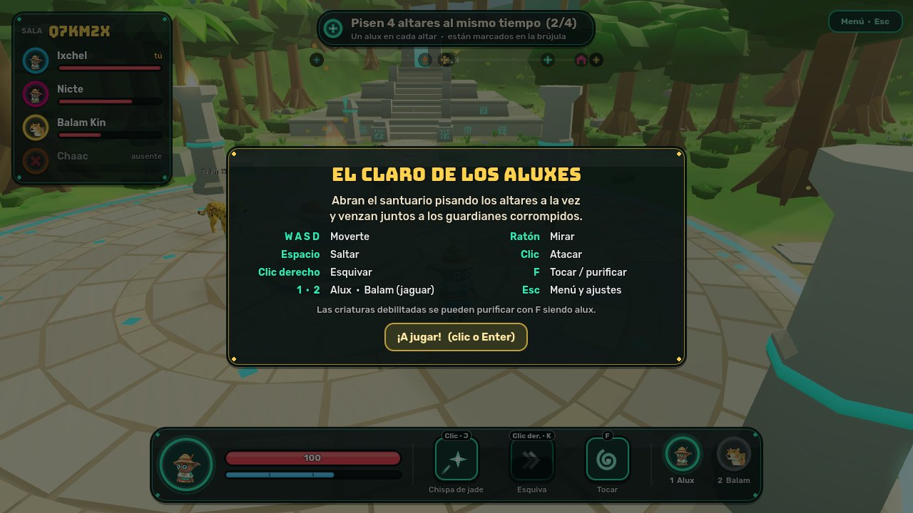
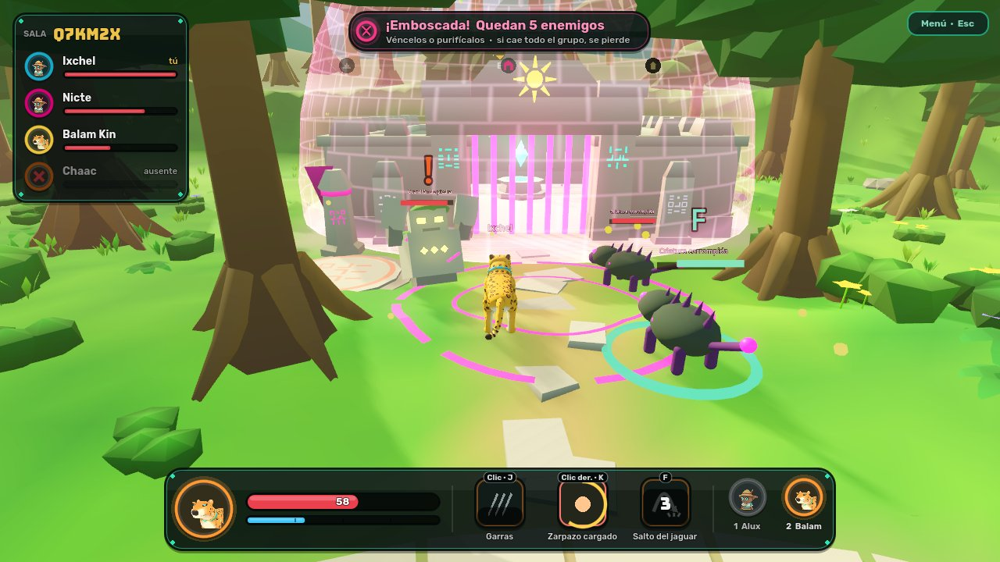
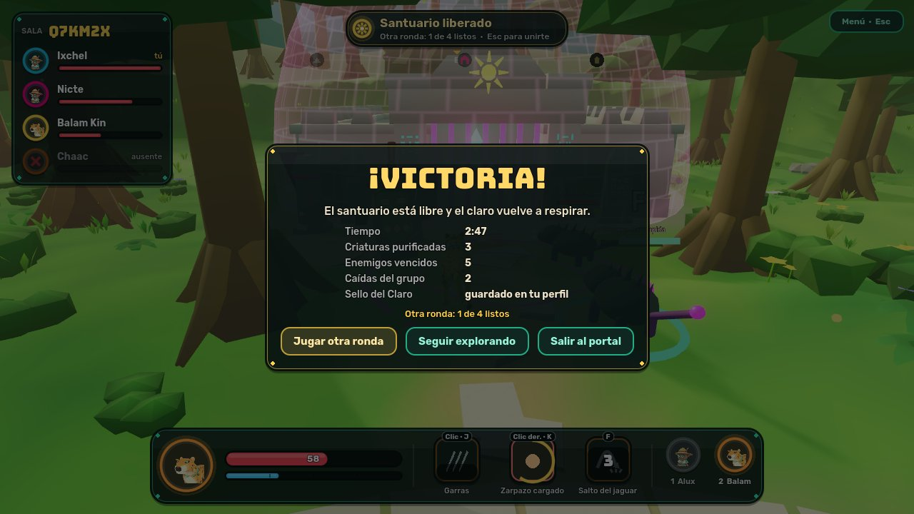
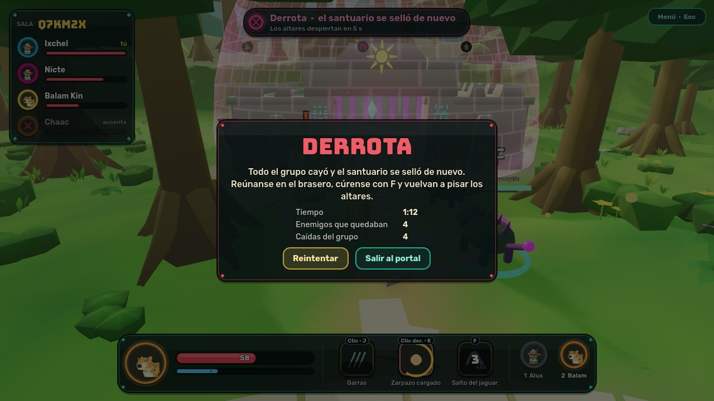
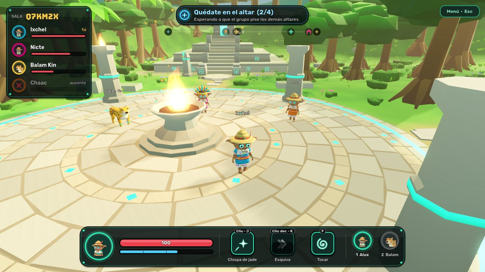
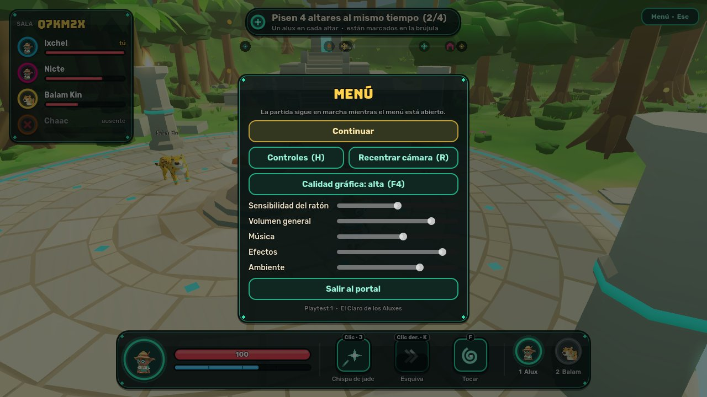
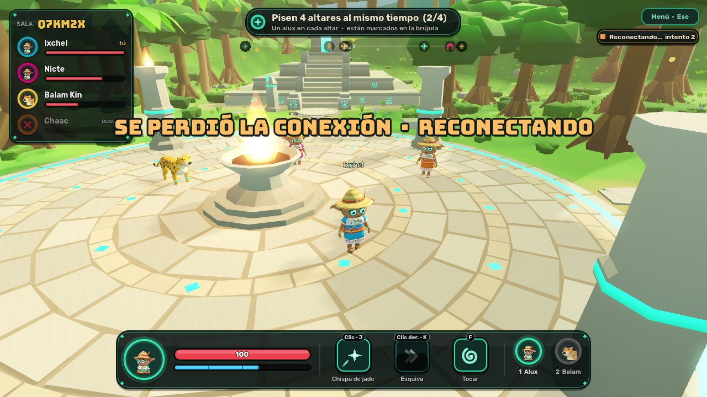
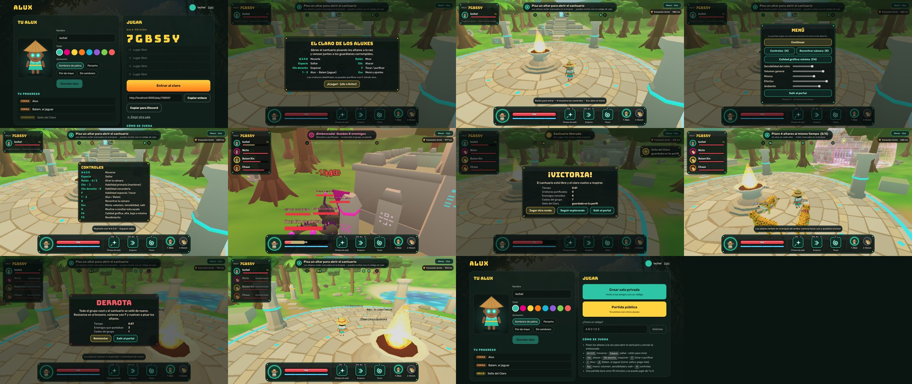

# Playtest: guía de la sesión y resultados

Una sesión corta (10–15 minutos) para 1 a 4 personas. Esta guía sirve a quien organiza la prueba y
a quien juega por primera vez.

| Bienvenida | Emboscada |
| --- | --- |
|  |  |

| Victoria | Derrota |
| --- | --- |
|  |  |

| Esperando al grupo | Menú | Reconectando |
| --- | --- | --- |
|  |  |  |

Estas siete imágenes salen de la vista previa del juego (escena preparada, calidad alta). La hoja de
abajo son capturas de una sesión real en el navegador, tomadas por la prueba automática
`npm run test:flow` en calidad mínima (el entorno de pruebas no tiene tarjeta gráfica): portal,
bienvenida, exploración, menú, controles, emboscada, victoria, nueva ronda, derrota, reintento y
vuelta al portal.

## Cómo entrar

1. Abre el portal y entra (con Discord, o con la entrada de prueba si no está configurado).
2. Pulsa **Crear sala privada** y comparte el código, o **Partida pública**.
3. Pulsa **Entrar al claro**. La primera carga tarda unos segundos (el motor queda en caché).

Para jugar en una sola computadora, ver [README](../README.md#probarlo-en-tu-computadora).

## Qué pasa en una partida

| Paso | Qué ve el jugador | Qué tiene que hacer |
| --- | --- | --- |
| 1. Bienvenida | Tarjeta con el objetivo y los controles. | Clic, Enter o cualquier tecla. |
| 2. Explorar | Objetivo arriba: «Pisa un altar…» o «Pisen N altares…». Los altares salen en la brújula. | Caminar hasta un altar y quedarse encima. Con varios jugadores, uno en cada altar. |
| 3. Esperar | «Quédate en el altar (2/4) · esperando al grupo». | No moverse hasta que el grupo complete los altares. |
| 4. Emboscada | Aviso, música de combate y objetivo «Quedan N enemigos». | Vencer o purificar a todos. |
| 5. Resultado | Panel de **Victoria** (resumen y sello) o de **Derrota**. | Otra ronda, seguir explorando, reintentar o salir. |

- **Victoria**: no queda ningún enemigo. Todos reciben el Sello del Claro (una sola vez por perfil).
- **Derrota**: todo el grupo conectado está caído a la vez. El santuario se sella y, a los 6 s, se
  puede volver a pisar los altares.
- **Otra ronda**: tras la victoria, la piden todos los jugadores (botón del panel o del menú).

## Controles

| Acción | Tecla |
| --- | --- |
| Moverse · saltar | W A S D · Espacio |
| Mirar | Ratón (clic para capturarlo) · Q / E |
| Atacar · habilidad secundaria · especial | Clic · clic derecho · F (o J · K · F) |
| Alux · Balam | 1 · 2 |
| Recentrar la cámara | R |
| Menú (volumen, sensibilidad, calidad, salir) | Esc o P |
| Ayuda de controles | H |
| Calidad gráfica · datos técnicos | F4 · F3 |

Los ajustes del menú se guardan en el navegador.

## Cómo se lee el combate

| Señal | Significa |
| --- | --- |
| **!** naranja sobre un enemigo y marca en el suelo | Va a golpear: aléjate o esquiva (clic derecho). |
| Estrellas amarillas girando | Está aturdido: aprovecha. |
| Anillo de jade en el suelo y **F** sobre la criatura | Ya se puede purificar: acércate como alux y pulsa F (cura al grupo). |
| Barra de vida verde en una criatura | Lo mismo: está lo bastante débil para purificarla. |
| Ranura de habilidad que se sacude en rojo | No se puede usar: falta energía o sigue recargándose. |
| Bordes de la pantalla latiendo en rojo | Te queda poca vida: toca el brasero de la plaza (F como alux). |
| «Has caído · reapareces en N» | Vuelves solo junto al brasero; en la emboscada tarda 8 s. |
| Aviso arriba a la derecha | Conexión lenta o reconectando (el juego sigue visible y vuelve solo). |

Los dos enemigos: el **guardián de piedra** (lento, golpea en área, resiste las chispas) y la
**criatura corrompida** (rápida, embiste, débil a las chispas y purificable).

## Qué observar en la prueba

- ¿Entiende el objetivo sin que nadie se lo explique? ¿Cuánto tarda en encontrar un altar?
- ¿Descubre a Balam y cuándo conviene cada forma?
- ¿Entiende por qué no puede usar una habilidad?
- ¿Purifica alguna criatura? ¿Usa el brasero?
- ¿Se entiende por qué se pierde y qué hacer después?
- ¿El volumen por defecto molesta? ¿Algún sonido cansa?
- ¿Algún momento de confusión con la cámara o el ratón?

## Resultados

| Fecha | Versión | Qué se probó | Resultado |
| --- | --- | --- | --- |
| 12 nov 2026 | Closed Alpha 0.1 (publicada) | Automático contra el servicio real: HTTPS, WSS, invitación, guardado, partida, reconexión, métricas; sesión de un jugador en navegador | Pasa. Detalle en [RELEASES.md](RELEASES.md) |
| 12 nov 2026 | Alpha 0.2, incremento 1 (sin publicar) | Automático en local: API, simulación, 12 pruebas de servidor (incluida la historia), flujo en navegador con introducción y diálogo, cuatro navegadores | Ver [RELEASES.md](RELEASES.md) |
| 12 nov 2026 | Alpha 0.2, incremento 2 (sin publicar) | Automático en local: API, simulación, 13 pruebas de servidor (incluida la cinemática compartida y su voto), flujo completo en navegador, cuatro navegadores, medición de rendimiento | Ver [RELEASES.md](RELEASES.md) |
| 12 nov 2026 | Alpha 0.3, incremento 1 (sin publicar) | Automático en local: API, 14 pruebas de servidor (fases de la cinemática, reconexión), vídeo en navegador (5 casos, con vídeos de prueba), cuatro navegadores con vídeo y con fallos, flujo completo, rendimiento | Ver [RELEASES.md](RELEASES.md) |
| — | Closed Alpha 0.1 | **Primera sesión con testers reales** (cuatro a la vez, Edge, audio a oído, FPS con tarjeta gráfica) | **Pendiente** |

Cuando haya una sesión real, se anota aquí: quiénes, cuánto duró, qué entendieron sin ayuda, qué no,
y las métricas que registró el juego (`npm run beta:metrics`).

## Límites conocidos de esta build

- El audio es provisional: está generado por código, no grabado.
- Los enemigos siguen siendo modelos provisionales.
- Sin mando ni controles táctiles: teclado y ratón.
- El rendimiento con tarjeta gráfica real no está medido (ver [rendimiento.md](rendimiento.md)).
- Un solo escenario y un solo encuentro.

Lo demás, en [pendientes.md](pendientes.md).
