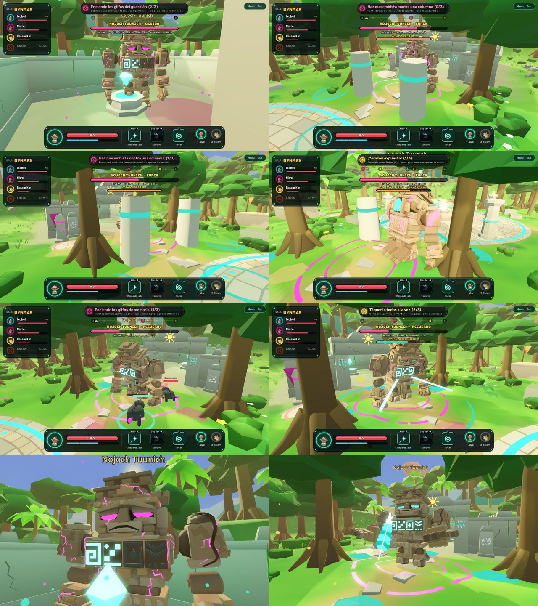
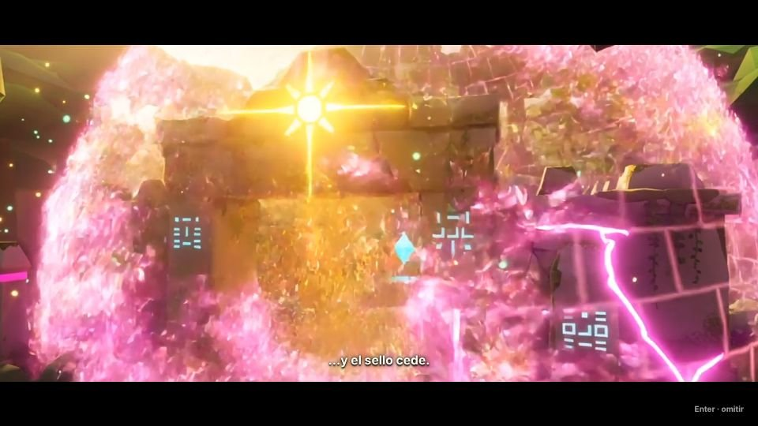
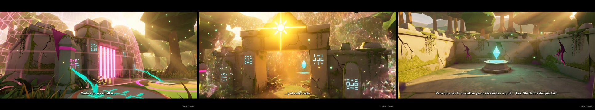
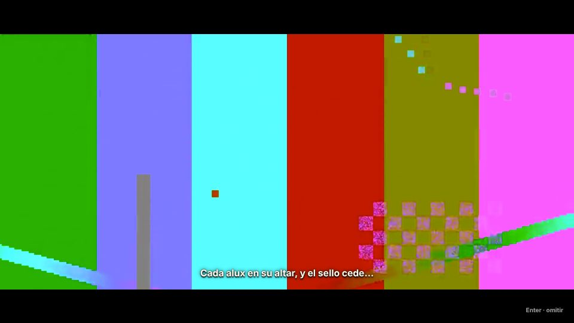
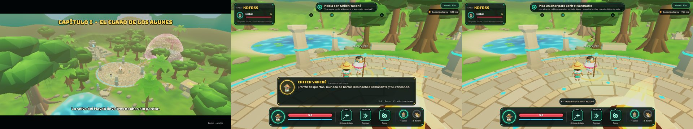
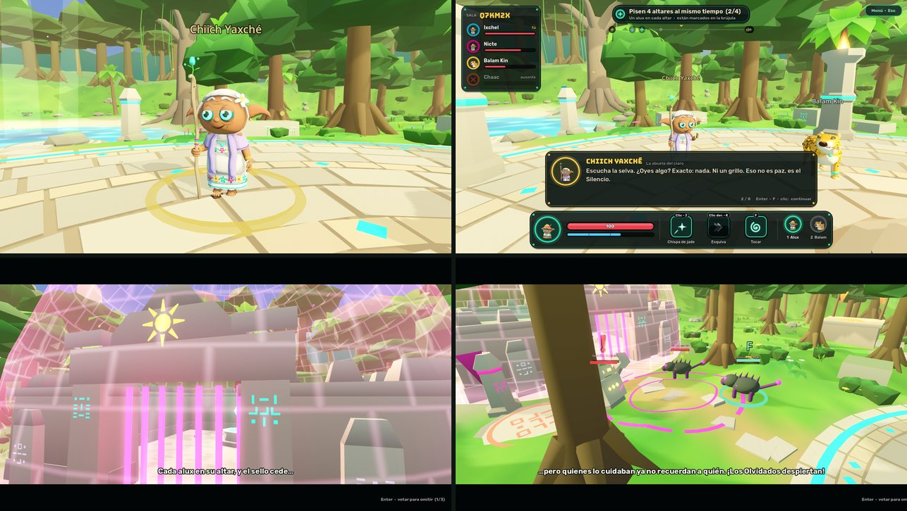
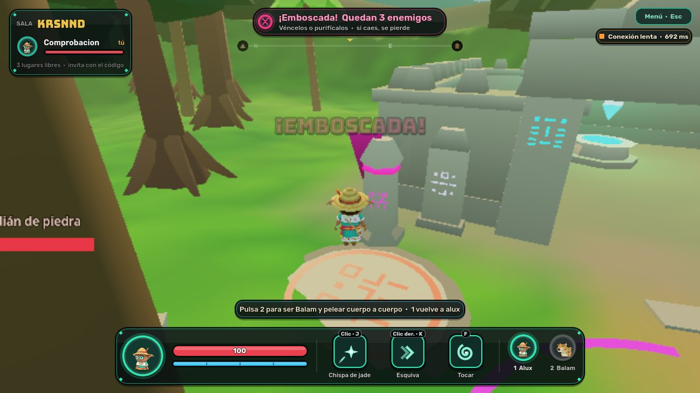

# Versiones de ALUX

Qué lleva cada versión, qué se comprobó y cuál está publicada. Plan de las siguientes:
[ROADMAP.md](ROADMAP.md).

| Versión | Estado | Contenido |
| --- | --- | --- |
| Closed Alpha 0.1 | Publicada el 12 nov 2026; **sustituida por la 0.2**. Commit `12fadbe`: es el punto de rollback | Claro de los Aluxes jugable de 1 a 4, combate, emboscada, victoria y derrota, audio provisional, acceso por invitación |
| Closed Alpha 0.2 | Publicada el 12 nov 2026; **sustituida por la 0.2.1**. Commit `c28e32c`: es el punto de rollback | Introducción «El llamado», Chiich Yaxché con modelo propio y diálogo, primer objetivo narrativo, cinemáticas locales y compartidas con voto, progreso del capítulo en el perfil |

| **Closed Alpha 0.2.1** | **Publicada** el 12 nov 2026 en <https://alux-beta.onrender.com> (commit `94bb9c8`) | La 0.2 más las cinemáticas híbridas, **«El sello cede» producida con Kling** y los modelos de los personajes corregidos |

| Alpha 0.3 (candidata) | Rama `release/alpha-0.3-rc1`, **sin publicar** | Jefe Nojoch Tuunich completo (tres fases, modelo definitivo, cinemáticas de despertar y liberación), Pluma de Jade y pista del Cenote |

## Publicación en la rama `beta`

La rama `beta` es lo único que Render despliega. Cada entrada dice qué commit lleva el código de
esa versión, qué se comprobó antes de publicarla y cómo volver a ella.

Para saber qué hay desplegado en este momento: `npm run beta:check -- <URL>` muestra el commit que
informa el servicio, y `--commit <hash>` exige que sea uno concreto.

## Alpha 0.3 — El Guardián Dormido (candidata, sin publicar)

Rama candidata: `release/alpha-0.3-rc1`. **No está en `beta`**: se publica sólo con tu visto bueno.
Diseño completo del jefe: [BOSS.md](BOSS.md).

| Novedad | Detalle |
| --- | --- |
| Nojoch Tuunich, combate completo | Tres fases cooperativas decididas por el servidor. **Olvido** (patio): purificar criaturas junto a él enciende los glifos del pecho. **Furia** (explanada): columnas que despierta el alux, lluvia de piedra, embestida que se corta contra una columna, anclas, cadenas de jade y corazón expuesto a las garras de Balam. **Recuerdo**: glifos de memoria y contacto de todos a la vez |
| Transición de fase | El guardián cruza el portal andando; nadie se teletransporta. Punto de control en cada fase: una derrota retoma la fase alcanzada |
| Modelo definitivo | Caliza cálida, rostro con tres expresiones (triste, dolor contenido, serena), grietas que cambian con el Silencio, glifos que se encienden; animaciones revisadas en movimiento. 11 006 triángulos, 30 huesos |
| Pluma de Jade | Objeto ancestral persistente: sale en la liberación, la entrega el servidor una vez por jugador, aparece en el perfil y abre la pista del Cenote hablando con el guardián liberado. No desbloquea transformaciones |
| Cinemáticas del jefe | «El despertar» (16 s) y «La liberación» (12 s), compartidas, con voto para omitir, versión del motor de respaldo y vídeos de Kling |
| Presentación | Escenario del combate (anclas, columnas, cadenas, lluvia, carril de embestida, glifos, haces de contacto), barra con segunda barra, objetivos y pistas por momento, 31 sonidos, música por fase, sacudida de cámara regulable (en cero si el sistema pide menos movimiento) |
| Secuelas de «El sello cede» | El santuario conserva lo que mostró el vídeo: enredaderas, grietas y marcas que se asientan |
| Otros | Enter en un panel de victoria sigue la aventura (otra ronda se pide con su botón); al liberar al guardián, las criaturas corrompidas cercanas también recuerdan |



Protocolo: el estado del jefe (`b`) crece de 14 a 24 campos y hay eventos `boss` nuevos; la historia
de la sala gana dos banderas; llegan los avisos `story` `freed` y `clue`. Compatible hacia atrás: un
cliente anterior ignora lo que no conoce. Recompensa nueva en el catálogo (`pluma_de_jade`).
**Sin migraciones de base de datos**: usa las tablas de recompensas y misiones que ya existían.

### Comprobado (en local)

| Comprobación | Resultado |
| --- | --- |
| API | @@API@@ |
| Simulación compartida | @@SIM@@ |
| Servidor con bots | @@PROTO@@ |
| Navegador, combate completo (`npm run test:boss`) | Una jugadora en un navegador real y tres compañeros: las tres fases, las dos cinemáticas, panel «Capítulo I completado», Pluma de Jade guardada en el perfil y pista del Cenote. La jugadora toca al guardián manteniendo F |
| Navegador, resto | @@NAV@@ |
| Vídeos | @@VID@@ |

### Rendimiento medido

| Qué | Medida |
| --- | --- |
| Servidor de juego durante el combate | 107 MB de memoria residente y 4 % de CPU de media (13 % de pico) con **tres salas a la vez** (1, 2 y 4 jugadores) peleando las tres fases. Sin crecimiento durante la prueba |
| Coste del jefe en el motor (calidad alta, con sombras) | El modelo: unas 27 llamadas de dibujo y 33 000 triángulos dibujados más (11 006 por pasada). El escenario del combate: otras 20–25 llamadas en la fase 2 y unas 10 en la 3. La pluma: 30 |
| Escenas completas (calidad alta) | Fase 1: 270 llamadas · fase 2: 295–304 · fase 3: 282 · liberado: 88 |
| Navegador de pruebas (render por software, calidad mínima, cuatro jugadores) | 309 llamadas de dibujo al final del combate; 1–3 FPS, como el resto del juego en este entorno: **no es representativo** de un equipo con tarjeta gráfica |
| Carga del juego en el navegador de pruebas | 8–12 s hasta estar jugando |
| Descarga | @@DESCARGA@@ |

### Rollback

Volver a la 0.2.1: publicar en `beta` el commit `94bb9c8`. Los datos son compatibles en los dos
sentidos (no hay migraciones); quien ya tenga la Pluma de Jade la conserva en la base de datos
aunque la 0.2.1 no la muestre.

**Sin comprobar:** el combate con personas (ritmo, dificultad, si las pistas bastan); con tarjeta
gráfica, en Safari o Firefox; la imagen de despliegue de esta versión @@IMAGEN@@.

## ALUX Closed Alpha 0.2.1

| | |
| --- | --- |
| **Código de la versión** | `e9a51c1bd2b3` (rama candidata `release/alpha-0.2.1-rc1`) |
| **Commit publicado en `beta`** | El siguiente a ese: añade este registro y el nombre de la versión en el juego y en el portal. Es el que informa `/healthz`. |
| **Fecha** | 12 de noviembre de 2026 |
| **Autorizada por** | El dueño del proyecto, el 12 de noviembre de 2026 |
| **Qué añade a la 0.2** | Sistema cinematográfico híbrido (vídeo en el navegador con respaldo del motor, fases de preparación y reanudación, fundidos), «El sello cede» producida con Kling (3 planos, 10 s, 2.6 MB) y los tres personajes con los hilos de sus prendas corregidos. |
| **Qué no lleva** | El jefe Nojoch Tuunich ni las secuelas visibles del sello en el santuario: son de la Alpha 0.3 y siguen en la rama de trabajo. |
| **Base de datos** | Sin cambios: no hay migraciones nuevas. |
| **Recursos** | Los mismos dos; no se crea ninguno. |

**Comprobado sobre el código de la versión antes de publicar:** API (10 de 10), simulación (427 840
comprobaciones sin violaciones), servidor con bots (14 de 14), vídeos reales de Kling en un navegador,
cinco casos de fallo del vídeo, flujo completo en navegador (14 pasos), cuatro navegadores (10 pasos,
con los vídeos presentes) y la revisión previa, que ahora exige que los vídeos del manifiesto sean los
definitivos: 3 declarados y presentes, ninguno de prueba.

**Imagen desplegable:** verificada en local con los vídeos en el commit `bc353a7`. Entre ese commit y
el de esta versión sólo cambian tres modelos, dos retratos, guiones de arte, documentación y pruebas;
no se pudo repetir la construcción sobre el commit exacto porque el registro de imágenes base limitó
las peticiones desde el entorno de pruebas. Render construye la suya y, si fallara, deja la 0.2 en
servicio.

**Volver a la 0.2:** en Render → `alux-beta` → **Events** → el despliegue del commit `c28e32c` →
**Rollback**; o, desde Git, `git push origin c28e32c42925ae3c27b73b763772c84df8709a04:beta --force-with-lease`.
La base de datos no necesita nada: el esquema es el mismo. Detalle en [beta.md](beta.md), sección 9.

**Comprobado después de desplegar, contra <https://alux-beta.onrender.com>:**

| Comprobación | Resultado |
| --- | --- |
| Versión en servicio | `/healthz` informa `94bb9c888bb041dd0491a924eee45b45f537ff4d`; base de datos respondiendo |
| HTTPS, cabeceras y cierre sin sesión | Pasa |
| WSS | `wss://alux-beta.onrender.com/ws` abre y rechaza tickets falsos |
| Invitación, guardado, métricas | Pasa |
| Partida por WebSocket | 15 estados por segundo, latencia de 30 ms, reconexión tras un corte en el mismo sitio |
| Carga de vídeo | Los tres vídeos se sirven con 200 y caché de un año (`immutable`): 2.63 MB en MP4; el manifiesto, con revalidación |
| Reproducción en navegador real | «El sello cede» pausa la sala y se ve **como vídeo**, los tres planos, durante 8.9 s; la partida sigue con la emboscada y el santuario abierto |
| Omisión | Enter a mitad del vídeo la termina a los 2.5 s y la partida sigue |
| Respaldo | Con las descargas de vídeo cortadas, la escena se ve con el motor (9.3 s), los tres fallos quedan registrados y la partida sigue |
| Introducción | «El llamado» se reproduce al entrar y se omite con Enter |
| Ciclo completo de un jugador | Pasa: carga (17.5 s), audio, menú, altar, emboscada, derrota, reintento y salida |



**Sin comprobar en el servicio:** de dos a cuatro jugadores a la vez (sólo hay una invitación de
comprobación), los registros de Render (no hay acceso desde aquí; el servicio responde y no se
reinició durante las pruebas), Safari, Firefox y cualquier navegador con tarjeta gráfica.

**Etiqueta de versión:** `alpha-0.2.1` (`94bb9c8`) está creada en local y **no se pudo subir**: el
servicio de Git de este entorno sigue rechazando las etiquetas. Para crearla:

```bash
git tag -a alpha-0.2.1 94bb9c888bb041dd0491a924eee45b45f537ff4d -m "ALUX Closed Alpha 0.2.1"
```

```bash
git push origin alpha-0.2.1
```

## Contenido de la 0.2.1 — «El sello cede» con Kling

La primera cinemática producida con Kling, integrada sobre el sistema del incremento 1.
Producción completa: [art/cinematicas/sello/kling/PRODUCCION.md](../art/cinematicas/sello/kling/PRODUCCION.md).



| Novedad | Detalle |
| --- | --- |
| «El sello cede» en vídeo | 10 s en tres planos (la barrera reacciona, el sello se rompe, algo despierta), en el tratamiento enriquecido: misma arquitectura del juego con luz, materiales y partículas de cine. 2.6 MB en MP4, 2.0 MB en WebM |
| Dos tratamientos | También se produjo el fiel al juego, para comparar; está guardado y se puede cambiar sustituyendo tres archivos |
| Guion del motor | Mismos tres planos y cámaras, como respaldo. El portal se abre a la vista en el plano 2 y al volver ya está abierto |
| Reloj real | La escena se mide con el reloj y no sumando cuadros: un navegador lento ya no pierde el último plano |
| Decodificación bajo demanda | Los vídeos se descargan al entrar, pero su decodificador se crea justo antes de la escena y se libera al terminar |
| Créditos | 284 de los 500 autorizados; saldo 2 375 |

| Comprobación (en local) | Resultado |
| --- | --- |
| API, simulación, servidor con bots | 10 de 10 · sin violaciones · 14 de 14 |
| Vídeos reales de Kling en un navegador | Pasa: los tres planos se ven como vídeo con sus subtítulos, la escena dura lo que su guion, no hay fallos registrados y se vuelve al juego con el santuario abierto y la emboscada |
| Casos de fallo (vídeos de prueba) | 5 de 5: reproducción, archivo ausente y corrupto, descarga lenta, vídeo atascado, omitir a mitad; al terminar no queda ningún decodificador abierto |
| Flujo completo (un navegador y tres bots) | Pasa, con la escena compartida y su voto |
| Cuatro navegadores (movimiento, combate, reconexión) | Pasa, con los vídeos reales presentes |
| Cuatro navegadores viendo la escena (`test:cine-coop`) | **Inestable en este entorno.** Con el incremento 1 pasó dos veces seguidas; con esta versión, en una ejecución los cuatro llegaron a la escena (vídeo, vídeo, motor, motor) y en tres la prueba se agotó **antes** de la escena, al no conseguir parar a los cuatro personajes sobre sus altares a 1 cuadro por segundo. Hay que repetirla con tarjeta gráfica |
| Imagen desplegable (commit `bc353a7`, en local) | Se construye con los vídeos dentro y pasa sus comprobaciones. Sirve los vídeos con caché de un año y el manifiesto con revalidación; 197 MB de memoria recién arrancada, de 512 |
| Descarga | 2.63 MB más (MP4) por jugador, en segundo plano y con prioridad baja; el juego no espera por ella |

**Un problema encontrado y corregido:** con los tres vídeos reales precargados como elementos de vídeo
vivos, la prueba de cuatro navegadores dejó de pasar (los personajes no llegaban a su destino). Sin
el manifiesto, pasaba. Por eso la decodificación es ahora bajo demanda; con el cambio vuelve a pasar.
Es una medición sin tarjeta gráfica, pero apunta a un costo real en equipos modestos.

**Sin comprobar:** con tarjeta gráfica y con personas; Safari y Firefox; cuatro personas viendo la
escena a la vez; nada de esto en Render (la beta lleva la 0.2, sin estos vídeos).

## Contenido de la 0.2.1 — cinemáticas híbridas

Kling pasa a ser obligatorio en las cinemáticas narrativas ([CINEMATICS.md](CINEMATICS.md)). Este
incremento construye todo lo necesario para reproducir sus vídeos sin arriesgar la partida. **No
incluye ningún vídeo de Kling ni gastó créditos**: el manifiesto de vídeos está vacío y el juego se
ve igual que en la 0.2 hasta que se apruebe el primero.

| Novedad | Detalle |
| --- | --- |
| Vídeo en el navegador | El motor no reproduce MP4 ni WebM en la web, así que los reproduce el navegador sobre el juego, dirigido por un puente (`cine-video.js` + `video_bridge.gd`). Manifiesto, precarga, caché, subtítulos, sonido sólo tras interacción. |
| Respaldo por plano | Cada plano de vídeo tiene debajo el plano del motor. Si el vídeo falta, está roto, no llega a tiempo o se atasca, se ve el del motor sin detener nada. |
| Fases compartidas | `PREPARING → PLAYING → RESUMING`. El servidor pausa la sala, espera a los clientes (5 s como máximo), da la orden de inicio a todos, cuenta votos y deja 1 s de pausa sin daño al volver. |
| Reconexión | Quien vuelve o llega a mitad recibe la fase y el punto por el que va. |
| Transiciones | Fundido a negro al entrar y al salir; la cámara vuelve a su sitio sin que se vea el salto. |
| Métricas | Cada sesión informa de cuántas cinemáticas vio como vídeo o con el motor y qué falló. |
| Referencias para Kling | Hojas de personaje del alux, Balam y Chiich Yaxché (`art/referencias/`) y cuadros clave de «El sello cede» sacados del juego (`art/cinematicas/sello/`). |
| «El sello cede» | Storyboard definitivo de 3 planos y 10 s, prompts y presupuesto, **pendientes de aprobar**. El plano 2 de la versión del motor tenía un árbol delante: corregido. |

Cambios de protocolo (compatibles: un cliente que no conteste sólo retrasa el inicio 5 s): mensaje
`cine_ready`, evento `cine_prep`, campo `at` en `cine` y un valor más en el estado del mundo.
Sin migraciones.

| Comprobación (en local, con vídeos de prueba generados sin Kling) | Resultado |
| --- | --- |
| API | 10 de 10, con las métricas de cinemáticas |
| Servidor con bots | 14 de 14. Nuevas: preparación, inicio compartido, pausa en las tres fases, voto sólo durante la reproducción, reanudación; quien se va no bloquea, quien vuelve o llega se engancha y nada se duplica |
| Vídeo en un navegador (`npm run test:cine`) | 5 de 5: reproducción con subtítulos y vuelta al juego; archivo ausente y corrupto; descarga que no llega; vídeo atascado a mitad; omitir durante el vídeo |
| Cuatro navegadores en una sala (`npm run test:cine-coop`) | Pasa: dos con vídeo, uno con archivos rotos, uno con la descarga colgada. Todos reciben la orden de inicio, cada uno la ve con lo que tiene y los cuatro siguen jugando |
| Flujo completo y cuatro navegadores de siempre | Pasan |
| Rendimiento en juego (render por software, 640×360) | Sin cambio: 6.9 FPS en mínima y 4.8 en baja (6.7 y 4.7 antes) |
| Durante la escena | Con vídeo el juego no dibuja el mundo: 16–19 cuadros/s de su bucle frente a 5–5.5 con la escena del motor, en el mismo equipo |
| Imagen desplegable (commit `8bc476a`, en local) | Se construye con los archivos nuevos y pasa sus comprobaciones (migraciones, invitaciones, HTTPS/WSS, partida, reconexión, persistencia). Sirve el puente y el manifiesto con revalidación, y los vídeos con caché de un año |
| Descarga | El puente pesa 13 KB. Los vídeos se piden aparte y sólo en un formato; objetivo ~2 MB para los 10 s de «El sello cede» (medido: 0.85 MB por 5 s a 720p) |



**Sin comprobar:** con tarjeta gráfica y con personas; Safari y Firefox (la prueba usa Chromium);
sonido dentro de un vídeo (los de prueba son mudos); el voto con cuatro navegadores a la vez (sin GPU
van a 1–2 cuadros por segundo y la escena acaba antes de que lleguen los votos: está cubierto con
bots); la reconexión a mitad de escena en un navegador (cubierta con bots); nada de esto en Render
(no está publicada).

## ALUX Closed Alpha 0.2

| | |
| --- | --- |
| **Código de la versión** | `ddb1aa9980a6b7074e7cf674d028acab7425fa34` (rama candidata `release/alpha-0.2-rc1`) |
| **Commit publicado en `beta`** | `c28e32c42925ae3c27b73b763772c84df8709a04`: el siguiente a ese; añade este registro y el nombre de la versión en el juego y en el portal. Es el que informa `/healthz`. |
| **Fecha** | 12 de noviembre de 2026 |
| **Autorizada por** | El dueño del proyecto, el 12 de noviembre de 2026 |
| **Base de datos** | Sin cambios: no hay migraciones nuevas respecto a la 0.1. |
| **Recursos** | Los mismos dos de la 0.1; no se crea ninguno. |

**Comprobado sobre el código de la versión, en una copia limpia, antes de publicar:** API (10 de 10),
simulación (427 840 comprobaciones sin violaciones), servidor con bots (13 de 13), flujo completo en
navegador (14 pasos), cuatro navegadores (10 pasos), revisión de secretos y la imagen desplegable
(migraciones, acceso sólo con invitación, HTTPS/WSS, partida, reconexión, métricas y persistencia
tras reiniciar).

**Volver a la 0.1:** en Render → `alux-beta` → **Events** → el despliegue del commit `12fadbe` →
**Rollback**; o, desde Git, `git push origin 12fadbec9be468036f05b551c87282d19fcaca6f:beta --force-with-lease`. La base de datos no necesita nada:
el esquema es el mismo. Detalle en [beta.md](beta.md), sección 9.

**Comprobado después de desplegar, contra <https://alux-beta.onrender.com>:**

| Comprobación | Resultado |
| --- | --- |
| Versión en servicio | `/healthz` informa `c28e32c`; base de datos respondiendo |
| HTTPS, cabeceras y cierre sin sesión | Pasa: sin entrada anónima, rutas internas cerradas, códigos inventados rechazados |
| WSS | `wss://alux-beta.onrender.com/ws` abre y rechaza tickets falsos |
| Invitación | Entra con un código vigente; el perfil se guarda |
| Partida por WebSocket | 15 estados por segundo, latencia de 57 ms, reconexión tras un corte en el mismo sitio |
| Métricas de sesión | Recibidas y guardadas |
| Navegador real, un jugador | Pasa la sesión completa: carga (18 s), audio, menú, altar, emboscada, derrota, reintento y salida |
| Cinemáticas en navegador real | «El llamado» se reproduce al entrar y se omite; «El sello cede» pausa la sala, se ve y la partida sigue con la emboscada |

**Sin comprobar en el servicio:** de dos a cuatro jugadores a la vez (sólo hay una invitación de
comprobación; hacen falta testers o más invitaciones), los registros de Render (no hay acceso desde
aquí) y cualquier navegador con tarjeta gráfica.

**Etiquetas de versión:** `alpha-0.1` (`12fadbe`) y `alpha-0.2` (`c28e32c`) están creadas pero **no se
pudieron subir**: el servicio de Git de este entorno rechazó la subida de etiquetas. Para crearlas:

```bash
git tag -a alpha-0.1 12fadbec9be468036f05b551c87282d19fcaca6f -m "ALUX Closed Alpha 0.1"
```

```bash
git tag -a alpha-0.2 c28e32c42925ae3c27b73b763772c84df8709a04 -m "ALUX Closed Alpha 0.2"
```

```bash
git push origin alpha-0.1 alpha-0.2
```

## Alpha 0.2 — La abuela del claro (contenido)

**Incremento 1.** No toca el protocolo existente: añade un mensaje (`talk`), un evento (`story`) y un
valor al estado del mundo. Un cliente de la 0.1 seguiría funcionando contra este servidor.

| Novedad | Detalle |
| --- | --- |
| Introducción «El llamado» | Cinemática dentro del motor (4 planos, 19 s) la primera vez que se entra; se omite con Enter o Esc y se repite desde el menú. |
| Chiich Yaxché | Personaje junto al brasero. F abre el diálogo; lo que dice cambia según el momento (antes de los altares, en la emboscada, tras una derrota, con el santuario libre). |
| Primer objetivo narrativo | «Habla con Chiich Yaxché», con marca en la brújula. Al terminar de hablar, el servidor lo anota para toda la sala y el objetivo pasa a los altares. No es obligatorio. |
| Reproductor de cinemáticas | Reutilizable: guiones como datos, cámara, subtítulos, rótulos y sonido. Ver [CINEMATICS.md](CINEMATICS.md). |
| Pruebas | `&cine=0` desactiva la introducción en las pruebas que no la necesitan. |

| Comprobación (en local) | Resultado |
| --- | --- |
| API | 10 de 10 |
| Simulación | 427 840 comprobaciones sin violaciones (el mundo compartido no cambió) |
| Servidor con bots | 12 de 12, con la prueba nueva: hablar sólo cuenta estando a su lado y lo sabe toda la sala |
| Flujo en navegador | Pasa: la introducción se reproduce y deja quieto al personaje, se omite, se habla con la abuela, el servidor anota el avance y el resto de la partida sigue igual |
| Cuatro navegadores | Pasa: movimiento, transformación, combate sincronizado, reconexión, sala llena y recarga |
| Rendimiento (render por software, 640×360, un jugador, mismo día y máquina) | Sin diferencia medible: 7.2 FPS en mínima y 5.0 en baja, frente a 7.2 y 4.9 de la versión anterior. Unas 25–30 llamadas de dibujo más (el personaje y la interfaz nueva). |



**Sin comprobar:** con tarjeta gráfica, con personas, y contra el servicio desplegado (no está publicada).

**Incremento 2.** Amplía el protocolo sin romperlo: un mensaje (`skip`), dos eventos (`cine`,
`cine_end`) y dos valores más al final del estado del mundo. No hay migraciones nuevas.

| Novedad | Detalle |
| --- | --- |
| Cinemáticas compartidas | Las empieza y las termina el servidor. Mientras duran, la sala está en pausa: nadie se mueve ni recibe daño y los enemigos esperan. Cada sala las ve una sola vez. |
| «El sello cede» | La primera (2 planos, 7 s): se reproduce para todo el grupo cuando abre el santuario por primera vez, justo antes de la emboscada. |
| Voto para omitir | Enter vota. Se omite con la mayoría de los conectados (1 de 1, 2 de 2, 2 de 3, 3 de 4); en pantalla se ve cuántos votos van. Quien se desconecta deja de contar. |
| Progreso del capítulo | Al hablar con la abuela, el servidor guarda «El llamado de la abuela» en el perfil de quienes estén conectados (una vez por jugador) y el portal lo muestra junto a los sellos. |
| Chiich Yaxché, modelo propio | Hecho en Blender por código, como el alux y Balam: 8 599 triángulos, 39 huesos, 542 KB. Animaciones de reposo, hablar, regañar y bendecir; el brote de jade del bastón late. Retrato propio en el diálogo. |
| Toma de prueba de Kling | Una toma de 5 s de «El vínculo de Balam» para medir el costo: **50 créditos**. No está en el juego. Ver [CINEMATICS.md](CINEMATICS.md). |

| Comprobación (en local) | Resultado |
| --- | --- |
| API | 10 de 10 |
| Simulación | Sin violaciones (el mundo compartido no cambió) |
| Servidor con bots | 13 de 13, con la prueba nueva: la escena pausa la sala, un voto de cuatro no basta, tres la terminan, y no se repite en la misma sala |
| Flujo en navegador | Pasa completo: introducción, diálogo, escena compartida con voto, victoria, otra ronda, derrota, reintento y salida |
| Cuatro navegadores | Pasa: movimiento, transformación, combate sincronizado, reconexión, sala llena y recarga |
| Rendimiento (mismo método que el incremento 1) | 6.7 FPS en mínima y 4.7 en baja, frente a 7.2 y 5.0 del incremento 1: **una bajada de alrededor del 7 %**, atribuible al modelo nuevo (antes eran piezas sin esqueleto). Está cerca del margen de error de esta medición; hay que confirmarlo con tarjeta gráfica. |



**Corregido en las pruebas, no en el juego:** el paso de la derrota en la prueba de flujo dependía de
observar una fase que dura pocos segundos; con el equipo cargado se la perdía. Ahora un testigo dentro
de la página la registra.

**Sin comprobar:** con tarjeta gráfica, con personas (¿se entiende el voto?, ¿molesta la pausa?) y
contra el servicio desplegado.

## ALUX Closed Alpha 0.1

| | |
| --- | --- |
| **Código de la versión** | `3dc3f81d205a26ec840de5984ef10668ff634446` |
| **Commit publicado en `beta`** | El siguiente a ese: sólo añade este registro. Es el que informará `/healthz` (`git rev-parse origin/beta`). |
| **Publicada desde** | `claude/tender-johnson-c2gk0s` |
| **Fecha** | 12 de noviembre de 2026 |
| **Estado en Render** | **Desplegada** el 12 de noviembre de 2026 en <https://alux-beta.onrender.com> (juego: `wss://alux-beta.onrender.com/ws`). El servicio informa el commit `12fadbec9be468036f05b551c87282d19fcaca6f`. |

**Recursos que crea** (y ninguno más): `alux-beta` (Docker, `0.5c-512mb`, Ohio, US$7 al mes) y
`alux-beta-db` (PostgreSQL 16, `0.1c-256mb`, 1 GB, Ohio, US$6 + US$0.30 al mes).

**Migraciones incluidas:** `20261111000000_init` y `20261112000000_beta`. Las dos sólo crean
tablas e índices, activan RLS y amplían una restricción; no borran ni modifican datos.

**Comprobado antes de publicar** (en local; nada de esto se ha ejecutado aún en Render):

| Comprobación | Resultado |
| --- | --- |
| `npm run beta:preflight` (Blueprint, secretos en archivos e historial, accesos de prueba, invitaciones, migraciones) | Supera las 8 revisiones |
| API | 10 de 10; 20 de 20 contra PostgreSQL 16 con el migrador |
| Simulación | 427 840 comprobaciones sin violaciones |
| Servidor de juego con bots | 11 de 11 |
| Imagen única como en Render (`scripts/test-beta-image.sh`): migraciones, acceso sólo con invitación, HTTPS/WSS, partida, métricas, commit informado, persistencia tras reiniciar y bloqueo por códigos inventados | Pasa |
| Flujo completo de la partida en navegador contra esa imagen | Pasa (3 de 4 pasadas del día; la que falló coincidió con la máquina saturada) |
| Cuatro navegadores contra esa imagen | **Inestable en el entorno de pruebas**: pasa 3 de 6 pasadas. Las que fallan lo hacen porque una pestaña, renderizando por software en una máquina de 4 núcleos, se congela más de 15 s y el servidor la desconecta. La misma prueba pasa sin Docker con el mismo código. |
| Respaldo y restauración (`scripts/beta-backup.sh`) | Probado contra PostgreSQL 16: datos estropeados a propósito y recuperados |

**Comprobado contra el servicio desplegado**, desde fuera de Render:

| Comprobación | Resultado |
| --- | --- |
| `npm run beta:check` con una invitación: HTTPS, HSTS, API y base de datos, commit desplegado, rutas internas cerradas, sin entrada anónima, descarga del juego, `wss://`, sesión, guardado, partida por WebSocket (15 estados/s), reconexión con el mismo lugar y posición, latido y métricas | Pasa |
| Sesión de un jugador en un navegador real (`tests/e2e/beta-solo.ts`): portal, carga del cliente Godot, audio del navegador activo, menú, altar, emboscada, derrota, reintentar y salir | Pasa |
| Descarga del cliente | 8.2 MB con Brotli (10.6 MB con gzip) |



**Sin comprobar todavía:** cuatro jugadores a la vez en el servicio desplegado, persistencia tras un
reinicio del servicio provocado a propósito, Edge, el audio a oído, y FPS y latencia con tarjeta
gráfica desde las conexiones de los testers.

**Volver a esta versión:** en Render, *Rollback* al despliegue de este commit; o, desde Git,
`git push origin <commit publicado>:beta --force-with-lease` (sólo si `beta` avanzó con algo que
hay que retirar; lo normal es `git revert`). Ver [beta.md](beta.md), sección 9.
