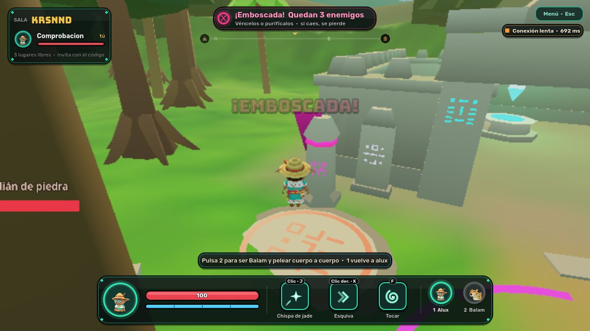

# Versiones publicadas en la rama `beta`

La rama `beta` es lo único que Render despliega. Cada entrada dice qué commit lleva el código de
esa versión, qué se comprobó antes de publicarla y cómo volver a ella.

Para saber qué hay desplegado en este momento: `npm run beta:check -- <URL>` muestra el commit que
informa el servicio, y `--commit <hash>` exige que sea uno concreto.

## ALUX Closed Alpha 0.1

| | |
| --- | --- |
| **Código de la versión** | `3dc3f81d205a26ec840de5984ef10668ff634446` |
| **Commit publicado en `beta`** | El siguiente a ese: sólo añade este registro. Es el que informará `/healthz` (`git rev-parse origin/beta`). |
| **Publicada desde** | `claude/tender-johnson-c2gk0s` |
| **Fecha** | 12 de noviembre de 2026 |
| **Estado en Render** | **Desplegada** el 12 de noviembre de 2026 en <https://alux-beta.onrender.com> (juego: `wss://alux-beta.onrender.com/ws`). El servicio informa el commit `12fadbec9be468036f05b551c87282d19fcaca6f`. |

**Recursos que crea** (y ninguno más): `alux-beta` (Docker, `0.5c-512mb`, Ohio, US$7 al mes) y
`alux-beta-db` (PostgreSQL 16, `0.1c-256mb`, 1 GB, Ohio, US$6 + US$0.30 al mes).

**Migraciones incluidas:** `20261111000000_init` y `20261112000000_beta`. Las dos sólo crean
tablas e índices, activan RLS y amplían una restricción; no borran ni modifican datos.

**Comprobado antes de publicar** (en local; nada de esto se ha ejecutado aún en Render):

| Comprobación | Resultado |
| --- | --- |
| `npm run beta:preflight` (Blueprint, secretos en archivos e historial, accesos de prueba, invitaciones, migraciones) | Supera las 8 revisiones |
| API | 10 de 10; 20 de 20 contra PostgreSQL 16 con el migrador |
| Simulación | 427 840 comprobaciones sin violaciones |
| Servidor de juego con bots | 11 de 11 |
| Imagen única como en Render (`scripts/test-beta-image.sh`): migraciones, acceso sólo con invitación, HTTPS/WSS, partida, métricas, commit informado, persistencia tras reiniciar y bloqueo por códigos inventados | Pasa |
| Flujo completo de la partida en navegador contra esa imagen | Pasa (3 de 4 pasadas del día; la que falló coincidió con la máquina saturada) |
| Cuatro navegadores contra esa imagen | **Inestable en el entorno de pruebas**: pasa 3 de 6 pasadas. Las que fallan lo hacen porque una pestaña, renderizando por software en una máquina de 4 núcleos, se congela más de 15 s y el servidor la desconecta. La misma prueba pasa sin Docker con el mismo código. |
| Respaldo y restauración (`scripts/beta-backup.sh`) | Probado contra PostgreSQL 16: datos estropeados a propósito y recuperados |

**Comprobado contra el servicio desplegado**, desde fuera de Render:

| Comprobación | Resultado |
| --- | --- |
| `npm run beta:check` con una invitación: HTTPS, HSTS, API y base de datos, commit desplegado, rutas internas cerradas, sin entrada anónima, descarga del juego, `wss://`, sesión, guardado, partida por WebSocket (15 estados/s), reconexión con el mismo lugar y posición, latido y métricas | Pasa |
| Sesión de un jugador en un navegador real (`tests/e2e/beta-solo.ts`): portal, carga del cliente Godot, audio del navegador activo, menú, altar, emboscada, derrota, reintentar y salir | Pasa |
| Descarga del cliente | 8.2 MB con Brotli (10.6 MB con gzip) |

**Sin comprobar todavía:** cuatro jugadores a la vez en el servicio desplegado, persistencia tras un
reinicio del servicio provocado a propósito, Edge, el audio a oído, y FPS y latencia con tarjeta
gráfica desde las conexiones de los testers.

**Volver a esta versión:** en Render, *Rollback* al despliegue de este commit; o, desde Git,
`git push origin <commit publicado>:beta --force-with-lease` (sólo si `beta` avanzó con algo que
hay que retirar; lo normal es `git revert`). Ver [beta.md](beta.md), sección 9.
